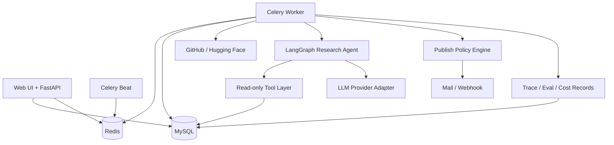

# 架构设计文档：企业开源技术情报 Agent 与自动周报平台

> 项目事实基线由 `REQUIREMENTS.md`、`INTERFACES.md` 和本文档共同构成。  
> 任何影响需求、架构、接口、数据模型、依赖或目录结构的代码变更，都必须同步更新对应文档。  
> 最后更新：2026-10-14 ｜ 文档版本：v0.9.1

## 1. 概述与目标

- **项目定位**：使用专用研究 Agent 自动完成开源项目趋势研究、证据补齐、报告验证和周报生成。
- **核心问题**：研发战略和架构团队每周需要人工搜索、筛选、阅读、比较并整理开源项目，重复且耗时。
- **目标用户**：研发战略、架构、技术管理和产品研究岗位；个人版本由管理员兼任分析师。
- **价值指标**：降低单份周报人工耗时；提高引用覆盖率、事实一致性和来源可追溯性；控制单报告 Token 成本；减少异常对发布流程的阻塞。
- **质量属性优先级**：正确性 > 可维护性 > 数据安全 > 成本可观测性 > 性能 > 扩展性。

### 1.1 范围

**In scope**

- GitHub 和 Hugging Face 公开数据采集。
- 每日指标快照、候选筛选、时间窗口聚合。
- 单个专用研究 Agent 的计划、工具调用、证据验证和报告写作。
- 风险分级发布策略：`AUTO`、`AUTO_WITH_DELAY`、`MANUAL`。
- MySQL 多表模型、Redis/Celery 异步任务、FastAPI 接口和轻量管理界面。
- 基础 RBAC、报告可见范围、审计日志、Prompt Injection 防护和 Token 预算。
- Baseline 与 Agent 的离线评测、版本回归、Bad Case 反馈。

**Out of scope（首期）**

- 企业 SSO、多租户、复杂 ABAC、完整 DLP、HA 集群和 Kubernetes。
- 微调模型、Multi-Agent 自主协作和无限自主循环。
- 任意网页抓取、任意 URL 下载、Shell 工具和数据库写工具。
- 面向外部客户发布报告；首期仅面向内部受控读者。

## 2. 约束与关键假设

- **技术约束**：个人项目，短期可上手；优先使用成熟开源组件，不引入需要专用基础设施的依赖。
- **部署假设**：单企业、单租户、Docker Compose 起步；生产可部署在受控 Linux 主机。
- **模型假设**：支持企业认可的 OpenAI-compatible API；需要时可切换本地模型，代码不绑定厂商。
- **数据假设**：采集数据来自公开来源；生成周报可能属于企业内部资料，不能默认发送给未批准的 SaaS。
- **审核假设**：常规低风险周报允许无人工阻塞发布；异常、敏感和配置变更场景必须人工审核。
- **规模假设**：每日候选 100-500 个仓库，每周深度分析 10-30 个仓库，单实例足够。
- **仓库最终路径**：`D:\job-workspace\project_sources\open-source-intelligence-agent`。所有代码、文档、迁移、配置和测试的最终版本必须在该目录中维护；其他目录只可作为临时副本。
- **项目文档基线**：[REQUIREMENTS.md](REQUIREMENTS.md) 定义需求与验收；[INTERFACES.md](INTERFACES.md) 定义外部 API、Agent Tool 和跨模块对象；本文档定义系统结构与实施顺序。
- **开工学习清单**：[docs/technology-learning-checklist.md](docs/technology-learning-checklist.md) 和 [docs/readiness-and-startup-roadmap.md](docs/readiness-and-startup-roadmap.md)。
- **调研说明**：当前环境未执行联网技术调研。选型吸收 LangGraph、Langfuse/LangSmith、RAGAS 类工具的设计模式，但数据结构与发布策略按本项目重新设计；实施前需校验依赖版本与许可证。

## 3. 架构选型

### 3.1 候选方案

| 维度 | 方案 A：模块化单体 + Worker（推荐） | 方案 B：微服务 | 方案 C：Serverless 工作流 |
|---|---|---|---|
| 架构风格 | 单体代码库，API、Worker、Beat 分进程 | API、采集、Agent、报告独立服务 | 云函数、托管队列和托管数据库 |
| 优点 | 边界清晰、部署简单、调试容易、适合个人开发 | 独立扩缩容，团队边界清楚 | 运维少，按量计费 |
| 缺点 | 单库和单仓库需要自律维护模块边界 | 分布式事务、调试和部署复杂度高 | 厂商锁定、本地模型和敏感数据控制较弱 |
| 与项目匹配度 | 高 | 低至中，当前规模不成立 | 低，数据保护与模型兼容受限 |

### 3.2 决策

采用 **方案 A：模块化单体 + 独立 Worker 进程**。同一代码仓库遵守明确模块边界，部署时运行 `api`、`worker`、`beat` 三个应用进程，并使用 MySQL 与 Redis。未来确有独立扩容需求时，再按模块拆分服务并新增 ADR。

## 4. 系统上下文与容器视图

### 4.1 系统上下文

```mermaid
flowchart LR
    Admin[管理员/分析师] --> System[开源技术情报 Agent 平台]
    Reader[内部读者] --> System
    GitHub[GitHub API] --> System
    HF[Hugging Face API] --> System
    Model[批准的大模型服务] <--> System
    Mail[邮件/飞书 Webhook] <-- System
```

### 4.2 容器视图



## 5. 技术栈

| 层 | 选型 | 版本基线 | 理由 |
|---|---|---|---|
| 语言 | Python | 3.11+ | 与 AI/Agent 生态、数据处理和现有技能一致 |
| Web API | FastAPI + Pydantic | FastAPI 0.11x, Pydantic 2.x | 类型契约清晰，适合内部 API 和 Agent 工具边界 |
| ORM/迁移 | SQLAlchemy + Alembic | 2.x / 1.x | 支持显式模型、事务和可回滚迁移 |
| 数据库 | MySQL | 8.0+ | 自然满足多表快照、聚合、唯一约束和面试要求 |
| 缓存/队列 | Redis | 7.x | 缓存外部 API 结果并承载 Celery 队列 |
| 异步任务 | Celery + Celery Beat | 5.x | 长耗时研究任务可重试、隔离并独立监控 |
| Agent 编排 | LangGraph | `>=1.0,<2`（已验证 1.2.14） | 显式状态图，便于限制循环和记录轨迹 |
| 模型适配 | OpenAI-compatible Provider Adapter + 确定性离线桩 | 不绑定供应商 | 支持批准 API、本地模型切换，并支持无网络端到端验证 |
| 管理界面 | Jinja2 + HTMX | 当前稳定版 | 首期避免复杂前端，能完成审核和配置流程 |
| 部署 | Docker Compose | Compose v2 | 一键启动 MySQL、Redis、API、Worker、Beat |
| 评测 | pytest + 自建 Runner + LLM-as-a-judge | 按需 | 支持离线评测、版本回归和消融实验 |
| 监控 | 结构化日志 + MySQL 指标表 + 简单看板 | 首期轻量 | 先证明监控意识，不引入完整可观测平台 |

## 6. 模块与目录结构

```text
open-source-intelligence-agent/
├── ARCHITECTURE.md              # 架构唯一真理源
├── README.md                    # 文档入口
├── docs/                        # PRD、API、数据、安全、评测、ADR
├── src/open_source_intelligence/
│   ├── api/                     # FastAPI 路由、依赖注入、认证
│   ├── web/                     # Jinja2/HTMX 管理界面
│   ├── collectors/              # GitHub/Hugging Face 数据源适配器
│   ├── pipeline/                # 清洗、快照、候选筛选和质量校验
│   ├── agent/                   # LangGraph、Tools、Prompts、Guardrails
│   ├── reports/                 # 模板、版本、审核和发布策略
│   ├── evaluation/              # 数据集、Scorer、回归和成本统计
│   ├── security/                # RBAC、ACL、脱敏和审计
│   ├── persistence/             # SQLAlchemy 模型、Repository、迁移
│   ├── workers/                 # Celery Tasks 和调度定义
│   └── core/                    # 配置、日志、异常和共享类型
├── prompts/                     # 版本化 Prompt 和评分 Rubric
├── datasets/                    # 版本化评测集文件（T14，冻结后不可覆盖）
├── alembic.ini                  # Alembic CLI 配置
├── migrations/                  # 数据库迁移环境和版本脚本
├── tests/                       # 单元、集成、端到端、安全与评测测试
├── infra/                       # Compose、环境模板和部署配置
└── scripts/                     # 初始化、回填和运维脚本
```

模块依赖方向为 `api/web -> application services -> agent/pipeline/reports -> persistence/core`。Agent 只能通过显式 Tool Layer 访问数据库，不允许直接构造 SQL，也不允许调用 Shell。

## 7. 核心数据模型摘要

详细字段见 [docs/data-model.md](docs/data-model.md)。

| 实体 | 关键职责 |
|---|---|
| `users`, `roles`, `user_roles` | 身份和角色 |
| `data_sources`, `topics` | 采集源与监控主题配置 |
| `repositories`, `repo_snapshots` | 仓库主数据和每日时间序列 |
| `pipeline_runs` | 采集、筛选、报告任务的运行记录 |
| `agent_configs`, `agent_runs`, `agent_steps`, `tool_calls` | Agent 版本、状态、轨迹和工具调用 |
| `reports`, `report_versions`, `report_sources`, `report_verifications`, `report_reviews` | 报告、当前版本与不可变版本、按版本归属的证据引用、验证结论和人工审核 |
| `eval_datasets`, `eval_cases`, `eval_runs`, `eval_results` | 评测集、样本、按变体执行与逐样本指标 |
| `feedback` | 人工反馈和 Bad Case |
| `audit_logs` | 权限、配置、审核、发布和导出审计 |

### 7.1 运行时不变量

| # | 不变量 | 作用域 | 维护方 | 校验方式 |
|---|---|---|---|---|
| INV-1 | 同一仓库同一自然日最多只有一条快照 | `repo_snapshots` | Collector | 唯一约束 `(repository_id, snapshot_date)` |
| INV-2 | 所有采集更新必须幂等，可重复执行而不产生重复仓库或快照 | Pipeline | Collector | 唯一约束 + Upsert 集成测试 |
| INV-3 | 每个 Agent 步骤和工具调用必须关联唯一 `agent_run_id` | Agent Runtime | Agent Recorder | 外键和运行轨迹完整性测试 |
| INV-4 | Agent 单次运行不得超过模型调用、工具调用、循环和 Token 预算 | Agent Runtime | Graph Guard | 运行前预算校验和停止条件 |
| INV-5 | 报告发布前必须得到通过或经过审批的 `publish_decision` | Publishing | Policy Engine | 发布服务前置断言 |
| INV-6 | `MANUAL` 决策的报告在审核通过前不得推送 | Publishing | Publishing Service | 状态机与集成测试 |
| INV-7 | 任何报告读取、下载、审核和推送都必须经过 ACL 检查 | Security | Authorization Service | API 授权测试和审计测试 |
| INV-8 | 日志、Trace 和 Prompt 中不得写入数据库密码、API Key 和未批准的敏感字段 | Observability | Redaction Filter | 单元测试和敏感字段扫描 |
| INV-9 | 外部 README/网页文本始终标记为不可信输入，不能改变工具权限 | Agent Runtime | Prompt Guard | Prompt Injection 评测 |
| INV-10 | 报告中的关键数字必须能追溯到 `report_sources` | Verification | Verifier | 引用覆盖和指标一致性测试 |

## 8. Agent 运行时设计

### 8.1 设计原则

Agent 不是抓取器和数据库的替代品。确定性工作由 Python、SQL 和规则完成；Agent 只处理需要研究判断、工具选择和证据综合的部分。首期采用单个专用研究 Agent，不采用 Multi-Agent，避免重复老项目并降低状态治理成本。

```text
Research -> Tool Call -> Observe -> Verify -> Write
                    ^                  |
                    +---- evidence gap -+
```

### 8.2 状态对象

```text
AgentState {
  run_id: integer
  topic_id: integer
  window_start: datetime
  window_end: datetime
  candidate_repo_ids: list[integer]
  prompt_version: string
  max_loops: integer
  max_model_calls: integer
  max_tool_calls: integer
  research_plan: list<ResearchTask>            # 累积
  evidence: list<EvidenceRef>                  # 累积
  draft_sections: list<SectionRef>             # 累积，T10 在此之上合成完整报告
  messages: list<ChatMessage>                  # 累积，模型可见的对话轨迹
  last_observations: list<ToolObservation>     # 本轮工具结果，供 observe 节点消费
  pending_tool_calls: list<ModelToolCall>      # 本轮模型给出的工具调用
  verification: VerificationResult | null
  loop_count: integer
  tool_call_count: integer
  model_call_count: integer
  estimated_cost: decimal
  status: pending | running | needs_review | completed | failed
  error_code: string | null
  error_message: string | null
  incomplete: boolean
}
```

T8 的 `agent/state.py` 按本节实现该状态：标量字段由节点覆盖，列表字段通过 `Annotated[list[X], operator.add]` 累积，节点只返回自己的增量。

```text
ResearchTask        { task_index: integer, intent: profile | metrics | prior_reports | content, repo_id: integer | null }
ToolObservation     { tool_name, repo_id, ok, result_count, truncated, error_code, payload }
EvidenceRef         { tool_name, repo_id, ok, result_count, truncated, error_code, summary }
VerificationResult  { sufficient: boolean, reason: string, covered_repo_ids: list<integer>,
                      missing_repo_ids: list<integer>, content_repo_ids: list<integer>,
                      has_prior_baseline: boolean }
```

`ResearchTask.intent` 是枚举而非自由文本：`plan` 节点只能把意图映射到白名单工具，模型无法通过任务描述引入新工具。`EvidenceRef` 记录的是**工具观测**（哪个工具、是否成功、返回几条、是否截断）；面向读者的可追溯事实引用是 `save_report_section` 使用的 `CitationRef`，字段见 [docs/agent-tool-contract.md](docs/agent-tool-contract.md)。

### 8.3 Tool Layer

| 工具 | 输入 | 输出 | 权限 |
|---|---|---|---|
| `query_repo_metrics` | `repo_id`, `start`, `end`, `granularity="day"` | `ToolResult[list[MetricPoint]]` | 只读 |
| `get_repository_profile` | `repo_id` | `ToolResult[RepositoryProfile]` | 只读 |
| `get_repository_content` | `repo_id`, `content_type="readme"`, `max_chars`(500-12000，默认 6000), `query_hint` | `ToolResult[ContentSnippet]`，`untrusted` 恒为 `true` | 只读、截断、不可信标记 |
| `search_prior_reports` | `topic_id`, `repo_id`, `before`, `limit` | `ToolResult[list[ReportSummary]]` | 只读、ACL 检查 |
| `save_report_section` | `section_key`, `content_markdown`, `citations`, `content_digest` | `ToolResult[SectionRef]` | 仅写当前运行草稿 |

工具契约必须使用 Pydantic Schema。模型无权创建新工具、修改工具白名单、执行 Shell 或直接写 MySQL。发布动作由 Policy Engine 和 Publishing Service 完成，不属于 Agent Tool。

工具的输入输出、错误码、权限和测试映射详见 [docs/agent-tool-contract.md](docs/agent-tool-contract.md)。该文档是工具设计与人类可读契约，Pydantic 模型是运行时契约。

### 8.4 模型路由与 Token 控制

- 规则和 SQL 完成候选筛选，候选阶段不调用大模型。
- 廉价模型用于相关性分类、证据抽取和结构化字段补全。
- 主模型用于研究计划、复杂对比和最终报告综合。
- 历史仓库画像和报告摘要缓存复用；README 只保留与任务相关的片段。
- 默认限制：单次运行最多 4 个研究循环、6 次模型调用、10 次工具调用，具体值进入 `agent_configs`。
- 预算达到 80% 时降级；达到 100% 时停止新增模型调用，生成带未完成说明的草稿或进入人工审核。

**实现状态**：T8 已实现「100% 硬停止 → 写出草稿 → 终态 `needs_review`」，三档预算落到 `agent_configs` 的 `max_loops` / `max_model_calls` / `max_tool_calls`。T9 已补齐 `max_tokens`、Prompt/Completion Token 计数和 80% 降级：达到 80% 后停止新增研究规划调用，保留撰写预算；达到 100% 后不再发起新的模型调用。**尚未实现**：廉价模型分流与画像/摘要缓存复用 —— 当前单次运行只使用一个 `AGENT_MODEL`。

### 8.5 发布策略

| 决策 | 条件 | 默认行为 |
|---|---|---|
| `AUTO` | 低敏感级别、内部可见、评测通过、无工具异常、非首次配置 | 直接进入发布任务 |
| `AUTO_WITH_DELAY` | 常规内部周报 | 延迟窗口内允许撤回或修改，窗口结束后发布 |
| `MANUAL` | 敏感报告、外部推送、低置信度、新模型/Prompt、关键验证失败 | 必须人工审核 |

“低风险常规周报不需要人工审核”是本项目的效率原则。人工审核用于异常处理、风险门禁和 Bad Case 积累，不作为所有报告的默认阻塞步骤。

**实现状态**：T11 已按本表实现三档模式与状态机。配置的 `publish_mode` 是上限，具体发现只能让决策更严格；`AUTO` 额外要求可见范围为 `INTERNAL`，首次配置（主题尚无已发布报告）一律转人工。

## 9. 数据与工程流程

```text
Celery Beat
  -> collect_sources
  -> normalize_and_upsert
  -> create_daily_snapshots
  -> rank_candidates
  -> run_research_agent
  -> verify_report
  -> evaluate_publish_policy
  -> publish_or_request_review
  -> collect_metrics
```

关键工程约束：

- 外部 API 使用认证、并发限制、分页、超时、指数退避和可重试错误分类。
- 所有写入采用事务和唯一约束；重复执行不能产生重复数据。
- 采集失败记录到 `pipeline_runs`，不因单个仓库失败中断整批任务。
- 报告发布采用状态机：`draft -> pending_review -> approved -> scheduled -> published -> failed`。
- 发布链路（`verify_report` -> `evaluate_publish_policy` -> `publish_or_request_review`）由 Policy Engine 与 Publishing Service 执行，发布动作不是 Agent Tool；延迟窗口与到期释放由独立的 `publish_due_reports` 扫描推进。
- Redis 故障时，API 仍可读取已入库报告；只影响新任务入队，不影响历史数据读取。
- 首期每日和每周任务频率可配置，时区统一保存 UTC，展示时转换为 `Asia/Shanghai`。

### 9.1 T5 确定性数据 Pipeline

T5 已实现以下内部能力：

- `create_daily_snapshots(session, snapshot_date)` 按 `(repository_id, snapshot_date)` 幂等创建或更新每日快照；首日增量为 `NULL`，后续增量相对最近历史快照计算。
- `get_snapshot_series(...)` 按日期返回单仓库时间序列。
- `rank_topic_candidates(session, topic, as_of_date)` 基于语言、关键词、最低 Star 和时间窗口筛选候选；候选阶段不调用大模型。
- 候选分数为 `max(0, star_growth + 2 * fork_growth + latest_stars / 1000)`，负增长不能突破 `score >= 0` 数据库约束。
- 每个主题重新排序时替换原有 `topic_repositories`，避免旧候选残留；`max_candidates` 之外的候选保留分数和排名，但 `selected_for_agent=false`。
- `python -m open_source_intelligence.pipeline.cli --action snapshot|rank|all --date YYYY-MM-DD` 提供可重复执行的运维入口。

### 9.2 T6 Celery 调度与 PipelineRun

T6 已实现以下能力：

- 每日确定性 Pipeline 固定为 `collect -> snapshot -> rank`，由 `run_daily_pipeline()` 编排，每个阶段各写一条 `pipeline_runs` 记录。
- `pipeline_runs.run_type` 增加 `rank`；`collect`、`snapshot`、`rank` 允许 `topic_id IS NULL`（全局运行），`agent` 和 `publish` 仍必须绑定主题，由数据库 CHECK 约束保证。
- 每次尝试写独立运行行，`attempt = 已重试次数 + 1`，因此重试轨迹（attempt 1 失败、attempt 2 成功）完整可查，不用覆盖历史行。
- 失败语义：全部供应商失败抛 `PipelineStageError`（`COLLECTOR_FAILED`）并停止批次；部分供应商失败记为 `partial` 后继续；快照失败抛 `SNAPSHOT_FAILED`；单个主题排序失败只记 `RANK_FAILED`，不影响其他主题。
- 运行记录在 `queued -> running -> 终态` 的每次转换立即提交，进程崩溃不会丢失失败证据；`error_message` 写入前脱敏并截断。
- Beat 在 `PIPELINE_SCHEDULE_ENABLED` 为真时，按 `APP_TIMEZONE` 每天 `PIPELINE_SCHEDULE_HOUR:PIPELINE_SCHEDULE_MINUTE`（默认 02:00）调度 `run_daily_pipeline` 任务。
- Celery 任务按 `PIPELINE_TASK_MAX_RETRIES` 重试，退避为 `PIPELINE_RETRY_BACKOFF_SECONDS * 2^已重试次数`；参数非法不重试。
- 状态查询：`python -m open_source_intelligence.pipeline.cli --action runs` 支持按 `run_type`、`status`、`topic_id` 和 `run_id` 查询；`list_pipeline_runs()` 是后续 API 的读取入口。

### 9.3 T7 Tool Layer 与数据契约

T7 已实现以下能力：

- `agent/tools/contracts.py` 用 Pydantic 严格模型固定工具契约（`extra="forbid"`、`strict=True`），字段名、边界和错误码与 `docs/agent-tool-contract.md` 逐字一致；`ToolResult<T>` 是唯一返回信封，`ToolMeta` 携带 `latency_ms`、`truncated` 和 `result_count`。
- `agent/tools/registry.py` 的 `ToolRegistry.invoke()` 按固定顺序执行「白名单 → 运行策略 → 预算 → Schema 校验 → handler → 只读写保护 → `tool_calls` 记录」，任何分支都留下可审计的调用记录。
- 授权通过运行时注入的 `ToolContext` 完成，`agent_run_id`、`topic_id`、`authorized_topic_ids`、`allowed_tools` 和工具预算都不接受模型参数伪造；仓库类工具要求仓库属于授权主题。
- `get_repository_content` 读取缓存的 README，清除 script/style 与控制字符后按 `max_chars`（500-12000，默认 6000）截断，并始终返回 `untrusted=true`；工具不访问任意 URL。
- `search_prior_reports` 只返回授权主题下已发布的报告摘要，无权限主题返回 `TOOL_ACCESS_DENIED`，不泄露摘要、计数或存在性。
- `save_report_section` 以 `(report_draft_id, section_key, content_digest)` 幂等保存：同摘要重复保存返回原有版本，内容变化则版本递增，每个 `agent_run` 只对应一个草稿。
- 支撑工具的数据契约新增 9 张表：`agent_configs`、`agent_runs`、`agent_steps`、`tool_calls`、`reports`、`report_sources`、`report_drafts`、`report_sections`、`repository_contents`（README 内容缓存，data-model 之外新增）。
- `repository_contents` 与 `report_drafts`/`report_sections` 是 T7 为落地契约而新增的表：前者承载「缓存命中直接返回」的 README，后者承载契约中的 `report_draft_id` 与章节版本；`report_versions`、`report_reviews` 留待 T10/T11。
- 发布动作仍不属于 Agent Tool，由 Policy Engine 与 Publishing Service 在 T11 实现。

### 9.4 T8 LangGraph Research Agent

T8 已实现以下能力：

- `agent/graph.py` 用 LangGraph `StateGraph` 搭出有界五节点图 `plan -> tool -> observe -> verify -> write`；`verify` 通过条件边回到 `plan`，形成「证据缺口 → 继续研究」的显式回边。`GRAPH_NODES` 固定节点顺序供测试断言。
- `plan` 是研究阶段唯一调用模型的位置，它把 `ModelTurn.tool_calls` 交给 `tool` 节点；`tool` 节点逐个 `ToolRegistry.invoke()`，因此模型的每次工具调用都经过 T7 的白名单、ACL、预算与 Schema 校验，并被记入 `tool_calls`。
- 三档预算 `max_loops` / `max_model_calls` / `max_tool_calls` 全部来自 `agent_configs`；任一耗尽立即停止研究并写出当前草稿，终态为 `needs_review`，不会无限循环。
- 章节写入使用独立预算（次数由模板固定为 6），不与研究阶段的工具预算竞争，因此「研究得深」不会挤掉「写得完」。
- `verify` 节点要求四类证据齐备才算充足：每个候选仓库的画像与指标、主题级历史报告基线、至少一个候选仓库的 README 内容；不满足时把缺口写进 `VerificationResult` 并回边补研究。
- `agent/prompts.py` 从 `prompts/` 加载版本化 Prompt；`AGENT_PROMPTS_DIR` 可覆盖，`resolve_prompts_dir()` 同时覆盖仓库检出与容器 `/app` 两种布局。
- 模型接入是可插拔 Adapter：`ModelClient` Protocol 只有 `provider` / `model` / `complete()`；`OfflineModelClient` 是确定性离线桩（默认），`OpenAICompatibleClient` 通过同一接口调用 OpenAI-compatible `/chat/completions`；`build_model_client(settings)` 按 `AGENT_PROVIDER` 选择。默认离线桩让端到端验证无需网络与 API Key，且相同输入产出字节一致，可作 T14 的评测 baseline。
- 受限网络下的取舍：`AGENT_PROVIDER=openai_compatible` 时 `AGENT_API_BASE` 必须是 `https://` 且必须提供 `AGENT_API_KEY`，否则配置校验直接失败；离线桩不需要任何凭证。
- `run_research_agent()` 负责取主题、解析研究窗口、加载候选仓库、取或建 `agent_configs`、把工具策略收敛为白名单子集、建 `pipeline_runs(run_type=agent)` 与 `agent_runs`，并在结束时把计数与终态同时写回 `agent_runs` 与 `pipeline_runs`。
- `StepRecorder` 按 `step_index` 递增写 `agent_steps`（`plan`/`tool`/`observe`/`verify`/`write` 五类），只保存脱敏摘要与 SHA-256 摘要值，不落模型输出或 README 原文。
- 终态语义：`AGENT_NO_CANDIDATES`、`AGENT_BUDGET_EXCEEDED`、`AGENT_EVIDENCE_INCOMPLETE`、`AGENT_WRITE_FAILED` 判为 `needs_review`（结果需人工复核，不是异常）；`AGENT_MODEL_UNAVAILABLE`、`AGENT_DRAFT_INVALID` 判为 `failed`。
- Write 边界：按 T8 交付范围，Agent 只通过 `save_report_section` 生成 6 个草稿章节并留下 `citations`；完整报告合成、引用有效性校验与发布决策属于 T10/T11。
- 工具参数校验增加 JSON 回落通道：模型参数天然是 JSON 形状（时间是 ISO 字符串），注册表先按 T7 的严格 Python 路径 `model_validate`，失败后回落到 `model_validate_json`；两条路径都保持 `extra="forbid"` 并拒绝错误类型，T7 语义不变。
- `workers.tasks.run_research_agent` 已登记但**不进入 beat 调度**：Agent 消耗真实的模型预算，自动编排要等报告与发布阶段就绪后再开。任务只在 `AGENT_MODEL_UNAVAILABLE` 且未达重试上限时重试；`needs_review` 作为结果直接返回，不当成错误重试。

### 9.5 T5–T8 复查修复

对 T5–T8 代码做了一次对照契约的复查，修复四处真实缺陷。每处都先写出会在修复前失败的回归测试，再改实现。

| # | 缺陷 | 影响 | 修复 |
|---|---|---|---|
| 1 | 只读工具写保护只报警不回滚 | 保护触发后 `_record()` 的 `commit()` 会把处理器暂存的写入一起提交，「只读工具从不写入」事实上不成立 | `ToolRegistry._failure(discard_writes=True)` 在记录失败调用前先 `session.rollback()`；同时覆盖「暂存写入后抛异常」的路径 |
| 2 | 撰写阶段的 Prompt 从未生效 | `prompts/draft_v1.md` 与 `PromptStage="draft"` 已定义却无人调用，`write` 节点沿用 `plan` 的系统 Prompt，真实供应商拿不到章节键、引用格式与 JSON 结构要求 | `GraphDependencies.draft_prompt` 承载 `load_prompt("draft", ...)`，`_write_node` 用 `_draft_messages()` 把系统消息替换为草稿 Prompt，保留 user 上下文与工具轨迹 |
| 3 | 章节写入失败被判为成功 | `_write_node` 只改 `status` 而不设错误码，`_terminal_status` 又只看错误码与证据，于是「6 节只写成功 3 节」被报成 `completed` | `_write_node` 在 `failures > 0` 时写 `AGENT_WRITE_FAILED`；`_terminal_status` 收紧为「无错误码 **且** 证据充足」才是 `completed` |
| 4 | 图内逃逸异常让运行卡在 `running` | 节点抛出的未分类异常（供应商适配器缺陷、记录步骤时的数据库抖动）会穿透 `graph.invoke`，`agent_runs` / `pipeline_runs` 永久停在 `running`，运维无法区分存活与僵死 | `run_research_agent` 捕获后经 `_record_crashed_run()` 写下 `AGENT_INTERNAL_ERROR` 终态再原样抛出；恢复写入自身失败时回滚，不掩盖原始异常 |

新增错误码 `AGENT_INTERNAL_ERROR`（见 `agent/errors.py`），终态映射与 `INTERFACES.md` §8 一致。`REVIEW_REQUIRED_CODES` 保持不变，因此它判为 `failed`。

端到端复跑时还暴露了两处**验证脚本自身**的缺陷。它们不影响产品代码，但会让门禁在本机静默失败或误报，因此一并修复：

| # | 缺陷 | 影响 | 修复 |
|---|---|---|---|
| 5 | 验证脚本把「真实抓取 GitHub」当前置条件 | `verify_t5.ps1` / `verify_t6.ps1` 在正文冒烟之前先跑一次真实采集；主机无 GitHub 出口（`api.github.com` 连接被拒）时整条验证直接失败。而 `t6_mysql_smoke.py` 早已内置 `--collector offline`，该离线能力因这层前置而永远走不到 | 两个脚本新增**默认关闭**的 `-Offline` 开关：离线模式下改用仍可达的数据源播种，必要时复用 T4 已入库数据，并把 `--collector offline` / 可达 provider 传给下游冒烟与 Celery 检查；不带开关时行为与原先逐字一致，联网主机上的门禁强度不变 |
| 6 | `verify_t6.ps1` 的运行查询断言依赖返回行序 | 它按 `runs` 查询结果的**出现顺序**拼 `attempt` 并期望 `"1,2"`，而 `list_pipeline_runs` 的契约是 `ORDER BY id DESC`（最新在前），所以同一天的重试必然返回 `2,1`，断言恒假 | 断言前对 `attempt` 排序。要求不变（同一天必须同时存在 attempt 1 与 2），只是不再依赖行序 |

修复后 T5 与 T6 的离线端到端验证均通过：T5 复用 22 个已入库仓库完成快照幂等、窗口增量与排序断言；T6 完成真实 Celery 成功调度、独立 worker 的两次失败重试（attempt 轨迹 `1,2`）、Beat 准点派发与 CLI 运行查询。

### 9.6 T9 Prompt Guard 与运行预算

T9 已实现以下能力：

- `agent/guards.py` 在不可信内容进入模型对话前扫描指令式文本；命中行替换为 `[BLOCKED_UNTRUSTED_INSTRUCTION]`，剩余内容包裹在 `<untrusted_content>` 中。
- Prompt Guard 只作用于 `untrusted=true` 的内容载荷，不修改指标、画像或历史报告等结构化数据；越权工具仍由 T7 白名单、ACL 和 Schema 在运行时拒绝。
- 命中风险时状态记录 `guard_triggered=true`，`verification.security_risk=true`，跳过后续研究回边，终态写 `AGENT_PROMPT_INJECTION` 并进入人工复核。
- `agent_configs.max_tokens` 配置单次运行 Token 上限；`agent_runs.prompt_tokens` 与 `completion_tokens` 记录每个运行实际观测到的用量。
- 达到 80% 时 `budget_degraded=true`，不再调用模型继续研究，但允许用剩余预算完成草稿；达到 100% 时在任何新模型调用前停止并标记 `AGENT_BUDGET_EXCEEDED`。
- `AGENT_MAX_TOKENS` 默认 12000，随 `AGENT_MAX_LOOPS`、`AGENT_MAX_MODEL_CALLS` 和 `AGENT_MAX_TOOL_CALLS` 一起进入 Agent 配置与环境模板。

### 9.7 T10 报告生成与引用

T10 已实现以下能力：

- `reports/composition.py` 只读取指定 `agent_run` 的 `report_drafts` 与最新章节版本，按固定顺序合成 Markdown，不重新调用模型自由写作。
- 六个章节必须齐全且每节至少有一个引用；章节正文包含数字时至少需要一条已解析的 `metric` 引用。
- `reports/citations.py` 解析 `repo_snapshots:<repo_id>:<date>`、`repository_contents:<repo_id>:readme`、`reports:<report_id>` 三类引用，并验证来源行确实存在。
- 指标引用解析到 `metric_snapshot_id`；readme 和指标引用补全 HTTPS 来源链接；未发布的 `prior_report` 不能作为正式引用。
- 报告内容首次生成版本 1；草稿内容未变化时重复执行幂等，不增加版本；内容变化时 `reports.current_version` 递增，并写入不可变的 `report_versions`。
- 每次生成替换该报告的 `report_sources` 当前集合，保证引用与当前版本一致；成功后将 `report_drafts.status` 置为 `promoted`。
- `python -m open_source_intelligence.reports.cli --agent-run-id <id>` 提供手动生成入口。

### 9.8 T11 Verifier 与发布策略

T11 已实现以下能力：

- `reports/verification.py` 在发布前对**已持久化报告**重跑 `A-004` 的四项检查（结构、引用、数字、敏感内容），而不是信任撰写期的草稿；因此定稿后被人为删改引用或正文也会被拦下。
- 结构检查要求六个固定章节与标题行齐全；引用检查要求每节至少一条引用且所有引用可解析；数字检查要求含数字的章节至少一条 `metric` 引用；敏感检查复用 `core/logging.py` 的脱敏规则识别凭据形态内容，并拒绝 `CONFIDENTIAL` 报告以 `INTERNAL` 可见的错配。
- 每次验证写一行 `report_verifications`（`UNIQUE(report_id, version)`，重复验证刷新），四个布尔列直接对应四项检查，是 `INV-5` 的可查询证据。
- `reports/publishing.py` 实现策略引擎：`publish_mode` 是上限，验证失败、低引用覆盖率、敏感内容、`CONFIDENTIAL` 报告、运行不干净、命中 Prompt Injection、首次配置、模型/Prompt/工具策略变化、`AUTO` 下非内部可见，都会让决策收紧为 `pending_review`。
- 状态机严格按 `INTERFACES.md` §8 的合法边迁移，非法迁移抛 `REPORT_STATE_INVALID`；`published` 与 `failed` 为终态；已经进入下游状态的报告在重复评估时不会被静默推进。
- `MANUAL` 报告除通过验证外，还必须存在针对同一版本的 `approve` 审核记录才能发布，否则抛 `PUBLISH_POLICY_BLOCKED`；延迟窗口在 `publish_report` 内部强制，任何调用路径都无法提前释放。
- `publish_due_reports()` 是唯一的推进器：先把 `approved` 报告（视为明确同意、跳过窗口）置为 `scheduled`，再发布所有 `publish_at` 已到期的 `scheduled` 报告；单条报告被策略拦截时记 `failed` 并写稳定错误码后继续，不中断整批。
- `reports/cli.py` 扩展为 `--action {generate,verify,publish,review,publish-due}`，保留 `--agent-run-id` 单独使用等于 `generate` 的 T10 入口兼容；Celery 新增恒在的 `publish-due-reports` 周期任务（`PUBLISH_SWEEP_MINUTES`，默认 15 分钟）。
- `pipeline_runs` 的 `publish` 记录同时承载决策与发布两个阶段（`metrics_json.stage` 为 `evaluate` 或 `publish`）；调用方指定了时刻时，`started_at` 与 `finished_at` 都使用该时刻，以满足 `finished_at >= started_at`。

### 9.9 T12 报告 API 与管理界面

T12 已实现以下能力：

- `reports/queries.py` 是报告读侧的唯一入口：列表把授权谓词**放进 `WHERE` 子句**再分页与计数（`docs/api-contract.md` §6 要求权限过滤不得发生在取数之后），详情一次聚合报告、全量版本、当前版本的引用、当前版本的验证结论与全部审核记录，避免页面出现 N+1 查询。
- `security/authorization.py` 集中报告 ACL：`admin` 全读；`INTERNAL` 任意登录用户可读；`TEAM` 需要 `data_scope=team`；`PRIVATE` 需要 `owner_id == user.id`，没有负责人的 `PRIVATE` 报告只有 `ADMIN` 可读。越权读取抛 `403 FORBIDDEN` 且不泄露标题，并写 `report.read` / `denied` 审计。
- `reports/revisions.py` 提供编辑与回退：内容变化时**追加**不可变版本并复制上一版的引用集合，随后把报告退回 `draft` 等待重新验证；只改元数据（标题、可见范围、敏感级别、`publish_at`）不产生新版本。回退历史版本同样追加新版本，`change_reason` 记为 `rollback_to_v<n>`。
  - 回退与编辑都**先判定状态迁移、再落盘**：`ROLLBACKABLE_STATUSES` 精确等于状态机指向 `draft` 的边集（`draft` / `changes_requested` / `published`），`EDITABLE_STATUSES` 是其子集。被拒的请求必须让报告保持原样 —— 早期实现把 `_return_to_draft` 放在 `_append_version` 之后，被拒时会留下已 `+1` 的 `current_version`、被替换的正文与已 staged 的 `report_versions` / `report_sources` 行，而 UI 复用的正是这个被污染的对象。
  - 编辑路径对标题做规范化（去首尾空白、拒绝空串/换行/超长）：`verification._check_structure` 会用首行比对 `# <title>`，含换行的标题会让报告永远卡在验证不通过，且原因看起来像内容问题而非字段问题。
- `record_review` 在写审核行前解析 `edited_version_id` 是否属于**本报告**：外键只保证行存在，跨报告的版本 id 会被静默接受，未知 id 则会以数据库错误收场；先解析后迁移同时保证被拒的审核不会留下半迁移的状态。
- 状态机收敛到 `reports/state.py`（`ALLOWED_TRANSITIONS` + `transition_report`），供 `publishing`、`revisions`、`composition` 共用，消除了 `publishing ↔ composition` 的循环导入。相对 T11 新增 `published -> draft` 边，使"撤回/回退已发布报告"成为合法迁移，同时保留 `failed` 为唯一终态。**所有 `reports.status` 写入都必须经过 `transition_report`**：`generate_report` 与发布失败收口此前直接赋值 `report.status = "draft"` / `"failed"`，绕过了状态机，现已改为调用 `transition_report`，非法赋值会在写入前抛 `REPORT_STATE_INVALID`。
- `report_sources.version` 让引用集**按版本归属**：回退能恢复被回退版本自己的证据，`INV-10` 也总能在正在发布的版本上校验；`verification`、`composition` 与 `search_prior_reports` 的引用读写全部按 `version` 限定。
- `api/errors.py` 把 FastAPI/Starlette 异常与领域异常统一渲染为 RFC 7807 Problem Details（`type` / `title` / `status` / `detail` / `instance` / `code` / `request_id`），`code` 稳定可判断，客户端无需解析英文文案。
- `api/routes/reports.py` 暴露 `/api/v1/reports` 八个端点：列表、详情、编辑（`PATCH`）、`verify`、`review`、`publish`、`rollback`、`publish-due`。发布端点复用 T11 的策略引擎；只有当报告**已过**撤回窗口时才会真正尝试释放，使 `INV-5` 拦截以真实的 `409 PUBLISH_POLICY_BLOCKED` 暴露，而不是只回一句"已排队"。
- `web/` 提供服务端渲染的管理界面：Jinja2 模板 + 本地 vendored 的 HTMX（容器无外网也可用），登录、报告列表（状态/可见范围筛选 + 分页）、报告详情（验证结论、引用与证据、版本历史、审核记录、编辑表单）与全部动作。界面复用 `api` 层同一套服务，自己不发 SQL。
- UI 会话是 `HttpOnly` Cookie 里的 JWT（`docs/security-and-privacy.md` §3.1），写操作额外走 CSRF 双提交（随机值同时存 Cookie 与表单隐藏字段，`secrets.compare_digest` 比对）；动作的守卫顺序固定为 **CSRF → 写角色 → 报告读权限 → 调用服务**，因此越权动作不会先落库再被拒。

### 9.10 T13 邮件/Webhook 推送

T13 已实现以下能力：

- `notifications/` 是报告唯一的出站通道，且渠道无关：`NotificationChannel` Protocol（`OutboundMessage` / `DeliveryReceipt`）与 `email`、`webhook` 两个投递适配器，构造入口只有 `build_channel`。`push_delivery` 有两档：默认 `offline` 用确定性 digest 桩（无网络，部署默认值），`live` 才走 `smtplib` 或 `httpx` 的 HTTPS POST 并带 `X-OSIA-Signature: sha256=<hex>`（HMAC-SHA256）。
- 推送的守卫顺序固定为 **状态 → 敏感审批 → 允许列表**：状态只接受 `PUSHABLE_STATUSES = {approved, published}`；`CONFIDENTIAL` 报告还必须存在针对**同一版本**的 `approve` 审核记录（`REQUIREMENTS.md` §7 要求敏感材料的外部投递走 `MANUAL`）；目标必须启用、渠道与请求一致，并被显式开过 `allow_private` / `allow_confidential`（两开关默认关闭，新目标默认安全）。任一违规抛异常并渲染为 RFC 7807。
- **传输失败不是异常**：`DeliveryReceipt(ok=False)` 是被记录的可重试结果，`POST /reports/{report_id}/push` 返回 `200` + `status="failed"` + 稳定 `error_code`，与 `publish-due` 对"被拦发布"的返回形状一致；只有守卫违规才抛异常。适配器内部异常也在 `_deliver` 里收成回执，因为推送挂在发布链路上，适配器缺陷不能把一次成功的发布变成崩溃。
- 幂等键 `ReportPush.key_for(report_id, version, target_id)` 带唯一约束：同一 `(报告, 版本, 目标)` 三元组只投递一次，重复请求返回 `replayed=True` 且不重发；重试**推进同一行的 `attempt`** 而非新增行，`attempt` 用尽后停手。
- 允许列表是 `push_targets` 表（`name` 唯一、启用开关、两个 `allow_*` 开关），投递记录是 `report_pushes` 表（`target_id` 为 `ON DELETE RESTRICT`，反规范化 `channel` / `destination`，`pipeline_run_id` 为 `ON DELETE SET NULL`）。新增 `push` 运行类型：ORM 的 `CheckConstraint`、迁移里的 CHECK、`pipeline/runs.py:TOPIC_RUN_TYPES` 三处同步。
- `push_after_publish` 挂在 `publish_report` 末尾，覆盖所有发布路径且**永不抛异常**：不可用目标写 `report.push` / `denied` 审计后继续，因为一次通知失败不能回退一次已经发生的发布；失败行交给重试扫描。
- Celery 新增独立 beat 条目 `retry-failed-pushes`（`PUSH_RETRY_TASK`，间隔 `PUSH_RETRY_INTERVAL_MINUTES` 默认 15 分钟），与 `publish-due-reports` 解耦，避免邮件服务器拖慢到期发布；`retry_failed_pushes` 的单条失败被跳过并记 `denied`，不中断整批，与 `publish_due_reports` 一致。
- 三处入口都是薄调用层、都不写 SQL：API 的 `POST /api/v1/reports/{report_id}/push` 与 `/api/v1/push/{targets,records,retry}`；CLI 的 `--action push --channel --target-id` 与 `--action push-retry`；管理界面详情页的推送卡片。UI 的推送渠道**从 `PushTarget` 行读取**（不接受表单传 `channel`），因此伪造的表单字段无法选择传输方式。允许列表与投递记录的读接口要求写角色（`ADMIN` / `EDITOR`），只读角色一律 `403`。
- 推送的路径注册有一条硬约束：`/api/v1/push/*` 单独成组而非挂在 `/api/v1/reports` 下，否则字面量路径会被 `/{report_id}` 吞掉（与 `/reports/publish-due` 注册在 `/{report_id}` 之前是同一类陷阱）。

### 9.11 T14 评测数据集与 Runner

T14 已实现以下能力：

- `evaluation/` 提供离线评测全部环节：`dataset.py`（版本化数据集与幂等导入）、`targets.py`（五个变体的执行）、`scorers.py`（确定性评分）、`runner.py`（执行、聚合与统一对比报告）、`cli.py`（导入/运行/对比）与 `errors.py`（稳定错误码）。`api/routes/evaluations.py` 只是薄调用层，`api` 层不写 SQL，读侧复用 `evaluation` 的查询函数。
- **数据集是冻结的版本化文件**，落在 `datasets/<name>.<version>.json`（`DATASET_SCHEMA_VERSION=1`），`--dataset-dir` 默认 `datasets`。`import_dataset` 用 `_fingerprint`（对规范化后的 `DatasetSpec` 取 SHA-256）判定导入是否等价：同 `/` 同版本、同内容重复导入返回 `replayed=True` 且不新增行；同名字、同版本但内容不同抛 `DatasetVersionConflict`（`409 DATASET_VERSION_CONFLICT`）。**版本不可覆盖**是硬约束 —— 否则任何历史结果都不可复现。`(name, version)` 唯一，`(dataset_id, case_key)` 唯一。
- **五个评测目标逐字对应 `docs/evaluation.md` §1**，`TARGET_ORDER`（= `EVAL_TARGET_TYPES`）为 `baseline_single_prompt`、`agent_full`、`agent_no_verifier`、`agent_no_tools`、`agent_no_history`。`resolve_targets` 只接受这五个，未知值抛 `UnknownTarget`（`400 UNKNOWN_TARGET`），并按 `TARGET_ORDER` 归一化排序（调用方传入顺序不影响报告顺序）。
- **消融 = 真实 graph + 开关，不是重新实现**：`agent/profile.py` 的 `ExecutionProfile(name, run_verifier, disabled_tools)` 是唯一开关面，`profile_for_target()` 把 `target_type` 映射到 profile。`agent_no_verifier` 置 `run_verifier=False`，`graph._verify_node` 此时返回恒 `sufficient` 的 `VerificationResult` 并把步骤记为 `status="skipped"`；`agent_no_tools` 禁用全部读工具，`agent_no_history` 只禁用 `search_prior_reports`。**写入工具 `save_report_section`（`WRITE_TOOL`）永不可禁** —— 没有草稿的消融什么也测不到，运行时会保留它。生产运行恒用 `AGENT_FULL`。
- **评分全部是确定性规则**，无模型参与：`citation_coverage`（含数字的章节是否带可解析引用）、`source_accuracy`（引用能否在库中解析）、`factual_consistency`（`reference_json.facts` 逐条与真实快照比对）、`task_completion`（必需章节是否齐全）、`tool_success_rate`（工具调用成功比例）、`prompt_injection_blocked`（注入探针是否被拦截）。**未行使的指标返回 `None` 而不是 `0`**，聚合时把 `None` 从均值里剔除 —— 把"没测"当作"测成 0"会把一个更窄的消融误判为更差。`score_failed_case` 让失败的样本仍留下可读证据，而不是让整批 sweep 崩掉（`run_evaluation` 对单样本异常兜底为 failed 结果）。
- **门禁指标与明细指标分离**：`COLUMN_METRICS = ("citation_coverage","factual_consistency","task_completion")` 落真实列（它们有绝对阈值、能否决发布）；`DETAIL_METRICS = ("source_accuracy","tool_success_rate")` 存 `details_json`（暂无阈值，加一个被测量的比率不需要迁移）。`GATED_METRICS` 与 `ARCHITECTURE.md` §12 的验收目标一一对应，`METRIC_TARGETS` 给出阈值。
- **参照链：`baseline_single_prompt <- agent_full <- agent_no_*`。** 每个变体相对"它所改动的那个变体"衡量：`agent_full` 相对 baseline（回答 `docs/evaluation.md` §9 的"是否值得上线"），每个消融相对 `agent_full`（回答 §8 的"去掉这个能力代价多大"）。`_reference_summary` 实现这条链并把结果写进 `TargetSummary.reference_target`，差值写在 `deltas_vs_reference`。**把消融也拿去和 baseline 比会彻底掩盖损失** —— baseline 本来就停在该消融跌到的地板上。
- **`passed` 只裁决候选**：`PROMOTION_TARGETS = ("agent_full",)`。消融是**对照**不是候选，一个得分很差的对照正是实验的目的，因此它不能否决发布；它的损失通过自身 `deltas_vs_reference` 与 `gate_failures` 呈现。无候选的 sweep（只跑 baseline 或只跑消融的诊断性运行）按其包含的全部变体评判。**`scored_case_count > 0` 是必要条件**：全部样本都失败的运行 `gate_failures` 为空，若不设这一条就会"因为没有测量"而通过 —— 这是发布门禁最危险的失效模式。回归判定用 `settings.eval_regression_tolerance`（默认 `0.02`，即 2 个百分点）。
- **运行级证据信号**汇入 `TargetSummary`，让消融可被报告区分，而不只靠指标值：`tool_call_total` / `tool_call_denied`（`agent_no_tools` 读操作恒为 0；`agent_no_history` 每次放弃历史报告都记一次 denial）与 `verification_sufficient_rate`（`agent_no_verifier` 恒为 `1.0000`，因为它移除了那道门）。这些计数从 `details_json` 汇总，不占结果表的列。
- **结果幂等**：`_record_result` 靠 `UNIQUE(eval_run_id, eval_case_id)` 存在即更新，重跑同一变体只刷新自身测量而不追加重复行；而 `run_evaluation` **每次都为每个变体新建一条 `eval_runs` 行**（`latest_runs_per_target` 取每变体最新一行），因此"重跑"是一次新执行而不是改写历史。`build_comparison` 在同一循环内先定终态、再构造 `TargetSummary`、最后写回 `run.status` / `run.summary_json` / `run.finished_at`，避免摘要里出现滞后状态。
- 三处入口都不写 SQL：API 的 `GET /api/v1/evaluations`（数据集列表）、`GET /api/v1/evaluations/runs`、`GET /api/v1/evaluations/runs/{run_id}`、`GET /api/v1/evaluations/{dataset_id}/cases`、`POST /api/v1/evaluations/{dataset_id}/run`、`GET /api/v1/evaluations/{dataset_id}/comparison`；CLI 的 `--action list|import|run|compare`。**所有评测端点都要求写角色**（运行一次评测会用真实数据执行 Agent，是运维动作而非读），`VIEWER` 得到 `403`、匿名得到 `401`。
- 路由注册有与 `/reports/publish-due` 同类的陷阱：`/runs`、`/runs/{run_id}` 是字面量段，`/{dataset_id}/...` 以路径参数开头，**必须把字面量路由声明在前**，否则 `/runs` 会被当成 dataset id 解析。
- `list_cases` 按 `case_key` 排序返回（文件顺序不持久化），因此报告与 API 的用例顺序稳定且可断言，不依赖 JSON 书写次序。

### 9.12 T15 监控指标与看板

详细协议（数据来源、窗口语义、逐指标口径、三条语义约定、权限与端点）见 [docs/observability.md](docs/observability.md)；下面是实现层面的决定。

T15 已实现以下能力：

- **监控层没有新表，也不需要迁移。** `observability/` 只是把 `pipeline_runs`、`agent_runs`、`agent_steps`、`tool_calls`、`reports`、`eval_runs` / `eval_results` 这些既有账本读出来聚合，因此它可以被加进一个正在服务的部署，且不可能干扰它只是在描述的那次运行。这一层分两个文件、职责不重：`metrics.py` 是**纯聚合**（输入是行、输出是不可变 dataclass，完全不碰数据库），`queries.py` 是**读侧**（取数、窗口、分页、组装 `MetricsOverview` 与 `AgentRunTrace`），`errors.py` 只放一个 `AgentRunNotFound`（`code = "NOT_FOUND"`）。
- **窗口是半开区间**：`start <= started_at < end`，`end` 取请求时刻。工具调用没有 `started_at`，按 `created_at` 落入窗口。`window_days` 在端点上由 `Query(ge=1, le=90)` 校验，越界返回 `422`，**不夹取** —— 夹取会静默返回一个与请求不符的答案，而两边数字都"看起来正常"，偏差无法被发现。`resolve_window` 仍然夹取，使将来直接调用聚合层的代码也无法请求超宽窗口；这条差别由聚合层测试直接覆盖。
- **`null` 与 `0` 是两件事。** 分母为零时比率是 `null`，`Latency.samples == 0` 时 `p50_ms` / `p95_ms` 也是 `null`；只有 `estimated_cost` 这类可加量无样本时为 `0`。空窗口必须与"全是真实零"可区分，否则一次没跑到任何东西的窗口会显示成"运行全成功"。
- **分位数是 nearest-rank，不插值**：`p95_ms` 取排序后第 `ceil(0.95 * n)` 个样本，即"某一次运行真实经历过的时长"。延迟要回答的是"最慢的那次有多慢"，线性插值会给出一个从未发生过的数。
- **评测段不做窗口过滤**，且 `passed` 直接读 `evaluation.runner.compare_latest`。评测是运维触发的低频动作，1 天窗口通常什么也没有；固定展示最新一轮 sweep 才有用。裁决不重算是关键：看板上的绿灯因此不可能与它摘要的那份评测报告打架，将来裁决规则变化时两者也不会漂移。
- **报告人工阻断率走状态集常量**：`manual_block_rate` = `MANUAL_BLOCK_STATUS`（`pending_review`）在窗口内报告中的占比，与 T11 的 `changes_requested` 区分开，前者的定义只写在一处。
- **轨迹端点让"从失败追到具体工具调用"成立**：`AgentRunTrace.unlinked_tool_calls` 保留 `agent_step_id` 为空的工具调用而不是丢弃 —— 一次在步骤落库前就被预算硬停的运行，其失败证据恰在这些行里。`summary` / `result_summary` / `arguments` 出站前一律过 `security` 的脱敏实现，与日志共用同一条规则，**UI 与 JSON API 都是 egress 路径**，因此两边都过（Jinja 过滤器 `redact` / `redacted_json`）。
- **Agent 运行对 API 是只读的。** 运行由 pipeline 侧在 worker 进程内创建，HTTP 只提供列表、单条与轨迹三个 `GET`。这是有意的：一次运行会消耗模型预算，触发权属于受调度控制的管道，而不是任意一个已登录客户端。`docs/api-contract.md` §5 早期描述过一个 `POST /agent/runs`，实现里从未存在，已在本次一并校正（见 §15）。
- 路由注册顺序沿用 `/reports/publish-due` 的教训：`/api/v1/agent/runs` 必须先于 `/api/v1/agent/runs/{run_id}` 声明，`/ui/dashboard` 必须先于 `/ui/dashboard/runs/{run_id}`。
- 端点与界面：`GET /api/v1/metrics/overview?window_days=`（总览）、`GET /api/v1/agent/runs`（账本，支持 `status` / `topic_id` 过滤与分页，`page_size` 上限 100）、`GET /api/v1/agent/runs/{run_id}`、`GET /api/v1/agent/runs/{run_id}/steps`（轨迹）、`GET /ui/dashboard?window_days=`、`GET /ui/dashboard/runs/{run_id}`。全部要求 `METRICS_ROLES = (ROLE_ADMIN, ROLE_EDITOR)`：`VIEWER` 得到 `403`、匿名得到 `401`，且导航栏只在有权时渲染「运维看板」入口 —— 无权用户看不到通向 403 的死链。
- 看板页把总览的六个区块按运维阅读顺序排开（任务执行 / Agent 运行 / 工具调用 / 报告产出 / 评测结果 / 最近运行），窗口切换器提供 1 / 7 / 30 天三档；轨迹页按 `step_index` 展开步骤与挂在每个步骤下的工具调用，每步的摘要与参数都经脱敏后渲染。

## 10. 关键接口摘要

完整契约见 [docs/api-contract.md](docs/api-contract.md)。

| 接口组 | 代表接口 | 说明 |
|---|---|---|
| 认证 | `POST /api/v1/auth/login`, `GET /api/v1/auth/me` | 登录和当前用户 |
| 数据源 | `/api/v1/sources` | 采集源配置 |
| 主题 | `/api/v1/topics` | 监控主题与筛选条件 |
| 仓库 | `/api/v1/repositories`, `/api/v1/repositories/{id}/snapshots` | 仓库和趋势查询 |
| Agent | `GET /api/v1/agent/runs`, `/api/v1/agent/runs/{id}`, `/api/v1/agent/runs/{id}/steps` | 只读：运行账本、单个运行与完整轨迹（含未挂到步骤的工具调用）；运行由 pipeline 创建，不经 API |
| 报告 | `/api/v1/reports`、`/{id}/verify`、`/{id}/review`、`/{id}/publish`、`/{id}/rollback`、`/{id}/push`、`/publish-due` | 查询、校验、审核、发布、回退和推送 |
| 推送 | `/api/v1/push/targets`、`/api/v1/push/records`、`/api/v1/push/retry` | 投递允许列表、投递记录与失败重试扫描，需写角色 |
| 管理界面 | `/ui/login`、`/ui/reports`、`/ui/reports/{id}`、`/ui/dashboard`、`/ui/dashboard/runs/{id}` | 服务端渲染的审核与运维界面，动作走 HTMX 片段替换；看板与轨迹页同监控角色 |
| 评测 | `/api/v1/evaluations`、`/runs`、`/runs/{id}`、`/{dataset_id}/cases`、`/{dataset_id}/run`、`/{dataset_id}/comparison` | 数据集版本、样本、按变体执行与统一对比报告，全部需写角色 |
| 监控 | `GET /api/v1/metrics/overview` | 纯只读运维总览：任务、Token、延迟、失败率、报告人工阻断率与最新一轮评测裁决，需 `ADMIN`/`EDITOR` |
| 审计 | `/api/v1/audit-logs` | 只读审计查询，限管理员 |

API 使用 JSON，错误返回 RFC 7807 Problem Details。列表接口统一支持 `page`、`page_size`，并限制最大 `page_size`。所有写操作需要 CSRF 防护或 Bearer 认证，所有报告读取执行 ACL。

## 11. 安全与隐私架构

- 外部采集内容是不可信输入，必须隔离、截断并标记来源。
- 首期角色为 `ADMIN`、`EDITOR`、`VIEWER`；报告可见范围为 `PRIVATE`、`TEAM`、`INTERNAL`。报告的读写判定集中在 `security/authorization.py`，列表的权限过滤在数据库查询阶段完成，越权读取返回 `403` 且不泄露资源标题。
- 管理界面用 `HttpOnly` Cookie 承载 JWT，写操作强制 CSRF 双提交；守卫顺序为 CSRF → 写角色 → 资源读权限 → 调用服务，越权请求不会产生任何数据变更。
- 机密报告默认禁止发送给未经批准的外部模型；Provider Adapter 必须读取模型数据策略。
- 模型请求前执行基础敏感信息识别，数据库连接串、API Key、Cookie 和内部密码不得进入 Prompt 或日志。
- 关键操作写入不可由普通管理员修改的审计日志。
- 报告导出和下载需记录事件；首期不实现完整水印和端到端 DLP。
- 报告出站（邮件/Webhook）只能走 `push_targets` 允许列表：目标必须启用、渠道一致，并被显式开过 `allow_private` / `allow_confidential`（默认关闭）；`CONFIDENTIAL` 报告额外要求同版本的 `approve` 审核，因此敏感材料的外部投递被强制走人工链路。允许列表与投递记录的读接口只对写角色开放。
- 详细威胁与控制见 [docs/security-and-privacy.md](docs/security-and-privacy.md)。

## 12. 评测与可观测性

必须评测三件事：

1. Agent 是否比单 Prompt Baseline 提升报告质量。
2. 报告事实和引用是否可追溯，关键数字是否与数据库一致。
3. 每次运行的 Token、成本、延迟、工具成功率和人工干预率是否可接受。

初始验收目标：

| 指标 | 初始目标 |
|---|---|
| 关键数字准确率 | >= 95% |
| 引用覆盖率 | >= 95% |
| 事实一致性 | >= 90% |
| 任务完成率 | >= 90% |
| Prompt Injection 阻断率 | >= 95% |
| Agent 相对 Baseline 的引用覆盖率提升 | >= 10 个百分点 |
| 常规报告人工阻塞率 | 接近 0，异常报告除外 |

详细协议见 [docs/evaluation.md](docs/evaluation.md)；实现见 §9.11。上表的引用覆盖率、事实一致性与任务完成率三条阈值就是 `evaluation/runner.py:METRIC_TARGETS` 的代码化版本，构成 `GATED_METRICS`（能阻断发布的三个指标）。"关键数字准确率"以 `citation_coverage`（含数字的章节是否有引用）与 `source_accuracy`（引用能否在库中解析）两个可测比率落地；Prompt Injection 阻断率被真实测量但暂不设门禁，存 `details_json`；"Agent 相对 Baseline 的引用覆盖率提升"由统一对比报告的 `deltas_vs_reference` 直接给出，无需另设阈值。常规报告人工阻塞率由 T11 发布链路的 `pending_review` / `MANUAL` 占比观测，已由 T15 看板以 `ReportMetrics.manual_block_rate` 落地。

第三项验收（"每次运行的 Token、成本、延迟、工具成功率和人工干预率是否可接受"）与 `docs/technology-learning-checklist.md` L65-66 的"能从失败报告追到具体工具调用"由 T15 的监控层承载，协议见 [docs/observability.md](docs/observability.md)，实现见 §9.12：`/api/v1/metrics/overview` 给出窗口内的任务成功率、Token、成本、延迟分位数与失败原因分布，`/api/v1/agent/runs/{id}/steps` 给出一次运行的步骤与工具调用序列。两者都是读侧，因此"可观测"不会反过来改变被观测的对象。

## 13. 架构决策记录

- [ADR-001](docs/adr/ADR-001-single-specialized-agent.md)：采用单个专用研究 Agent，不采用 Multi-Agent。
- [ADR-002](docs/adr/ADR-002-deterministic-pipeline.md)：确定采集与指标计算，Agent 只负责研究闭环。
- [ADR-003](docs/adr/ADR-003-risk-based-publishing.md)：常规低风险报告自动发布，异常报告人工审核。
- [ADR-004](docs/adr/ADR-004-modular-monolith.md)：模块化单体代码库，API、Worker、Beat 分进程部署。
- [ADR-005](docs/adr/ADR-005-lightweight-enterprise-controls.md)：实现轻量 RBAC、ACL、审计和模型数据策略，不追求完整企业治理。

## 14. 实施计划

> 状态：[ ] 未开始  [~] 进行中  [x] 已完成

- [x] T1 项目脚手架与配置 — 依赖：无 — 验证：测试、Compose、API、Worker、Beat 端到端验证通过
- [x] T1.1 项目元数据与包骨架 — 验证：`pyproject.toml` 可解析，可编辑安装和导入成功
- [x] T1.2 核心配置与日志 — 依赖 T1.1 — 验证：保留配置校验与脱敏测试，真实输出 JSON 日志
- [x] T1.3 FastAPI 空应用与健康检查 — 依赖 T1.2 — 验证：真实 Uvicorn 启动后 `/health` 和 `/docs` 返回 200
- [x] T1.4 Worker 与 Beat 空服务 — 依赖 T1.2 — 验证：Worker 消费健康任务，Beat 每 60 秒成功调度 Redis 任务
- [x] T1.5 Docker Compose 与环境模板 — 依赖 T1.3/T1.4 — 验证：五服务健康启动，API、Worker、Beat 容器化闭环通过
- [x] T1.6 T1 测试与冒烟收口 — 依赖 T1.3-T1.5 — 验证：14 项测试、Ruff、Compose、API、Worker 和 Beat 通过
- [x] T2 数据库模型与迁移 — 依赖：T1 — 验证：10 张核心表、升级/回滚、schema drift 检查通过
- [x] T2.1 SQLAlchemy 基础层与水合类型 — 验证：UTC 类型、命名约定和 Session 工厂通过测试
- [x] T2.2 十个核心 ORM 模型 — 验证：身份、来源、主题、仓库、快照、Pipeline 和审计模型通过约束测试
- [x] T2.3 Alembic 迁移环境 — 验证：`upgrade head`、`downgrade base`、再次升级和 `alembic check` 通过
- [x] T3 认证、RBAC 与审计骨架 — 依赖：T2 — 验证：Argon2、JWT、三角色权限、401/403 和审计事件通过
- [x] T4 GitHub/Hugging Face Collector — 依赖：T2 — 验证：真实双源采集、重试、幂等入库和采集审计通过
- [x] T5 每日快照与候选排序 — 依赖：T4 — 验证：重复运行不重复，按时间窗口可查出趋势
- [x] T6 Celery 调度与 PipelineRun — 依赖：T3/T5 — 验证：定时任务可执行、失败可重试、状态可查询
- [x] T7 Tool Layer 与数据契约 — 依赖：T2/T5 — 验证：工具 Schema、ACL、截断和只读限制测试通过
- [x] T8 LangGraph Research Agent — 依赖：T7 — 验证：完成一条 Research→Tool→Observe→Verify→Write 轨迹，17 步、13 次工具调用、6 个草稿章节，两条降级路径均干净收敛
- [x] T9 Prompt Guard 与运行预算 — 依赖：T8 — 验证：循环、工具、Token 超限时安全停止
- [x] T10 报告生成与引用 — 依赖：T8 — 验证：关键数字可追溯，引用链接有效
- [x] T11 Verifier 与发布策略 — 依赖：T10 — 验证：`AUTO`、`AUTO_WITH_DELAY`、`MANUAL` 状态机测试通过
- [x] T12 报告 API 与管理界面 — 依赖：T3/T11 — 验证：可查看、编辑、审核、发布和回退报告
- [x] T13 邮件/Webhook 推送 — 依赖：T11/T12 — 验证：仅已批准报告可推送，失败可重试
- [x] T14 评测数据集与 Runner — 依赖：T8/T10 — 验证：Baseline、Agent、消融版本可输出统一报告
- [x] T15 监控指标与看板 — 依赖：T6/T10/T14 — 验证：窗口内任务成功率、Token、成本、延迟分位数、失败原因、工具成功率和报告人工阻断率全部真实可见；评测段复用 `compare_latest` 裁决；`/ui/dashboard` 与运行轨迹页在真实应用上渲染；`VIEWER` 被拒且导航不暴露入口
- [ ] T16 数据回填与端到端演示 — 依赖：T4/T5/T14 — 验证：完成一次历史回填和完整周报生成
- [ ] T17 安全测试与故障演练 — 依赖：T3/T9/T13 — 验证：越权、Prompt Injection、API 失败和重复任务均被正确处理
- [ ] T18 文档同步与发布检查 — 依赖：T1-T17 — 验证：架构、API、数据模型和评测文档与代码一致

任务顺序以数据模型和权限为地基，先跑通纵向切片，再扩展评测和界面。每个任务完成后必须真实运行核心路径，不能以单元测试替代冒烟验证。

## 15. 变更日志

| 日期 | 变更摘要 | 影响章节 | 关联任务/ADR | 验证方式 |
|---|---|---|---|---|
| 2026-09-24 | 初始架构建立，完成需求、选型、文档和任务拆解 | 全部 | ADR-001~005 | 文档审查，待用户确认 |
| 2026-09-24 | 新增 Agent 工具接口契约及文档索引 | 8.3、文档索引 | T7 | 链接与 JSON 示例校验 |
| 2026-10-08 | 明确 D 盘目录为项目唯一最终版路径 | 2、文档路径约定 | - | 目标目录存在性确认 |
| 2026-10-08 | 补齐根需求、接口文档与开工学习路线 | 文档基线、2、15 | S0-S3 门控 | 文档链接与验收检查 |
| 2026-10-09 | 完成 T1.1 项目元数据与包骨架 | 5、14 | T1.1 | `pyproject.toml` 解析、可编辑安装、源码与环境导入均成功 |
| 2026-10-09 | 完成 T1.2 配置校验与结构化日志 | 4、5、14 | T1.2 | 7 项测试、Ruff、compileall 和 JSON 日志冒烟验证通过 |
| 2026-10-09 | 完成 T1.3 FastAPI 应用工厂与健康检查 | 7、10、14 | T1.3 | 9 项测试、Ruff、Uvicorn 启动、`/health` 与 `/docs` 返回 200 |
| 2026-10-09 | 安装并验证 Docker Desktop WSL 2 与国内镜像 | 4、部署约束 | 环境准备 | `hello-world` 拉取运行成功，Engine 内核为 WSL 2，Compose v5.5.1 可用 |
| 2026-10-09 | 完成 T1.4 Celery Worker 与 Beat 空服务 | 5、9、14 | T1.4 | 11 项测试、Ruff、临时 Redis 容器、Worker 消费和 Beat 周期调度均通过 |
| 2026-10-09 | 完成 T1.5 Docker Compose 与环境模板 | 4、5、14 | T1.5 | 五服务构建启动、API 200、Worker 消费、Beat 容器周期调度通过 |
| 2026-10-09 | 增加浏览器根路径预览重定向 | 7、10、14 | T1.3 修复 | 根路径 307 到 `/docs`，`/docs` 返回 200，相关测试通过 |
| 2026-10-09 | 完成 T1.6 测试与冒烟收口 | 9、10、14 | T1.6 | 统一脚本通过 14 项测试、Ruff、Compose、API 健康、Worker 消费和 Beat 运行 |
| 2026-10-09 | 修复 T1 审查 P1 与验证脚本误报风险 | 4、5、9、14 | T1 复审 | mypy 0 错误、15 项测试、三服务 JSON 日志、URL/JSON 脱敏、强制重建和同任务 ID 生命周期通过 |
| 2026-10-09 | 完成 T2 SQLAlchemy 核心模型与 Alembic 迁移 | 5、6、14 | T2 | 19 项测试、10 张业务表、MySQL 升级/回滚、二次升级和 `alembic check` 通过 |
| 2026-10-09 | 修复 T2 审查问题并强化数据库验证 | 5、6、9、14 | T2 复审 | 22 项测试、时间默认值、CHECK 约束、自包含迁移和 MySQL CRUD 冒烟通过 |
| 2026-10-09 | 完成 T3 认证、RBAC 与审计骨架 | 5、7、8、14 | T3 | 29 项测试、真实登录、当前用户、401 拒绝和 auth.* 审计持久化通过 |
| 2026-10-09 | 完成 T4 GitHub/Hugging Face Collector | 4、5、9、14 | T4 | 36 项测试、真实双源采集、重复采集幂等、来源和成功审计验证通过 |
| 2026-10-09 | 修复 T3/T4 审查问题 | 2、4、5、9、14 | T3/T4 复审 | 40 项测试、认证时序均一化、生产密钥保护、API 异常统一、并发 Upsert 和唯一数据源通过验证 |
| 2026-10-12 | 完成 T5 每日快照、候选排序与 CLI | 9、14 | T5 | 44 项测试、Ruff、mypy、真实 4 仓库 MySQL 冒烟、重复快照和排序幂等、窗口增量与负分保护通过 |
| 2026-10-12 | `pipeline_runs` 支持全局运行并新增 `rank` 类型 | 7、9.2、14 | T6 | 迁移 `9c1f7b2d4e83`；`alembic upgrade head`、`alembic check` 通过；主题范围 CHECK 约束在 MySQL 上生效 |
| 2026-10-12 | 完成 T6 Celery 调度、每日 Pipeline 编排与运行状态查询 | 9.2、10、14 | T6 | 62 项测试、Ruff、mypy；MySQL 冒烟验证幂等、attempt 轨迹、错误脱敏和约束；真实 Celery 重试记录两次尝试；Beat 定时触发与 CLI 状态查询通过 |
| 2026-10-12 | 新增 Agent 运行、工具调用、报告与 README 内容缓存共 9 张表 | 6、7、9.3、14 | T7 | 迁移 `b3f6a1c2d4e7`；`upgrade head`、`downgrade -1`、再次升级和 `alembic check` 通过；元数据共 19 张表 |
| 2026-10-12 | 完成 T7 工具层、数据契约与五个白名单工具 | 8.3、9.3、10、14 | T7 | 109 项测试（Agent 46 项）、Ruff、mypy 57 文件 0 错误；真实 MySQL 冒烟执行 5 个工具并记录 8 条 tool_calls，ACL 拒绝、截断、不可信标记、草稿幂等与只读限制全部通过 |
| 2026-10-12 | 对齐 §8.2 状态对象与 §8.3 工具签名到已实现契约（`ResearchTask.intent` 枚举、`EvidenceRef` 的观测语义、五个工具的输入字段与返回信封） | 8.2、8.3 | T7/T8 文档校正 | 与 `agent/state.py`、`agent/tools/contracts.py` 逐字段比对 |
| 2026-10-12 | 完成 T8 LangGraph Research Agent：有界五节点图与条件回边、三档预算硬停止、可插拔模型 Adapter（默认确定性离线桩）、运行时编排与记录、运行历史 CLI、Celery 任务（不入 beat 调度） | 5、8.2、8.3、9.4、10、14 | T8 | 171 项测试、Ruff、mypy 74 文件 0 错误；真实 MySQL 冒烟 17 步 / 13 次工具调用 / 6 个草稿章节 / 2 个候选仓库，步类型齐全、只读工具零写入；无候选（`needs_review`）与模型不可用（`failed`）两条降级路径通过；新增依赖 `langgraph>=1.0,<2` 与 13 个 `AGENT_*` 配置项，无数据库迁移 |
| 2026-10-12 | T5–T8 复查修复四处缺陷：只读写保护改为回滚、撰写阶段启用 `draft` Prompt、章节写入失败计入 `AGENT_WRITE_FAILED`、逃逸异常收口为 `AGENT_INTERNAL_ERROR` | 9.3、9.4、9.5、15 | T5–T8 复查 | 新增 5 项回归测试（先证明修复前失败）；176 项测试、Ruff check+format、mypy 74 文件 0 错误；真实 MySQL 冒烟复跑通过 |
| 2026-10-12 | 修复两处验证脚本缺陷：`verify_t5.ps1` / `verify_t6.ps1` 新增默认关闭的 `-Offline` 开关；`verify_t6.ps1` 的运行查询断言改为按 attempt 排序 | 9.5、15 | T5–T8 复查 | T5 离线端到端通过（repositories=22, candidates=22）；T6 离线端到端通过（run_rows=6, attempts=1,3, retry_attempts=1,2）；不带 `-Offline` 的默认行为与原先一致 |
| 2026-10-12 | 完成 T9 Prompt Guard、80%/100% Token 预算与 Token 计数持久化 | 8.4、9.6、14 | T9 | 184 项测试、Ruff、mypy；迁移 `c4a9e2f1d6b8` 升级和 drift 检查通过；MySQL 冒烟验证正常 Token 持久化、80% 降级撰写、100% 硬停止和注入风险复核均通过 |
| 2026-10-12 | 修复 T6 迁移回滚的 MySQL 外键顺序，并让 T2 验证脚本按 ORM 元数据动态计算表数量 | 9.2、14、15 | T2/T6 回归 | `verify_t2.ps1` 完成升级、回滚 base、再次升级；19 张 ORM 表加 `alembic_version` 共 20 张，临时库已清理 |
| 2026-10-12 | 完成 T10 报告合成、不可变版本和引用校验 | 7、9.7、14 | T10 | 191 项测试、Ruff、mypy 80 文件；迁移 `d9e4b7c1a2f3` 升级/回滚/再次升级和 drift 检查通过；MySQL 冒烟生成 16 条可追溯引用，幂等、版本递增和伪造引用拒绝均通过 |
| 2026-10-13 | 完成 T11 Verifier 与发布策略：四项发布前校验与 `report_verifications` 证据、策略引擎与发布状态机、`report_reviews` 人工审核、`publish_due_reports` 到期释放与 Celery 周期任务、报告 CLI 五动作 | 8.5、9.8、14 | T11 | 232 项测试、Ruff check+format 137 文件、mypy 82 文件 0 错误；迁移 `e5b1c8a3f7d2` 新增两张表，链为单 head，升级/回滚 DDL 离线渲染正确；真实端到端验证伪造引用被拦（`CITATION_UNRESOLVED`）、`AUTO_WITH_DELAY` 窗口前不发布窗口后发布、`MANUAL` 缺 `approve` 记录不可发布 |
| 2026-10-13 | 新增 `report_verifications`、`report_reviews` 两张表 | 6、9.8、14 | T11 | 迁移 `e5b1c8a3f7d2`；`alembic heads` 单 head，`upgrade`/`downgrade` 的 MySQL DDL 离线渲染与 ORM 元数据逐字段一致 |
| 2026-10-13 | `finish_pipeline_run` / `fail_pipeline_run` 支持调用方注入收口时刻 | 9.8、14 | T11 | 新增回归测试；发布链路注入时钟时 `started_at` 与 `finished_at` 同源，满足 `pipeline_runs.finished_at >= started_at` |
| 2026-10-13 | 完成 T12 报告 API 与管理界面：报告 ACL 与读侧查询、编辑/回退服务、RFC 7807 错误处理、`/api/v1/reports` 八端点、Jinja2+HTMX 管理界面（Cookie 会话 + CSRF 双提交） | 5、6、7、9.9、10、11、14 | T12 | 279 项测试（含 API 23 项、UI 24 项）、Ruff check+format 151 文件、mypy 91 文件 0 错误；`alembic heads` 单 head `b7d2f4a91c63`，升级/回滚 MySQL DDL 离线渲染与 ORM 一致；真实应用 + 真实数据库端到端通过「查看/编辑/审核/发布/回退」全路径 |
| 2026-10-13 | `reports` 新增 `owner_id`（FK `users.id`，`ON DELETE SET NULL`）；`report_sources` 新增 `version` 并按 `(report_id, version, section_key)` 建索引 | 6、7、9.9、14 | T12 | 迁移 `b7d2f4a91c63`；`owner_id` 是 `PRIVATE` 可见范围的唯一抓手，`version` 让引用集按版本归属；DDL 双向离线渲染通过 |
| 2026-10-13 | 报告状态机新增 `published -> draft` 边，状态迁移表收敛到 `reports/state.py` | 8.5、9.9、14 | T12 | 撤回与回退均以"追加新版本"实现，`failed` 保持唯一终态；非法迁移仍抛 `REPORT_STATE_INVALID`，新增回归测试覆盖 |
| 2026-10-13 | 修复两处 T12 真实缺陷：UI 表单的 CSRF 字段名未与处理函数参数对齐（所有 UI 表单动作返回 422 而非执行）；UI 发布动作缺少"撤销窗口是否已到期"的判断，导致对未到期报告提前调用发布并误报 `PUBLISH_POLICY_BLOCKED` | 9.9、14、15 | T12 | 两处均由真实应用冒烟复现后修复（CSRF 字段加 `alias`，发布判断补 `publish_at <= utc_now()`）；UI 测试与真实端到端复跑通过 |
| 2026-10-13 | 修复 `changes_requested` 状态下重新生成报告会卡死的缺陷（`INTERFACES.md` §8 已声明的 `changes_requested -> draft` 边此前不可达） | 8.5、9.9、15 | T12 | 先复现后修复；`generate_report` 在 `changes_requested` 时显式回到 `draft` 并清空 `publish_at`，新增回归测试 |
| 2026-10-13 | T8–T12 复查修复七处产品缺陷：① `rollback_report` 先写版本后校验状态，被拒时已污染 `Report` 对象（`current_version` +1、正文替换、staged 行）并被 UI 渲染；② `report_panel.html` 回滚按钮按"非 `failed`"显示，与状态机实际允许的 `draft`/`changes_requested`/`published` 不符（修复时把两个状态集从 `render()` 注入全部模板上下文，模板不再硬编码）；③ `report_verifications.details_json` 空值在模板里渲染为空串而非占位符；④ `generate_report` 与 `fail_publish` 直接赋值 `report.status` 绕过状态机；⑤ `record_review` 接受任意 `edited_version_id`（外键只保证行存在，不保证属于该报告），跨报告 id 被静默接受、未知 id 直接 500；⑥ 编辑路径不校验标题，含换行的标题会让报告永远无法通过 `verification` 的结构检查；⑦ 回滚入口状态从"仅排除 `failed`"收紧为精确等于状态机指向 `draft` 的边集 | 8.5、9.8、9.9、15 | T8–T12 复查 | ① 先用探针实证（`version 2 -> 3`、`content changed = True`）再修复，修复后 `2 -> 2`；七处各补回归测试，`ROLLBACKABLE_STATUSES` 由 `ALLOWED_TRANSITIONS` 派生断言保持一致；303 项测试、Ruff check 通过、Ruff format 152 文件、mypy 91 源文件 0 错误；真实应用 + 真实数据库端到端复跑，修复前后 payload 逐字一致且连续两次运行幂等 |
| 2026-10-13 | 完成 T13 邮件/Webhook 推送：渠道无关的推送服务与 `offline`/`live` 两档投递、SMTP 与签名 Webhook 两个适配器、状态→敏感审批→允许列表三级守卫、幂等键与失败重试、发布链路自动扇出、独立 `retry-failed-pushes` 周期任务、API/CLI/UI 三处入口 | 5、7、9.10、10、11、14 | T13 | 361 项测试（含推送服务 24 项、推送 API、推送 UI）、Ruff check+format 通过、mypy 102 源文件 0 错误；`alembic heads` 单 head `d4f8b2c6a1e9`，升级/回滚 MySQL DDL 离线渲染与 ORM 元数据逐字段一致；真实 CLI + 真实 FastAPI 应用 + 真实数据库端到端跑通六条验收（非可推送状态被拒、允许列表外被拒、敏感报告需审批且需清空目标、重复请求重放不重发、失败行在**同一行**上重试且预算用尽后停手、发布后自动扇出到全部启用目标），连续两次运行 payload 逐字一致 |
| 2026-10-13 | 新增 `push_targets` 与 `report_pushes` 两张表，并给 `pipeline_runs.run_type` 增加 `push` 取值 | 6、9.10、14 | T13 | 迁移 `d4f8b2c6a1e9`；`report_pushes.target_id` 为 `ON DELETE RESTRICT`、`pipeline_run_id` 为 `ON DELETE SET NULL`；幂等键 `report:{id}:v{version}:target:{target_id}` 唯一约束；`alembic heads` 单 head，`upgrade`/`downgrade` 的 MySQL DDL 离线渲染与 ORM 一致 |
| 2026-10-13 | 自动推送接入发布链路：`publish_report` 末尾调用 `push_after_publish`，覆盖所有发布路径且保证不抛异常 | 9.10、14 | T13 | 不可用目标写 `report.push` / `denied` 审计后继续，发布结果不受影响；发布后自动扇出由真实端到端验证（一次发布向 4 个启用目标投递，报告最终 `published`） |
| 2026-10-13 | 完成 T14 评测数据集与 Runner：版本化数据集与幂等导入（指纹判定 + `409 DATASET_VERSION_CONFLICT`）、五个变体目标（消融 = 真实 graph + `ExecutionProfile` 开关）、六个纯确定性 Scorer、统一对比报告与发布裁决、API 六端点与 CLI 四动作、`EVAL_ENABLED` / `EVAL_REGRESSION_TOLERANCE` 两个配置项 | 5、6、7、9.11、10、12、14 | T14 | 485 项测试（含 runner 28、API 25、CLI 19）、Ruff check+format 188 文件、mypy 112 源文件 0 错误；`alembic heads` 单 head `f1a7c9d3b582`；真实 runner + 真实 CLI 子进程 + 真实 FastAPI 应用 + 真实数据库端到端跑通七条验收（版本冻结与冲突、一次 sweep 覆盖全部变体且各存自身摘要、候选与对照分离、指标来自数据库、结果幂等、坏样本记为证据而非崩溃、CLI/API 与 runner 一致），连续两次运行 payload 逐字一致 |
| 2026-10-13 | 新增 `eval_datasets`、`eval_cases`、`eval_runs`、`eval_results` 四张表 | 6、7、9.11、14 | T14 | 迁移 `f1a7c9d3b582`（`down_revision` = `d4f8b2c6a1e9`）；`(name, version)` 与 `(dataset_id, case_key)` 与 `(eval_run_id, eval_case_id)` 三处唯一约束；三个门禁指标落真实列，其余指标存 `details_json`；`alembic heads` 单 head，`upgrade`/`downgrade` 的 MySQL DDL 离线渲染与 ORM 元数据逐字段一致 |
| 2026-10-13 | 修正 T14 两处评测语义缺陷：① 消融此前相对 baseline 衡量，导致 `agent_no_tools` 的差值恒为 `0` —— 因为 baseline 本就在消融跌到的地板上，损失被完全掩盖；② 全部样本失败的 run 因 `gate_failures` 为空而 `passed=true` —— 把"没有测量"误判为"通过" | 9.11、14、15 | T14 | ① 引入参照链 `baseline_single_prompt <- agent_full <- agent_no_*`（`_reference_summary`），`agent_no_tools` 差值变为 `-1.0000`；② `passed` 增加 `scored_case_count > 0` 必要条件。两处均先复现后修，各补回归测试（`test_an_ablation_is_measured_against_the_agent_not_the_baseline`、`test_a_wholly_failed_run_cannot_pass`），并同步 `PROMOTION_TARGETS = ("agent_full",)` 使消融作为对照不否决发布 |
| 2026-10-13 | 修正 T14 两处夹具缺陷（不影响产品代码）：评测夹具的种子快照日期落在数据集样本窗口之外，导致 `query_repo_metrics` 静默返回空、所有样本 `citation_coverage=0`；历史报告 `generated_at` 等于窗口结束时刻，不满足 `search_prior_reports` 的 `< before` 条件而对 Agent 不可见 | 9.11、15 | T14 | 快照日期与 `SMOKE_NOW` 移入 2026-10 窗口，历史报告改用独立时刻 `PRIOR_REPORT_AT`；给冒烟脚本补 `_validate_world` 自检（校验主题存在、快照落在窗口内、历史报告早于窗口结束、stars/forks 取值匹配）以防再次静默失效；新增回归测试 `test_the_prior_report_is_actually_visible_to_the_agent`，修正后单元夹具与冒烟的 `source_accuracy` 一致为 `0.9630` |
| 2026-10-14 | 完成 T15 监控指标与看板：`observability/` 纯聚合层（`metrics.py` 不碰数据库）+ 读侧查询层（`queries.py`：总览、运行账本、运行轨迹）+ `AgentRunNotFound`；`GET /api/v1/metrics/overview` 与 `GET /api/v1/agent/runs` 三段读侧端点；`/ui/dashboard` 六区块看板与 `/ui/dashboard/runs/{id}` 轨迹页、导航入口按角色渲染 | 5、9.12、10、12、14 | T15 | 546 项测试（含聚合 20、监控 API 19、看板 UI 13）、Ruff check+format 200 文件、mypy 118 源文件 0 错误；**无新表、无迁移**（只读既有账本）；真实 FastAPI 应用 + 真实数据库端到端跑通：窗口 7/30/90 天分别命中 4/5/6 次 Agent 运行、`window_days` 越界 `422` 而非夹取、空窗口全部指标为 `null`、`VIEWER` 在 API 与 UI 两侧均 `403`、匿名 `401`、缺失运行 `404`/`NOT_FOUND`、轨迹直达被拒的工具调用（`TOOL_NOT_ALLOWED`）、账本与轨迹出站文本经脱敏、评测段与 `compare_latest` 逐字段一致；连续两次运行 payload 除时钟与自增 id 外逐字一致 |
| 2026-10-14 | 校正 `docs/api-contract.md` §5：移除从未实现的 `POST /agent/runs`。Agent 运行始终由 pipeline 在 worker 进程内创建（`run_research_agent`），HTTP 对运行只读；§5 补齐 `GET /agent/runs` 账本端点与 `GET /agent/runs/{id}/steps` 的完整轨迹形状 | 9.12、10、15 | T15 | 与 `api/routes/agent_runs.py`、`api/routes/*.py` 的路由清单逐条比对（全部 `router.post` 落点确认无该端点）；契约同步 `INTERFACES.md` §3/§4/§5 与 `docs/api-contract.md` §9 |
| 2026-10-14 | 修复测试套件的环境泄漏（产品代码无改动）：`tests/support.py:build_settings` 的 docstring 声明"不读 `.env`"，但 `Settings.model_validate(...)` 仍会走 dotenv 源 —— 开发者 `.env` 里填了 `AGENT_PROVIDER=openai_compatible` 后，agent 测试会构造真实 Provider 客户端并发出真实网络请求，既拖慢整套测试又消耗真实额度 | 9.12、15 | T15 | 改为 `Settings(_env_file=None, **values)`；实测 `build_settings().agent_provider` 由 `openai_compatible` 变为 `offline`，显式传参仍可覆盖。修复后全量 546 项测试由「9 分 40 秒只跑到 24%、5 项失败」变为「1 分 3 秒 100% 通过」 |
| 2026-10-14 | T10-T14 复审：修复报告 owner 丢失、Webhook SSRF、推送/评测失败详情脱敏、推送重试串版本、wheel 未打包 Web 资源、README/评测数据集未入镜像，以及 MySQL 非事务 DDL 半完成后的迁移重入问题 | 5、7、9.9、9.10、9.11、11、14、15 | T10-T14 复审 | 定向回归测试、全量 pytest、Ruff、mypy 通过；`verify_t2` 完成全链升级/回滚/再次升级；`verify_t11`、`verify_t12`、`verify_t13`、`verify_t14` 全部通过；本地 wheel 清单验证 `web/templates` 和 `web/static` 均被打包 |
