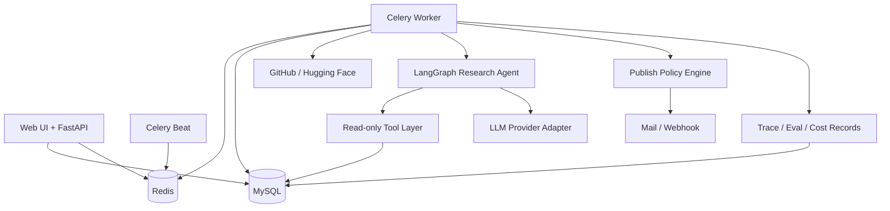

# 架构设计文档：企业开源技术情报 Agent 与自动周报平台

> 项目事实基线由 `REQUIREMENTS.md`、`INTERFACES.md` 和本文档共同构成。  
> 任何影响需求、架构、接口、数据模型、依赖或目录结构的代码变更，都必须同步更新对应文档。  
> 最后更新：2026-10-09 ｜ 文档版本：v0.3.1

## 1. 概述与目标

- **项目定位**：使用专用研究 Agent 自动完成开源项目趋势研究、证据补齐、报告验证和周报生成。
- **核心问题**：研发战略和架构团队每周需要人工搜索、筛选、阅读、比较并整理开源项目，重复且耗时。
- **目标用户**：研发战略、架构、技术管理和产品研究岗位；个人版本由管理员兼任分析师。
- **价值指标**：降低单份周报人工耗时；提高引用覆盖率、事实一致性和来源可追溯性；控制单报告 Token 成本；减少异常对发布流程的阻塞。
- **质量属性优先级**：正确性 > 可维护性 > 数据安全 > 成本可观测性 > 性能 > 扩展性。

### 1.1 范围

**In scope**

- GitHub 和 Hugging Face 公开数据采集。
- 每日指标快照、候选筛选、时间窗口聚合。
- 单个专用研究 Agent 的计划、工具调用、证据验证和报告写作。
- 风险分级发布策略：`AUTO`、`AUTO_WITH_DELAY`、`MANUAL`。
- MySQL 多表模型、Redis/Celery 异步任务、FastAPI 接口和轻量管理界面。
- 基础 RBAC、报告可见范围、审计日志、Prompt Injection 防护和 Token 预算。
- Baseline 与 Agent 的离线评测、版本回归、Bad Case 反馈。

**Out of scope（首期）**

- 企业 SSO、多租户、复杂 ABAC、完整 DLP、HA 集群和 Kubernetes。
- 微调模型、Multi-Agent 自主协作和无限自主循环。
- 任意网页抓取、任意 URL 下载、Shell 工具和数据库写工具。
- 面向外部客户发布报告；首期仅面向内部受控读者。

## 2. 约束与关键假设

- **技术约束**：个人项目，短期可上手；优先使用成熟开源组件，不引入需要专用基础设施的依赖。
- **部署假设**：单企业、单租户、Docker Compose 起步；生产可部署在受控 Linux 主机。
- **模型假设**：支持企业认可的 OpenAI-compatible API；需要时可切换本地模型，代码不绑定厂商。
- **数据假设**：采集数据来自公开来源；生成周报可能属于企业内部资料，不能默认发送给未批准的 SaaS。
- **审核假设**：常规低风险周报允许无人工阻塞发布；异常、敏感和配置变更场景必须人工审核。
- **规模假设**：每日候选 100-500 个仓库，每周深度分析 10-30 个仓库，单实例足够。
- **仓库最终路径**：`D:\job-workspace\project_sources\open-source-intelligence-agent`。所有代码、文档、迁移、配置和测试的最终版本必须在该目录中维护；其他目录只可作为临时副本。
- **项目文档基线**：[REQUIREMENTS.md](REQUIREMENTS.md) 定义需求与验收；[INTERFACES.md](INTERFACES.md) 定义外部 API、Agent Tool 和跨模块对象；本文档定义系统结构与实施顺序。
- **开工学习清单**：[docs/technology-learning-checklist.md](docs/technology-learning-checklist.md) 和 [docs/readiness-and-startup-roadmap.md](docs/readiness-and-startup-roadmap.md)。
- **调研说明**：当前环境未执行联网技术调研。选型吸收 LangGraph、Langfuse/LangSmith、RAGAS 类工具的设计模式，但数据结构与发布策略按本项目重新设计；实施前需校验依赖版本与许可证。

## 3. 架构选型

### 3.1 候选方案

| 维度 | 方案 A：模块化单体 + Worker（推荐） | 方案 B：微服务 | 方案 C：Serverless 工作流 |
|---|---|---|---|
| 架构风格 | 单体代码库，API、Worker、Beat 分进程 | API、采集、Agent、报告独立服务 | 云函数、托管队列和托管数据库 |
| 优点 | 边界清晰、部署简单、调试容易、适合个人开发 | 独立扩缩容，团队边界清楚 | 运维少，按量计费 |
| 缺点 | 单库和单仓库需要自律维护模块边界 | 分布式事务、调试和部署复杂度高 | 厂商锁定、本地模型和敏感数据控制较弱 |
| 与项目匹配度 | 高 | 低至中，当前规模不成立 | 低，数据保护与模型兼容受限 |

### 3.2 决策

采用 **方案 A：模块化单体 + 独立 Worker 进程**。同一代码仓库遵守明确模块边界，部署时运行 `api`、`worker`、`beat` 三个应用进程，并使用 MySQL 与 Redis。未来确有独立扩容需求时，再按模块拆分服务并新增 ADR。

## 4. 系统上下文与容器视图

### 4.1 系统上下文

```mermaid
flowchart LR
    Admin[管理员/分析师] --> System[开源技术情报 Agent 平台]
    Reader[内部读者] --> System
    GitHub[GitHub API] --> System
    HF[Hugging Face API] --> System
    Model[批准的大模型服务] <--> System
    Mail[邮件/飞书 Webhook] <-- System
```

### 4.2 容器视图



## 5. 技术栈

| 层 | 选型 | 版本基线 | 理由 |
|---|---|---|---|
| 语言 | Python | 3.11+ | 与 AI/Agent 生态、数据处理和现有技能一致 |
| Web API | FastAPI + Pydantic | FastAPI 0.11x, Pydantic 2.x | 类型契约清晰，适合内部 API 和 Agent 工具边界 |
| ORM/迁移 | SQLAlchemy + Alembic | 2.x / 1.x | 支持显式模型、事务和可回滚迁移 |
| 数据库 | MySQL | 8.0+ | 自然满足多表快照、聚合、唯一约束和面试要求 |
| 缓存/队列 | Redis | 7.x | 缓存外部 API 结果并承载 Celery 队列 |
| 异步任务 | Celery + Celery Beat | 5.x | 长耗时研究任务可重试、隔离并独立监控 |
| Agent 编排 | LangGraph | 当前稳定版 | 显式状态图，便于限制循环和记录轨迹 |
| 模型适配 | OpenAI-compatible Provider Adapter | 不绑定供应商 | 支持批准 API 和本地模型切换 |
| 管理界面 | Jinja2 + HTMX | 当前稳定版 | 首期避免复杂前端，能完成审核和配置流程 |
| 部署 | Docker Compose | Compose v2 | 一键启动 MySQL、Redis、API、Worker、Beat |
| 评测 | pytest + 自建 Runner + LLM-as-a-judge | 按需 | 支持离线评测、版本回归和消融实验 |
| 监控 | 结构化日志 + MySQL 指标表 + 简单看板 | 首期轻量 | 先证明监控意识，不引入完整可观测平台 |

## 6. 模块与目录结构

```text
open-source-intelligence-agent/
├── ARCHITECTURE.md              # 架构唯一真理源
├── README.md                    # 文档入口
├── docs/                        # PRD、API、数据、安全、评测、ADR
├── src/open_source_intelligence/
│   ├── api/                     # FastAPI 路由、依赖注入、认证
│   ├── web/                     # Jinja2/HTMX 管理界面
│   ├── collectors/              # GitHub/Hugging Face 数据源适配器
│   ├── pipeline/                # 清洗、快照、候选筛选和质量校验
│   ├── agent/                   # LangGraph、Tools、Prompts、Guardrails
│   ├── reports/                 # 模板、版本、审核和发布策略
│   ├── evaluation/              # 数据集、Scorer、回归和成本统计
│   ├── security/                # RBAC、ACL、脱敏和审计
│   ├── persistence/             # SQLAlchemy 模型、Repository、迁移
│   ├── workers/                 # Celery Tasks 和调度定义
│   └── core/                    # 配置、日志、异常和共享类型
├── prompts/                     # 版本化 Prompt 和评分 Rubric
├── tests/                       # 单元、集成、端到端、安全与评测测试
├── infra/                       # Compose、环境模板和部署配置
└── scripts/                     # 初始化、回填和运维脚本
```

模块依赖方向为 `api/web -> application services -> agent/pipeline/reports -> persistence/core`。Agent 只能通过显式 Tool Layer 访问数据库，不允许直接构造 SQL，也不允许调用 Shell。

## 7. 核心数据模型摘要

详细字段见 [docs/data-model.md](docs/data-model.md)。

| 实体 | 关键职责 |
|---|---|
| `users`, `roles`, `user_roles` | 身份和角色 |
| `data_sources`, `topics` | 采集源与监控主题配置 |
| `repositories`, `repo_snapshots` | 仓库主数据和每日时间序列 |
| `pipeline_runs` | 采集、筛选、报告任务的运行记录 |
| `agent_configs`, `agent_runs`, `agent_steps`, `tool_calls` | Agent 版本、状态、轨迹和工具调用 |
| `reports`, `report_sources`, `report_reviews` | 报告、证据引用、审核和版本 |
| `eval_datasets`, `eval_cases`, `eval_runs`, `eval_results` | 评测集、执行和指标 |
| `feedback` | 人工反馈和 Bad Case |
| `audit_logs` | 权限、配置、审核、发布和导出审计 |

### 7.1 运行时不变量

| # | 不变量 | 作用域 | 维护方 | 校验方式 |
|---|---|---|---|---|
| INV-1 | 同一仓库同一自然日最多只有一条快照 | `repo_snapshots` | Collector | 唯一约束 `(repository_id, snapshot_date)` |
| INV-2 | 所有采集更新必须幂等，可重复执行而不产生重复仓库或快照 | Pipeline | Collector | 唯一约束 + Upsert 集成测试 |
| INV-3 | 每个 Agent 步骤和工具调用必须关联唯一 `agent_run_id` | Agent Runtime | Agent Recorder | 外键和运行轨迹完整性测试 |
| INV-4 | Agent 单次运行不得超过模型调用、工具调用、循环和 Token 预算 | Agent Runtime | Graph Guard | 运行前预算校验和停止条件 |
| INV-5 | 报告发布前必须得到通过或经过审批的 `publish_decision` | Publishing | Policy Engine | 发布服务前置断言 |
| INV-6 | `MANUAL` 决策的报告在审核通过前不得推送 | Publishing | Publishing Service | 状态机与集成测试 |
| INV-7 | 任何报告读取、下载、审核和推送都必须经过 ACL 检查 | Security | Authorization Service | API 授权测试和审计测试 |
| INV-8 | 日志、Trace 和 Prompt 中不得写入数据库密码、API Key 和未批准的敏感字段 | Observability | Redaction Filter | 单元测试和敏感字段扫描 |
| INV-9 | 外部 README/网页文本始终标记为不可信输入，不能改变工具权限 | Agent Runtime | Prompt Guard | Prompt Injection 评测 |
| INV-10 | 报告中的关键数字必须能追溯到 `report_sources` | Verification | Verifier | 引用覆盖和指标一致性测试 |

## 8. Agent 运行时设计

### 8.1 设计原则

Agent 不是抓取器和数据库的替代品。确定性工作由 Python、SQL 和规则完成；Agent 只处理需要研究判断、工具选择和证据综合的部分。首期采用单个专用研究 Agent，不采用 Multi-Agent，避免重复老项目并降低状态治理成本。

```text
Research -> Tool Call -> Observe -> Verify -> Write
                    ^                  |
                    +---- evidence gap -+
```

### 8.2 状态对象

```text
AgentState {
  run_id: string
  topic_id: integer
  window_start: datetime
  window_end: datetime
  candidate_repo_ids: list[integer]
  research_plan: list[ResearchTask]
  evidence: list[EvidenceRef]
  verification: VerificationResult
  report_draft: ReportDraft
  publish_decision: PublishDecision
  loop_count: integer
  tool_call_count: integer
  model_call_count: integer
  estimated_cost: decimal
  status: pending | running | needs_review | completed | failed
  error_code: string | null
  error_message: string | null
}
```

### 8.3 Tool Layer

| 工具 | 输入 | 输出 | 权限 |
|---|---|---|---|
| `query_repo_metrics` | `repo_id`, `start`, `end` | `list[MetricPoint]` | 只读 |
| `get_repository_profile` | `repo_id` | `RepositoryProfile` | 只读 |
| `get_repository_content` | `repo_id`, `max_chars` | `ContentSnippet` | 只读、截断、不可信标记 |
| `search_prior_reports` | `topic_id`, `repo_id`, `limit` | `list[ReportSummary]` | 只读、ACL 检查 |
| `save_report_section` | `run_id`, `section_type`, `content`, `citations` | `SectionRef` | 仅写草稿 |

工具契约必须使用 Pydantic Schema。模型无权创建新工具、修改工具白名单、执行 Shell 或直接写 MySQL。发布动作由 Policy Engine 和 Publishing Service 完成，不属于 Agent Tool。

工具的输入输出、错误码、权限和测试映射详见 [docs/agent-tool-contract.md](docs/agent-tool-contract.md)。该文档是工具设计与人类可读契约，Pydantic 模型是运行时契约。

### 8.4 模型路由与 Token 控制

- 规则和 SQL 完成候选筛选，候选阶段不调用大模型。
- 廉价模型用于相关性分类、证据抽取和结构化字段补全。
- 主模型用于研究计划、复杂对比和最终报告综合。
- 历史仓库画像和报告摘要缓存复用；README 只保留与任务相关的片段。
- 默认限制：单次运行最多 4 个研究循环、6 次模型调用、10 次工具调用，具体值进入 `agent_configs`。
- 预算达到 80% 时降级；达到 100% 时停止新增模型调用，生成带未完成说明的草稿或进入人工审核。

### 8.5 发布策略

| 决策 | 条件 | 默认行为 |
|---|---|---|
| `AUTO` | 低敏感级别、内部可见、评测通过、无工具异常、非首次配置 | 直接进入发布任务 |
| `AUTO_WITH_DELAY` | 常规内部周报 | 延迟窗口内允许撤回或修改，窗口结束后发布 |
| `MANUAL` | 敏感报告、外部推送、低置信度、新模型/Prompt、关键验证失败 | 必须人工审核 |

“低风险常规周报不需要人工审核”是本项目的效率原则。人工审核用于异常处理、风险门禁和 Bad Case 积累，不作为所有报告的默认阻塞步骤。

## 9. 数据与工程流程

```text
Celery Beat
  -> collect_sources
  -> normalize_and_upsert
  -> create_daily_snapshots
  -> rank_candidates
  -> run_research_agent
  -> verify_report
  -> evaluate_publish_policy
  -> publish_or_request_review
  -> collect_metrics
```

关键工程约束：

- 外部 API 使用认证、并发限制、分页、超时、指数退避和可重试错误分类。
- 所有写入采用事务和唯一约束；重复执行不能产生重复数据。
- 采集失败记录到 `pipeline_runs`，不因单个仓库失败中断整批任务。
- 报告发布采用状态机：`draft -> pending_review -> approved -> scheduled -> published -> failed`。
- Redis 故障时，API 仍可读取已入库报告；只影响新任务入队，不影响历史数据读取。
- 首期每日和每周任务频率可配置，时区统一保存 UTC，展示时转换为 `Asia/Shanghai`。

## 10. 关键接口摘要

完整契约见 [docs/api-contract.md](docs/api-contract.md)。

| 接口组 | 代表接口 | 说明 |
|---|---|---|
| 认证 | `POST /api/v1/auth/login`, `GET /api/v1/auth/me` | 登录和当前用户 |
| 数据源 | `/api/v1/sources` | 采集源配置 |
| 主题 | `/api/v1/topics` | 监控主题与筛选条件 |
| 仓库 | `/api/v1/repositories`, `/api/v1/repositories/{id}/snapshots` | 仓库和趋势查询 |
| Agent | `/api/v1/agent/runs`, `/api/v1/agent/runs/{id}` | 触发与查看研究轨迹 |
| 报告 | `/api/v1/reports`, `/api/v1/reports/{id}/review`, `/publish` | 查询、审核和发布 |
| 评测 | `/api/v1/evaluations`, `/api/v1/evaluations/{id}/run` | 数据集、执行和指标 |
| 审计 | `/api/v1/audit-logs` | 只读审计查询，限管理员 |

API 使用 JSON，错误返回 RFC 7807 Problem Details。列表接口统一支持 `page`、`page_size`，并限制最大 `page_size`。所有写操作需要 CSRF 防护或 Bearer 认证，所有报告读取执行 ACL。

## 11. 安全与隐私架构

- 外部采集内容是不可信输入，必须隔离、截断并标记来源。
- 首期角色为 `ADMIN`、`EDITOR`、`VIEWER`；报告可见范围为 `PRIVATE`、`TEAM`、`INTERNAL`。
- 机密报告默认禁止发送给未经批准的外部模型；Provider Adapter 必须读取模型数据策略。
- 模型请求前执行基础敏感信息识别，数据库连接串、API Key、Cookie 和内部密码不得进入 Prompt 或日志。
- 关键操作写入不可由普通管理员修改的审计日志。
- 报告导出和下载需记录事件；首期不实现完整水印和端到端 DLP。
- 详细威胁与控制见 [docs/security-and-privacy.md](docs/security-and-privacy.md)。

## 12. 评测与可观测性

必须评测三件事：

1. Agent 是否比单 Prompt Baseline 提升报告质量。
2. 报告事实和引用是否可追溯，关键数字是否与数据库一致。
3. 每次运行的 Token、成本、延迟、工具成功率和人工干预率是否可接受。

初始验收目标：

| 指标 | 初始目标 |
|---|---|
| 关键数字准确率 | >= 95% |
| 引用覆盖率 | >= 95% |
| 事实一致性 | >= 90% |
| 任务完成率 | >= 90% |
| Prompt Injection 阻断率 | >= 95% |
| Agent 相对 Baseline 的引用覆盖率提升 | >= 10 个百分点 |
| 常规报告人工阻塞率 | 接近 0，异常报告除外 |

详细协议见 [docs/evaluation.md](docs/evaluation.md)。

## 13. 架构决策记录

- [ADR-001](docs/adr/ADR-001-single-specialized-agent.md)：采用单个专用研究 Agent，不采用 Multi-Agent。
- [ADR-002](docs/adr/ADR-002-deterministic-pipeline.md)：确定采集与指标计算，Agent 只负责研究闭环。
- [ADR-003](docs/adr/ADR-003-risk-based-publishing.md)：常规低风险报告自动发布，异常报告人工审核。
- [ADR-004](docs/adr/ADR-004-modular-monolith.md)：模块化单体代码库，API、Worker、Beat 分进程部署。
- [ADR-005](docs/adr/ADR-005-lightweight-enterprise-controls.md)：实现轻量 RBAC、ACL、审计和模型数据策略，不追求完整企业治理。

## 14. 实施计划

> 状态：[ ] 未开始  [~] 进行中  [x] 已完成

- [x] T1 项目脚手架与配置 — 依赖：无 — 验证：测试、Compose、API、Worker、Beat 端到端验证通过
- [x] T1.1 项目元数据与包骨架 — 验证：`pyproject.toml` 可解析，可编辑安装和导入成功
- [x] T1.2 核心配置与日志 — 依赖 T1.1 — 验证：保留配置校验与脱敏测试，真实输出 JSON 日志
- [x] T1.3 FastAPI 空应用与健康检查 — 依赖 T1.2 — 验证：真实 Uvicorn 启动后 `/health` 和 `/docs` 返回 200
- [x] T1.4 Worker 与 Beat 空服务 — 依赖 T1.2 — 验证：Worker 消费健康任务，Beat 每 60 秒成功调度 Redis 任务
- [x] T1.5 Docker Compose 与环境模板 — 依赖 T1.3/T1.4 — 验证：五服务健康启动，API、Worker、Beat 容器化闭环通过
- [x] T1.6 T1 测试与冒烟收口 — 依赖 T1.3-T1.5 — 验证：14 项测试、Ruff、Compose、API、Worker 和 Beat 通过
- [ ] T2 数据库模型与迁移 — 依赖：T1 — 验证：迁移可升级和回滚，核心约束生效
- [ ] T3 认证、RBAC 与审计骨架 — 依赖：T2 — 验证：三种角色权限和审计事件集成测试通过
- [ ] T4 GitHub/Hugging Face Collector — 依赖：T2 — 验证：真实 API 小批量采集、重试、幂等入库通过
- [ ] T5 每日快照与候选排序 — 依赖：T4 — 验证：重复运行不重复，按时间窗口可查出趋势
- [ ] T6 Celery 调度与 PipelineRun — 依赖：T3/T5 — 验证：定时任务可执行、失败可重试、状态可查询
- [ ] T7 Tool Layer 与数据契约 — 依赖：T2/T5 — 验证：工具 Schema、ACL、截断和只读限制测试通过
- [ ] T8 LangGraph Research Agent — 依赖：T7 — 验证：至少完成一条 Research→Tool→Verify→Write 轨迹
- [ ] T9 Prompt Guard 与运行预算 — 依赖：T8 — 验证：循环、工具、Token 超限时安全停止
- [ ] T10 报告生成与引用 — 依赖：T8 — 验证：关键数字可追溯，引用链接有效
- [ ] T11 Verifier 与发布策略 — 依赖：T10 — 验证：`AUTO`、`AUTO_WITH_DELAY`、`MANUAL` 状态机测试通过
- [ ] T12 报告 API 与管理界面 — 依赖：T3/T11 — 验证：可查看、编辑、审核、发布和回退报告
- [ ] T13 邮件/Webhook 推送 — 依赖：T11/T12 — 验证：仅已批准报告可推送，失败可重试
- [ ] T14 评测数据集与 Runner — 依赖：T8/T10 — 验证：Baseline、Agent、消融版本可输出统一报告
- [ ] T15 监控指标与看板 — 依赖：T6/T10/T14 — 验证：任务、Token、延迟、失败率和评测结果可见
- [ ] T16 数据回填与端到端演示 — 依赖：T4/T5/T14 — 验证：完成一次历史回填和完整周报生成
- [ ] T17 安全测试与故障演练 — 依赖：T3/T9/T13 — 验证：越权、Prompt Injection、API 失败和重复任务均被正确处理
- [ ] T18 文档同步与发布检查 — 依赖：T1-T17 — 验证：架构、API、数据模型和评测文档与代码一致

任务顺序以数据模型和权限为地基，先跑通纵向切片，再扩展评测和界面。每个任务完成后必须真实运行核心路径，不能以单元测试替代冒烟验证。

## 15. 变更日志

| 日期 | 变更摘要 | 影响章节 | 关联任务/ADR | 验证方式 |
|---|---|---|---|---|
| 2026-09-24 | 初始架构建立，完成需求、选型、文档和任务拆解 | 全部 | ADR-001~005 | 文档审查，待用户确认 |
| 2026-09-24 | 新增 Agent 工具接口契约及文档索引 | 8.3、文档索引 | T7 | 链接与 JSON 示例校验 |
| 2026-10-08 | 明确 D 盘目录为项目唯一最终版路径 | 2、文档路径约定 | - | 目标目录存在性确认 |
| 2026-10-08 | 补齐根需求、接口文档与开工学习路线 | 文档基线、2、15 | S0-S3 门控 | 文档链接与验收检查 |
| 2026-10-09 | 完成 T1.1 项目元数据与包骨架 | 5、14 | T1.1 | `pyproject.toml` 解析、可编辑安装、源码与环境导入均成功 |
| 2026-10-09 | 完成 T1.2 配置校验与结构化日志 | 4、5、14 | T1.2 | 7 项测试、Ruff、compileall 和 JSON 日志冒烟验证通过 |
| 2026-10-09 | 完成 T1.3 FastAPI 应用工厂与健康检查 | 7、10、14 | T1.3 | 9 项测试、Ruff、Uvicorn 启动、`/health` 与 `/docs` 返回 200 |
| 2026-10-09 | 安装并验证 Docker Desktop WSL 2 与国内镜像 | 4、部署约束 | 环境准备 | `hello-world` 拉取运行成功，Engine 内核为 WSL 2，Compose v5.5.1 可用 |
| 2026-10-09 | 完成 T1.4 Celery Worker 与 Beat 空服务 | 5、9、14 | T1.4 | 11 项测试、Ruff、临时 Redis 容器、Worker 消费和 Beat 周期调度均通过 |
| 2026-10-09 | 完成 T1.5 Docker Compose 与环境模板 | 4、5、14 | T1.5 | 五服务构建启动、API 200、Worker 消费、Beat 容器周期调度通过 |
| 2026-10-09 | 增加浏览器根路径预览重定向 | 7、10、14 | T1.3 修复 | 根路径 307 到 `/docs`，`/docs` 返回 200，相关测试通过 |
| 2026-10-09 | 完成 T1.6 测试与冒烟收口 | 9、10、14 | T1.6 | 统一脚本通过 14 项测试、Ruff、Compose、API 健康、Worker 消费和 Beat 运行 |
| 2026-10-09 | 修复 T1 审查 P1 与验证脚本误报风险 | 4、5、9、14 | T1 复审 | mypy 0 错误、15 项测试、三服务 JSON 日志、URL/JSON 脱敏、强制重建和同任务 ID 生命周期通过 |
