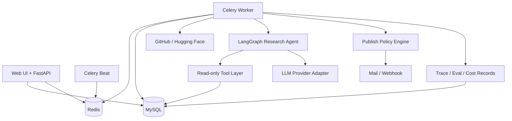

# 架构设计文档：企业开源技术情报 Agent 与自动周报平台

> 项目事实基线由 `REQUIREMENTS.md`、`INTERFACES.md` 和本文档共同构成。
> **本文档只写设计决策与不变量**：选型理由、分层依赖、目录结构、数据模型摘要、运行时设计与 ADR 索引，
> 回答「为什么这样」，不随每次提交变化。
> **本文档不写**开发进度、任务勾选、变更日志、真机验证记录 —— 过程层归属见 §14，
> 历史原文完整归档在本地《开发进度流水.md》（gitignored，不入库）。
> 任何影响需求、架构、接口、数据模型、依赖或目录结构的代码变更，都必须同步更新对应文档。
> 文档状态：设计基线（不随任务进度更新）｜版本 v1.0.0
## 1. 概述与目标

- **项目定位**：使用专用研究 Agent 自动完成开源项目趋势研究、证据补齐、报告验证和周报生成。
- **核心问题**：研发战略和架构团队每周需要人工搜索、筛选、阅读、比较并整理开源项目，重复且耗时。
- **目标用户**：研发战略、架构、技术管理和产品研究岗位；个人版本由管理员兼任分析师。
- **价值指标**：降低单份周报人工耗时；提高引用覆盖率、事实一致性和来源可追溯性；控制单报告 Token 成本；减少异常对发布流程的阻塞。
- **质量属性优先级**：正确性 > 可维护性 > 数据安全 > 成本可观测性 > 性能 > 扩展性。

### 1.1 范围

**In scope**

- GitHub 和 Hugging Face 公开数据采集。
- 每日指标快照、候选筛选、时间窗口聚合。
- 单个专用研究 Agent 的计划、工具调用、证据验证和报告写作。
- 风险分级发布策略：`AUTO`、`AUTO_WITH_DELAY`、`MANUAL`。
- MySQL 多表模型、Redis/Celery 异步任务、FastAPI 接口和轻量管理界面。
- 基础 RBAC、报告可见范围、审计日志、Prompt Injection 防护和 Token 预算。
- Baseline 与 Agent 的离线评测、版本回归、Bad Case 反馈。

**Out of scope（首期）**

- 企业 SSO、多租户、复杂 ABAC、完整 DLP、HA 集群和 Kubernetes。
- 微调模型、Multi-Agent 自主协作和无限自主循环。
- 任意网页抓取、任意 URL 下载、Shell 工具和数据库写工具。
- 面向外部客户发布报告；首期仅面向内部受控读者。

### 1.2 文档职责与边界

| 层 | 文档 | 职责 | 不写 |
|---|---|---|---|
| 事实基线 | `REQUIREMENTS.md` | 做什么、边界、验收标准、待确认项 | 实现细节、进度 |
| 事实基线 | `INTERFACES.md` | 模块 / API / Tool 签名、字段名、错误码、状态机 | 「哪次任务改的」 |
| 事实基线 | `ARCHITECTURE.md`（本文档） | 选型理由、分层依赖、目录结构、数据模型摘要、运行时设计、ADR 索引 | 开发进度流水、验证记录 |
| 详细规格 | `docs/*.md` | 展开基线：PRD、API/Tool 细则、数据模型、安全、评测、运维、回填 | 与根文档冲突的口径 |
| 决策日志 | `docs/adr/` | 一次决策一份，记当时的选项与理由 | 任务进度 |
| 过程记录 | 《使用手册.md》《开发进度流水.md》`git log` | 记录发生了什么：阶段操作、真机证据、提交历史 | 不参与契约判定，不被比较器当事实读 |

判据：**改动后需要同步修正代码或测试的，写基线；只是「记下来以后能查」的，写过程层。**
冲突时以根文档为准，并立即同步修正详细文档（`REQUIREMENTS.md` §1）。完整归属与修改顺序见 §14。

## 2. 约束与关键假设

- **技术约束**：个人项目，短期可上手；优先使用成熟开源组件，不引入需要专用基础设施的依赖。
- **部署假设**：单企业、单租户、Docker Compose 起步；生产可部署在受控 Linux 主机。
- **模型假设**：支持企业认可的 OpenAI-compatible API；需要时可切换本地模型，代码不绑定厂商。
- **数据假设**：采集数据来自公开来源；生成周报可能属于企业内部资料，不能默认发送给未批准的 SaaS。
- **审核假设**：常规低风险周报允许无人工阻塞发布；异常、敏感和配置变更场景必须人工审核。
- **规模假设**：每日候选 100-500 个仓库，每周深度分析 10-30 个仓库，单实例足够。
- **仓库根目录**：所有代码、文档、迁移、配置和测试都以**本仓库根目录**为准维护；其他位置只可作为临时副本，不作为交付或验收依据。
- **项目文档基线**：[REQUIREMENTS.md](REQUIREMENTS.md) 定义需求与验收；[INTERFACES.md](INTERFACES.md) 定义外部 API、Agent Tool 和跨模块对象；本文档定义系统结构与实施顺序。
- **调研说明**：当前环境未执行联网技术调研。选型吸收 LangGraph、Langfuse/LangSmith、RAGAS 类工具的设计模式，但数据结构与发布策略按本项目重新设计；实施前需校验依赖版本与许可证。

## 3. 架构选型

### 3.1 候选方案

| 维度 | 方案 A：模块化单体 + Worker（推荐） | 方案 B：微服务 | 方案 C：Serverless 工作流 |
|---|---|---|---|
| 架构风格 | 单体代码库，API、Worker、Beat 分进程 | API、采集、Agent、报告独立服务 | 云函数、托管队列和托管数据库 |
| 优点 | 边界清晰、部署简单、调试容易、适合个人开发 | 独立扩缩容，团队边界清楚 | 运维少，按量计费 |
| 缺点 | 单库和单仓库需要自律维护模块边界 | 分布式事务、调试和部署复杂度高 | 厂商锁定、本地模型和敏感数据控制较弱 |
| 与项目匹配度 | 高 | 低至中，当前规模不成立 | 低，数据保护与模型兼容受限 |

### 3.2 决策

采用 **方案 A：模块化单体 + 独立 Worker 进程**。同一代码仓库遵守明确模块边界，部署时运行 `api`、`worker`、`beat` 三个应用进程，并使用 MySQL 与 Redis。未来确有独立扩容需求时，再按模块拆分服务并新增 ADR。

## 4. 系统上下文与容器视图

### 4.1 系统上下文

```mermaid
flowchart LR
    Admin[管理员/分析师] --> System[开源技术情报 Agent 平台]
    Reader[内部读者] --> System
    GitHub[GitHub API] --> System
    HF[Hugging Face API] --> System
    Model[批准的大模型服务] <--> System
    Mail[邮件/飞书 Webhook] <-- System
```

### 4.2 容器视图



## 5. 技术栈

| 层 | 选型 | 版本基线 | 理由 |
|---|---|---|---|
| 语言 | Python | 3.11+ | 与 AI/Agent 生态、数据处理和现有技能一致 |
| Web API | FastAPI + Pydantic | FastAPI 0.11x, Pydantic 2.x | 类型契约清晰，适合内部 API 和 Agent 工具边界 |
| ORM/迁移 | SQLAlchemy + Alembic | 2.x / 1.x | 支持显式模型、事务和可回滚迁移 |
| 数据库 | MySQL | 8.0+ | 自然满足多表快照、聚合、唯一约束和面试要求 |
| 缓存/队列 | Redis | 7.x | 缓存外部 API 结果并承载 Celery 队列 |
| 异步任务 | Celery + Celery Beat | 5.x | 长耗时研究任务可重试、隔离并独立监控 |
| Agent 编排 | LangGraph | `>=1.0,<2`（已验证 1.2.14） | 显式状态图，便于限制循环和记录轨迹 |
| 模型适配 | OpenAI-compatible Provider Adapter + 确定性离线桩 | 不绑定供应商 | 支持批准 API、本地模型切换，并支持无网络端到端验证 |
| 管理界面 | Jinja2 + HTMX | 当前稳定版 | 首期避免复杂前端，能完成审核和配置流程 |
| 部署 | Docker Compose | Compose v2 | 一键启动 MySQL、Redis、API、Worker、Beat |
| 评测 | pytest + 自建 Runner + LLM-as-a-judge | 按需 | 支持离线评测、版本回归和消融实验 |
| 监控 | 结构化日志 + MySQL 指标表 + 简单看板 | 首期轻量 | 先证明监控意识，不引入完整可观测平台 |

## 6. 模块与目录结构

### 6.1 仓库顶层

```text
open-source-intelligence-agent/
├── REQUIREMENTS.md              # 需求基线（验收口径）
├── INTERFACES.md                # 接口基线（HTTP 契约、错误码、权限常量）
├── ARCHITECTURE.md              # 架构基线（本文件）
├── README.md / AGENTS.md        # 对外入口 / 协作与流程规则
├── 使用手册.md                  # 本地实操手册（gitignored，不入库）
├── pyproject.toml               # 宽范围依赖 + ruff / mypy / pytest 配置
├── requirements.txt             # 运行时依赖 pin（单一事实来源）
├── requirements-ci.txt          # -r requirements.txt + mypy / pytest / ruff
├── Dockerfile                   # 两步装：-r requirements.txt，再 --no-deps .
├── alembic.ini                  # Alembic CLI 配置
├── .github/workflows/ci.yml     # lint / 类型 / 测试 / 镜像冒烟
├── docs/                        # 需求、API、数据、安全、评测、运维文档
│   ├── adr/                     # ADR-001~005
│   ├── samples/                 # weekly-report-sample.md
│   └── assets/                  # README 截图与 demo.mp4
├── prompts/                     # 版本化 Prompt（draft_v1.md / plan_v1.md）
├── datasets/                    # 冻结评测集 weekly-agent-quality.v1~v4.json
├── infra/docker-compose.yml     # mysql / redis / api / worker / beat 五服务
├── migrations/                  # env.py、script.py.mako、versions/（19 个版本脚本）
├── scripts/                     # check_docs_drift.py、seed_demo.py、init_demo.py、
│                                # t*_mysql_smoke.py、verify_t*.ps1
├── src/open_source_intelligence/ # 见 6.2
└── tests/                       # 见 6.5（与被测包一一对应）
```

### 6.2 源码包内部结构

```text
src/open_source_intelligence/
├── __init__.py
├── core/                        # 配置、日志、共享文本辅助
│   ├── config.py                # Settings（pydantic-settings，extra="forbid"）
│   ├── logging.py               # 结构化日志 + 密钥脱敏
│   └── text.py
├── persistence/                 # 唯一 SQL 落点
│   ├── base.py                  # Declarative base、SQL 类型与时间戳约定
│   ├── session.py               # Engine / Session 工厂
│   └── models/                  # identity · intelligence · agent · reporting
│                                # · notifications · evaluation · audit
├── collectors/                  # 外部数据源适配
│   ├── github.py / huggingface.py # 两源采集器
│   ├── http.py / limiter.py     # 重试式 HTTP 与客户端限速
│   ├── service.py / types.py    # 幂等入库与归一化结构
│   └── cli.py
├── pipeline/                    # 确定性数据流水线
│   ├── snapshots.py             # 每日快照
│   ├── ranking.py               # 规则式候选排序（不调模型）
│   ├── contents.py              # README 缓存的唯一生产写入方
│   ├── daily.py                 # 每日编排：每阶段一条 PipelineRun
│   ├── research_dispatch.py     # 选研究目标 + 派发
│   ├── runs.py / queries.py     # 运行生命周期 / 仓库目录读侧
│   └── cli.py
├── backfill/                    # 可续跑的历史回填
│   ├── jobs.py / service.py     # 作业检查点与逐页游标提交
│   ├── errors.py
│   └── cli.py
├── agent/                       # LangGraph 研究 Agent（唯一调模型的地方）
│   ├── graph.py / state.py / runtime.py # 有界图、状态对象、运行编排
│   ├── guards.py / profile.py / prompts.py # 注入守卫 / 消融开关 / Prompt 加载
│   ├── writing.py / recording.py        # 草稿解析 / 轨迹与计数落库
│   ├── reviews.py / history.py / errors.py
│   ├── llm/                     # base · factory · messages · openai_compatible
│   │                            # · offline · errors
│   ├── retrieval/vector.py      # 词频向量 + 余弦相似度（历史报告召回）
│   ├── tools/                   # contracts · registry · access · context · errors
│   │                            # · outcome + 五个白名单工具
│   ├── tooling.py               # 白名单导出为 JSON Schema
│   └── cli.py
├── reports/                     # 报告成稿到发布的全链
│   ├── composition.py / citations.py        # 成稿与引用校验
│   ├── verification.py / publishing.py / state.py # 四项校验 / 风险评估 / 状态机
│   ├── revisions.py / sharing.py            # 编辑回退 / 免登录分享
│   ├── automation.py                        # 无人值守收口（研究完成后自动成稿）
│   ├── queries.py / errors.py
│   └── cli.py
├── notifications/               # 推送
│   ├── service.py               # 闸门 → allowlist → 投递 → 记账 → 重试
│   ├── channels/                # base · email_channel · webhook_channel
│   │                            # · offline · factory
│   └── errors.py
├── evaluation/                  # 离线评测
│   ├── dataset.py / targets.py / scorers.py / runner.py
│   ├── cli.py
│   └── errors.py
├── observability/               # 只读观测
│   ├── metrics.py               # 确定性指标聚合
│   ├── queries.py / errors.py
├── topics/                      # 主题配置读写
│   ├── service.py / queries.py / errors.py
├── security/                    # 认证、鉴权、审计
│   ├── authorization.py         # 读/写/审/发的唯一裁决点
│   ├── dependencies.py          # FastAPI 认证、RBAC、审计依赖
│   ├── passwords.py / tokens.py / bootstrap.py
│   └── service.py / audit.py / queries.py
├── api/                         # JSON API
│   ├── app.py / errors.py / middleware.py / params.py
│   └── routes/                  # health · auth · topics · repositories · reports
│                                # · push · metrics · audit · agent_runs · evaluations
├── web/                         # 服务端渲染管理界面
│   ├── router.py                # 全部 /ui 页面与写操作
│   ├── security.py              # Cookie 会话 + CSRF 双提交
│   ├── sharing.py               # /share/{token}（唯一免会话读面）
│   ├── markdown.py
│   ├── templates/               # 17 个页面模板 + partials/ 5 个片段
│   └── static/                  # app.css、htmx.min.js
└── workers/                     # Celery
    ├── celery_app.py / celery_entry.py
    └── tasks.py                 # 采集 · 快照 · 排序 · 研究 · 成稿 · 发布释放 · 推送重试
```

### 6.3 模块职责与入口

| 包 | 角色 | 是否调模型 | 运行入口 |
|---|---|---|---|
| `api` | HTTP 契约层：路由、Problem Details、请求关联 ID、分页参数 | 否 | `uvicorn open_source_intelligence.api.app:create_app --factory` |
| `web` | Jinja2 + HTMX 管理界面（左侧分组侧栏 + 右侧内容），复用同一套服务层 | 否 | 挂在同一 `app` 的 `/ui/*` |
| `collectors` | GitHub / Hugging Face 采集与幂等入库 | 否 | `python -m ...collectors.cli` |
| `pipeline` | 快照、排序、README 缓存、每日编排、研究派发 | 否 | `python -m ...pipeline.cli --action daily` |
| `backfill` | 历史仓库回填，按页提交游标可续跑 | 否 | `python -m ...backfill.cli` |
| `agent` | LangGraph 研究 Agent + 白名单 Tool Layer + 预算与守卫 | **是**（唯一） | `python -m ...agent.cli`；Celery `run_research_agent` |
| `reports` | 草稿成稿、引用校验、Verifier、发布策略、修订、分享、无人值守收口 | 否 | `python -m ...reports.cli`；`reports.automation.finish_run_report` |
| `notifications` | 邮件 / Webhook 投递与投递台账 | 否 | 报告发布后的 `push_report`；CLI `--action push` |
| `evaluation` | 数据集导入、五变体执行、确定性评分、对比报告 | 是（复用 `agent`） | `python -m ...evaluation.cli` |
| `observability` | 指标聚合与运行账本读侧 | 否 | `GET /api/v1/metrics`、`/ui/dashboard` |
| `topics` | 主题配置的读查询与增删改 | 否 | API `/topics`、UI `/ui/topics` |
| `security` | 密码、JWT、RBAC/ACL、审计、初始账号 | 否 | FastAPI 依赖注入 |
| `persistence` | ORM 模型、会话与迁移元数据 | 否 | Alembic |
| `workers` | Celery 应用、任务与 beat 表 | 否 | `celery -A ...workers.celery_entry:app worker\|beat` |
| `core` | 配置、日志、文本辅助 | 否 | 全层引用 |

### 6.4 分层与依赖方向

```text
api / web                    ← 传输层：只做协议转换、鉴权入口、渲染
      ↓
topics / reports / notifications / evaluation / observability
                             ← 应用服务层：编排领域动作，事务在此收口
      ↓
collectors / pipeline / backfill / agent
                             ← 作业域：确定性流水线 + 唯一模型调用域
      ↓
persistence / core           ← 基础设施：ORM 与会话、配置、日志
```

三条硬规则：

1. `api` 与 `web` **不发 SQL**，读侧一律走各领域 `queries.py`；列表权限过滤落在 SQL 层，否则分页 `total` 会泄露越权行。
2. Agent 只能经 `agent/tools/registry.py` 的白名单工具访问数据，不得自建 SQL、不得调 Shell；工具之外的路径对它是不可见的。
3. 模型调用只出现在 `agent/llm/`；`evaluation` 通过 `agent.profile` 的变体开关复用同一套运行时，不另建调用链。

### 6.5 测试目录映射

`tests/` 与被测包按同名目录对应，另有 `tests/support.py`（通用夹具）、`tests/api_support.py`、`tests/reports_support.py` 等按域分的共享构造器：

| 目录 | 覆盖对象 |
|---|---|
| `tests/agent/`（含 `tools/`） | 图节点与回边、预算与守卫、Prompt、草稿解析、轨迹、运行复核；五个工具逐个 + registry 契约 |
| `tests/api/` | 健康、认证、仓库、报告、推送、评测、指标、审计、分享链接 |
| `tests/web/` | 页面与账本、HTMX 片段边界、Markdown 渲染、推送页、运行复核、分享页 |
| `tests/pipeline/` | 快照、排序、内容缓存、每日编排、研究派发、运行生命周期 |
| `tests/reports/` | 发布策略、修订、验证、分享 |
| `tests/collectors/`、`tests/backfill/` | 双源适配器、分页、限速、README 抓取、幂等入库；回填游标 |
| `tests/security/`、`tests/topics/` | 鉴权与密码令牌；主题路由与服务 |
| `tests/evaluation/`、`tests/observability/`、`tests/notifications/` | 数据集、变体、评分器、Runner；指标聚合；推送服务 |
| `tests/persistence/`、`tests/core/`、`tests/workers/`、`tests/scripts/` | 模型约束；配置与配置对齐守卫；任务与调度；演练脚本的清理逻辑 |

## 7. 核心数据模型摘要

详细字段见 [docs/data-model.md](docs/data-model.md)。

| 实体 | 关键职责 |
|---|---|
| `users`, `roles`, `user_roles` | 身份和角色 |
| `data_sources`, `topics`, `topic_repositories` | 采集源、监控主题，以及主题盯住哪些仓库（含排序分与排名） |
| `repositories`, `repo_snapshots` | 仓库主数据和每日时间序列 |
| `repository_contents` | 按 `content_type` 缓存的仓库正文（首期为 README）；唯一生产写入方是 `contents` 阶段（§9.1） |
| `pipeline_runs` | 采集、筛选、回填、报告任务的运行记录 |
| `backfill_jobs` | 历史回填作业的检查点：游标 `next_page`、已完成页数、累计入库数与心跳 |
| `agent_configs`, `agent_runs`, `agent_steps`, `tool_calls` | Agent 版本、状态、轨迹和工具调用 |
| `agent_run_reviews` | 人对 `needs_review` 运行的判断（`acknowledged` / `needs_rerun`，只增不改、不改运行状态） |
| `reports`, `report_versions`, `report_sources`, `report_verifications`, `report_reviews` | 报告、当前版本与不可变版本、按版本归属的证据引用、验证结论和人工审核 |
| `report_drafts`, `report_sections` | Agent 写出的草稿与其章节，报告发布前的中间产物 |
| `push_targets`, `report_pushes` | 推送目标（允许列表）与逐次投递记录 |
| `report_share_links` | 免登录只读分享凭证（存令牌摘要，不存明文；可过期、可撤回） |
| `eval_datasets`, `eval_cases`, `eval_runs`, `eval_results` | 评测集、样本、按变体执行与逐样本指标 |
| `feedback` | 人工反馈和 Bad Case（**计划内、尚未实现**：无 ORM 模型与迁移） |
| `audit_logs` | 权限、配置、审核、发布和导出审计 |

### 7.1 运行时不变量

| # | 不变量 | 作用域 | 维护方 | 校验方式 |
|---|---|---|---|---|
| INV-1 | 同一仓库同一自然日最多只有一条快照 | `repo_snapshots` | Collector | 唯一约束 `(repository_id, snapshot_date)` |
| INV-2 | 所有采集更新必须幂等，可重复执行而不产生重复仓库或快照 | Pipeline | Collector | 唯一约束 + Upsert 集成测试 |
| INV-3 | 每个 Agent 步骤和工具调用必须关联唯一 `agent_run_id` | Agent Runtime | Agent Recorder | 外键和运行轨迹完整性测试 |
| INV-4 | Agent 单次运行不得超过模型调用、工具调用、循环、Token 和费用预算 | Agent Runtime | Graph Guard | 运行前预算校验和停止条件 |
| INV-5 | 报告发布前必须得到通过或经过审批的 `publish_decision` | Publishing | Policy Engine | 发布服务前置断言 |
| INV-6 | `MANUAL` 决策的报告在审核通过前不得推送 | Publishing | Publishing Service | 状态机与集成测试 |
| INV-7 | 任何报告读取、下载、审核和推送都必须经过 ACL 检查 | Security | Authorization Service | API 授权测试和审计测试 |
| INV-8 | 日志、Trace 和 Prompt 中不得写入数据库密码、API Key 和未批准的敏感字段 | Observability | Redaction Filter | 单元测试和敏感字段扫描 |
| INV-9 | 外部 README/网页文本始终标记为不可信输入，不能改变工具权限 | Agent Runtime | Prompt Guard | Prompt Injection 评测 |
| INV-10 | 报告中的关键数字必须能追溯到 `report_sources` | Verification | Verifier | 引用覆盖和指标一致性测试 |

## 8. Agent 运行时设计

### 8.1 设计原则

Agent 不是抓取器和数据库的替代品。确定性工作由 Python、SQL 和规则完成；Agent 只处理需要研究判断、工具选择和证据综合的部分。首期采用单个专用研究 Agent，不采用 Multi-Agent，避免重复老项目并降低状态治理成本。

```text
Research -> Tool Call -> Observe -> Verify -> Write
                    ^                  |
                    +---- evidence gap -+
```

### 8.2 状态对象

```text
AgentState {
  run_id: integer
  topic_id: integer
  window_start: datetime
  window_end: datetime
  candidate_repo_ids: list[integer]
  prompt_version: string
  max_loops: integer
  max_model_calls: integer
  max_tool_calls: integer
  research_plan: list<ResearchTask>            # 累积
  evidence: list<EvidenceRef>                  # 累积
  draft_sections: list<SectionRef>             # 累积，供报告合成阶段读取
  messages: list<ChatMessage>                  # 累积，模型可见的对话轨迹
  last_observations: list<ToolObservation>     # 本轮工具结果，供 observe 节点消费
  pending_tool_calls: list<ModelToolCall>      # 本轮模型给出的工具调用
  verification: VerificationResult | null
  loop_count: integer
  tool_call_count: integer
  model_call_count: integer
  estimated_cost: decimal
  status: pending | running | needs_review | completed | failed
  error_code: string | null
  error_message: string | null
  incomplete: boolean
}
```

`agent/state.py` 按本节实现该状态：标量字段由节点覆盖，列表字段通过 `Annotated[list[X], operator.add]` 累积，节点只返回自己的增量。

```text
ResearchTask        { task_index: integer, intent: profile | metrics | prior_reports | content, repo_id: integer | null }
ToolObservation     { tool_name, repo_id, ok, result_count, truncated, error_code, payload }
EvidenceRef         { tool_name, repo_id, ok, result_count, truncated, error_code, summary }
VerificationResult  { sufficient: boolean, reason: string, covered_repo_ids: list<integer>,
                      missing_repo_ids: list<integer>, content_repo_ids: list<integer>,
                      has_prior_baseline: boolean }
```

`ResearchTask.intent` 是枚举而非自由文本：`plan` 节点只能把意图映射到白名单工具，模型无法通过任务描述引入新工具。`EvidenceRef` 记录的是**工具观测**（哪个工具、是否成功、返回几条、是否截断）；面向读者的可追溯事实引用是 `save_report_section` 使用的 `CitationRef`，字段见 [docs/agent-tool-contract.md](docs/agent-tool-contract.md)。

### 8.3 Tool Layer

| 工具 | 输入 | 输出 | 权限 |
|---|---|---|---|
| `query_repo_metrics` | `repo_id`, `start`, `end`, `granularity="day"` | `ToolResult[list[MetricPoint]]` | 只读 |
| `get_repository_profile` | `repo_id` | `ToolResult[RepositoryProfile]` | 只读 |
| `get_repository_content` | `repo_id`, `content_type="readme"`, `max_chars`(500-12000，默认 6000), `query_hint` | `ToolResult[ContentSnippet]`，`untrusted` 恒为 `true` | 只读、截断、不可信标记 |
| `search_prior_reports` | `topic_id`, `repo_id`, `before`, `limit` | `ToolResult[list[ReportSummary]]` | 只读、ACL 检查 |
| `save_report_section` | `section_key`, `content_markdown`, `citations`, `content_digest` | `ToolResult[SectionRef]` | 仅写当前运行草稿 |

工具契约必须使用 Pydantic Schema。模型无权创建新工具、修改工具白名单、执行 Shell 或直接写 MySQL。发布动作由 Policy Engine 和 Publishing Service 完成，不属于 Agent Tool。

工具的输入输出、错误码、权限和测试映射详见 [docs/agent-tool-contract.md](docs/agent-tool-contract.md)。该文档是工具设计与人类可读契约，Pydantic 模型是运行时契约。

### 8.4 模型路由与 Token 控制

- 规则和 SQL 完成候选筛选，候选阶段不调用大模型。
- 廉价模型用于相关性分类、证据抽取和结构化字段补全。
- 主模型用于研究计划、复杂对比和最终报告综合。
- 历史仓库画像和报告摘要缓存复用；README 只保留与任务相关的片段。
- 默认限制：单次运行最多 4 个研究循环、6 次模型调用、10 次工具调用，具体值进入 `agent_configs`。
- 预算达到 80% 时降级；达到 100% 时停止新增模型调用，生成带未完成说明的草稿或进入人工审核。

**预算边界**：100% 硬停止 → 写出草稿 → 终态 `needs_review`；三档预算落到 `agent_configs` 的 `max_loops` / `max_model_calls` / `max_tool_calls`。`max_tokens` 与 Prompt/Completion Token 计数同属预算：达到 80% 后停止新增研究规划调用、保留撰写预算，达到 100% 后不再发起新的模型调用。廉价模型分流与画像/摘要缓存复用不在首期范围 —— 单次运行只使用一个 `AGENT_MODEL`。

### 8.5 发布策略

| 决策 | 条件 | 默认行为 |
|---|---|---|
| `AUTO` | 低敏感级别、内部可见、评测通过、无工具异常、非首次配置 | 直接进入发布任务 |
| `AUTO_WITH_DELAY` | 常规内部周报 | 延迟窗口内允许撤回或修改，窗口结束后发布 |
| `MANUAL` | 敏感报告、外部推送、低置信度、新模型/Prompt、关键验证失败 | 必须人工审核 |

“低风险常规周报不需要人工审核”是本项目的效率原则。人工审核用于异常处理、风险门禁和 Bad Case 积累，不作为所有报告的默认阻塞步骤。

**策略约束**：配置的 `publish_mode` 是上限，具体发现只能让决策更严格；`AUTO` 额外要求可见范围为 `INTERNAL`，首次配置（主题尚无已发布报告）一律转人工。

## 9. 数据与工程流程

```text
Celery Beat
  -> collect_sources
  -> normalize_and_upsert
  -> create_daily_snapshots
  -> rank_candidates
  -> run_research_agent
  -> verify_report
  -> evaluate_publish_policy
  -> publish_or_request_review
  -> collect_metrics
```

关键工程约束：

- 外部 API 使用认证、并发限制、分页、超时、指数退避和可重试错误分类。
- 所有写入采用事务和唯一约束；重复执行不能产生重复数据。
- 采集失败记录到 `pipeline_runs`，不因单个仓库失败中断整批任务。
- 报告发布采用状态机：`draft -> pending_review -> approved -> scheduled -> published -> failed`。
- 发布链路（`verify_report` -> `evaluate_publish_policy` -> `publish_or_request_review`）由 Policy Engine 与 Publishing Service 执行，发布动作不是 Agent Tool；延迟窗口与到期释放由独立的 `publish_due_reports` 扫描推进。
- Redis 故障时，API 仍可读取已入库报告；只影响新任务入队，不影响历史数据读取。
- 首期每日和每周任务频率可配置，时区统一保存 UTC，展示时转换为 `Asia/Shanghai`。
- 上面的 Beat 流程是**周期**路径；历史分页回填是**操作员触发**的一次性走查，走 CLI / Celery 而非 Beat，见 §9.7 与 [docs/backfill.md](docs/backfill.md)。

### 9.1 流水线编排与运行账本

- 每日确定性流水线固定为 `collect -> snapshot -> rank -> contents`。`contents` 排在 `rank` 之后，因为「哪些仓库值得预热 README 缓存」的答案就在排名里：放在采集阶段只能全量抓取，而只有入选候选会被研究；候选集合与「研究运行被授权读的仓库」因此是同一批行。
- 候选筛选完全由 Python / SQL 决定，**不调用模型**。排序**就地刷新**候选行，保留 `manually_pinned` 与窗口内无快照的行，不整表替换 —— 整表替换会连人工与评测主题的候选一起删掉。
- 每次尝试写独立的 `pipeline_runs` 行，`attempt` 递增、状态转换立即提交，进程崩溃不丢失败证据；`error_message` 写入前脱敏并截断。`agent` / `publish` 必须绑定主题，其余阶段允许全局运行，由数据库 CHECK 约束保证。
- 失败语义分层：全部供应商失败抛 `COLLECTOR_FAILED` 并停止批次；部分失败记 `partial` 后继续；单主题排序失败只记 `RANK_FAILED`。错误分类必须保留「源拒绝」与「我们写坏了」的区分。
- 研究运行由调度统一发起，HTTP 面不提供触发（消耗模型预算，触发权属调度器与操作员 CLI）。派发判据（主题启用、本业务日 `rank` 成功且有候选、本业务日无未失败的 `agent_runs`）同时是重试保护与预算保护；`failed` 不计入「已研究」，一次端点抖动不该让整夜空转。派发与执行分两层：纯读的 `select_research_targets()` 与接受 `dispatcher` 的 `dispatch_research_targets()`。
- 草稿升级为报告的生产路径唯一：`generate_report` 的生产调用方只有 `reports/cli.py` 与 `reports/automation.finish_run_report`。自动成稿失败返回稳定码而不抛异常，避免任务重试再花一次模型预算。
- **派生数字（百分比、覆盖率）一律由 `reports/composition.py` 计算**，不由模型写。

### 9.2 研究 Agent 与工具层

- 有界五节点 LangGraph `plan -> tool -> observe -> verify -> write`；`verify` 通过条件边回到 `plan`，形成「证据缺口 → 继续研究」的显式回边。`plan` 是研究阶段唯一调用模型的位置。
- 三档预算 `max_loops` / `max_model_calls` / `max_tool_calls` 来自 `agent_configs`。工具预算的有效值取 `max(配置值, evidence_tool_floor(候选数) = 2n + 2)`：验证器要求每个候选一份画像与一份指标，另加历史报告基线、至少一份 README。工具调用不计费，只有请求它的模型轮次计费，所以抬预算而不是砍候选；默认值必须留出余量，不能与下限持平。
- `verify` 要求四类证据齐备；不满足时把缺口写进 `VerificationResult` 并回边补研究。章节写入使用独立预算，不与研究阶段的工具预算竞争。`needs_review` 是结果不是异常，不作为错误重试。
- 工具调用统一经 `ToolRegistry.invoke()` 的固定顺序：白名单 → 运行策略 → 预算 → Schema 校验 → handler → 只读写保护 → `tool_calls` 记录。授权范围由运行时注入的 `ToolContext` 决定，不接受模型参数伪造；仓库类工具要求仓库属于授权主题。
- 失败与成功的载荷都是 dict，**构造与判据必须放在同一处**（`agent/llm/messages.py`）。`tool_calls.agent_step_id` 在步骤行落库后回填；未挂到步骤上的调用仍保留，因为一次在步骤落库前被预算硬停的运行，失败证据恰在这些行里。
- 不可信外部文本（README）先经 Prompt Guard：命中即隔离，停止研究回边，落 `AGENT_PROMPT_INJECTION` / `needs_review` / `security_risk=True`。**守卫是隔离，不是说服**：目标是不让被污染的输入进入决策链，不是让模型抵抗住。
- 模型接入是可插拔 Adapter（`ModelClient` Protocol）：离线确定性客户端让端到端验证无需网络与密钥，`OpenAICompatibleClient` 走同一接口；启用真实供应商时 `AGENT_API_BASE` 必须是 `https` 且必须提供密钥。
- 终态语义：`AGENT_NO_CANDIDATES` / `AGENT_BUDGET_EXCEEDED` / `AGENT_EVIDENCE_INCOMPLETE` / `AGENT_WRITE_FAILED` 判为 `needs_review`；`AGENT_MODEL_UNAVAILABLE` / `AGENT_DRAFT_INVALID` 判为 `failed`。完整映射见 `INTERFACES.md` §8。
- 精确签名、错误码与工具契约见 `INTERFACES.md` §4 / §6 与 [docs/agent-tool-contract.md](docs/agent-tool-contract.md)。

### 9.3 报告生成、验证与发布

- `reports/composition.py` 只读取指定运行的草稿与最新章节版本，按固定顺序合成 Markdown，**不重新调用模型**；六个章节必须齐全，每节至少一条引用，含数字的章节至少一条 `metric` 引用。
- 引用解析三类（`repo_snapshots` / `repository_contents` / `reports`），按版本归属；未发布的报告不能作为正式引用。报告版本不可变：内容变化追加新版本，幂等生成不增版本，回退同样追加。
- `reports/verification.py` 在发布前对**已持久化报告**重跑结构、引用、数字、敏感四项检查，而不是信任撰写期草稿；每次验证写一行 `report_verifications`。
- 发布决策是「上限 + 收紧」：`publish_mode` 是上限，验证失败、低引用覆盖、敏感内容、`CONFIDENTIAL`、运行不干净、命中注入、首次配置、模型 / Prompt / 工具策略变化、`AUTO` 下非内部可见，都会让决策收紧为 `pending_review`；`MANUAL` 额外要求同版本 `approve` 审核。
- `reports.status` 的唯一写入入口是 `reports/state.py:transition_report`；`publish_due_reports()` 是唯一推进器，延迟窗口在 `publish_report` 内部强制，任何调用路径都无法提前释放。
- 分享链接是报告唯一的免登录出口：闸门在 `sensitivity='PUBLIC'` 且 `status='published'`，**不在 `visibility` 上**（前者回答「内容能否离开组织」，后者回答「系统内谁能看」）。明文令牌只在创建响应里出现一次、库内只存 sha256；不存在、已撤销、已过期、报告撤回统一 `404` 且响应一致，不提供探测接口。读取不写审计，生成与撤销写。

### 9.4 出站投递

- `notifications/` 是报告唯一的出站通道，渠道无关：`NotificationChannel` Protocol（`OutboundMessage` / `DeliveryReceipt`）加 email / webhook 两个适配器，构造入口只有 `build_channel`。`push_delivery` 默认 `offline`（确定性摘要，不产生网络请求），`live` 才真实投递并带 HMAC-SHA256 签名。
- 守卫顺序固定为 **状态 → 敏感审批 → 允许列表**：状态只接受 `approved` / `published`；`CONFIDENTIAL` 额外要求同版本 `approve`；目标必须启用、渠道一致，并被显式开过 `allow_private` / `allow_confidential`（默认关闭）。允许列表是部署相邻配置，**只从后端写入**，界面不提供创建或修改入口。
- **传输失败不是异常**：`DeliveryReceipt(ok=False)` 落在 `failed` 行 + 稳定 `error_code`，接口返回 200；只有守卫违规抛异常。适配器异常也在投递层收成回执，因为推送挂在发布链路上，不能把一次成功的发布变成崩溃。
- 幂等键 `(report_id, version, target_id)` 带唯一约束：重复请求返回 `replayed=True`，重试**推进同一行的 `attempt`** 而非新增行。重试扫描与到期发布扫描是两个独立的 beat 条目，避免邮件服务器拖慢发布。
- 私网守卫是 SSRF 防线。本地演练需要私网接收器时，使用仅 `local` / `test` 可用的测试逃生口（生产配置开启即拒绝启动）；自签 CA 必须显式传给 httpx 的 `verify`，不能依赖 `trust_env`。

### 9.5 评测与可观测性

- 评测数据集是**冻结的版本化文件**：同版本内容不同即冲突，版本不可覆盖，否则历史结果不可复现。五个变体逐字对应 [docs/evaluation.md](docs/evaluation.md) §1；消融 = 真实 graph + 执行画像开关，不是重新实现；写入工具永不可禁。
- 评分全部是确定性规则，无模型参与；**未行使的指标返回 `None` 而不是 `0`**，聚合时从均值剔除。门禁指标落真实列，明细指标存 `details_json`。`passed` 只裁决 `("agent_full",)`（消融是对照不是候选），且 `scored_case_count > 0` 是必要条件 —— 「因为没有测量而通过」是发布门禁最危险的失效模式。
- 参照链是 `baseline_single_prompt <- agent_full <- agent_no_*`：每个变体相对它所改动的那个变体衡量，把消融也拿去与 baseline 比会掩盖损失。
- 监控层**没有新表**，只读既有账本做纯聚合（`metrics.py` 聚合 / `queries.py` 读侧），因此观测不会反过来改变被观测的对象。窗口是半开区间，越界返回 `422` 而非夹取；`null`（无样本）与 `0`（真实零）必须可分；分位数取 nearest-rank 不插值。评测段不做窗口过滤，`passed` 直接读评测报告而不重算。
- 出站前摘要、参数与结果一律经 `security` 的脱敏实现：**UI 与 JSON API 都是 egress 路径**；写入方自由发挥的 `metadata_json` 不出站。协议见 [docs/observability.md](docs/observability.md)。

### 9.6 界面、API 与安全边界

- `web/` 复用 `api` 层同一套服务，**自己不发 SQL**；`api` 也不发 SQL，读侧走各领域 `queries.py`。列表的权限过滤必须在 SQL 层完成（放进 `WHERE` 再分页与计数），否则 `total` 会泄露调用方永远翻不到的行数。
- **分组通配路由必须最后声明**（`/push/*`、`/reports/publish-due`、评测 `/runs`、`/agent/runs`），否则被 `/{id}` 吞掉；字面量段路由先于路径参数段。`hx-target` 容器只收片段。
- UI 会话是 `HttpOnly` Cookie 里的 JWT，写操作走 CSRF 双提交；守卫顺序固定为 **CSRF → 写角色 → 报告读权限 → 调用服务**。菜单可见性与路由准入由同一个常量定义（两者不一致都是缺陷），测试要同时断言渲染面与准入面。
- 运维配置（推送目标、账号）由后端拥有，界面只对管理员渲染提及；**渲染面不是闸门**，路由自身的角色检查才是。
- 越权对外沉默（403 响应不含标题）、对内留痕（审计带 `resource_id`）。`resource_id` 可空是语义：资源域拒绝有资源可命名，请求域拒绝本来没有。UI 与 API 共享同一组拒绝动作名，才能用一次查询回答「谁想读哪一份」。
- 全部 API 失败渲染为 RFC 7807 Problem Details，`code` 稳定可判断，客户端无需解析文案。审计决策是一对入口：`can_read_report` 与 `readable_reports_filter` 规则一致，`ADMIN` 短路在可见范围之前。
- 详细威胁与控制见 [docs/security-and-privacy.md](docs/security-and-privacy.md)，端点契约见 [docs/api-contract.md](docs/api-contract.md)。

### 9.7 历史回填与一次性走查

- 回填是独立走查路径，**不是把 `limit` 调大**：分页能力以 `PaginatedRepositoryCollector` 协议增量挂上，`collect(limit)` 的既有契约与调用点不变。游标只是一个页码，续传即「用更大的页码再问一次」。
- 有没有下一页**由源自己说**（`CollectedPage.has_more`），不由条目数或 `total_count` 推断 —— GitHub 走到搜索上限后仍返回完整 `total_count` 却不再宣告 `rel="next"`。分页差异留在各自 adapter 里；HTTP 头名大小写不敏感，读取统一走小写键的 `header(name)`。
- 限流器保证「请求起始间隔」而不是固定睡眠，也不允许突发再回填；释放时刻按 `last_release + interval` 推进。源自身延迟已超过间隔时不再等待。
- **作业行就是检查点**：每页提交一次，且当页仓库与指向下一页的游标在同一事务中提交；入库幂等落在 `(source_id, provider_repo_id)`。心跳是独立列（`updated_at` 的 `onupdate` 会覆盖显式赋值），过期才允许别的走查者接手，且是**拒绝而不是抢占**。
- 回填不进 beat、没有 HTTP 面：它花公共 API 预算、写整库目录，触发权属于操作员 CLI 与 worker；Celery 重试续传同一个作业，而不是从头新建。详细协议见 [docs/backfill.md](docs/backfill.md)。

### 9.8 文档一致性守卫

- 文档不是「读一遍」能校验的：`scripts/check_docs_drift.py` 把文档与代码的一致性表达成十项比较（端点、数据表、架构摘要、评测变体、配置、文档索引、迁移、密钥、状态行、版本），任一项失败退出非零，只有全部十项都跑过且通过才退出 0。
- **比较器必须能失败**：验证脚本要能临时改坏文档并看到漂移被报出，且复原路径不能有失败态；只跑部分检查不能输出「全部通过」。
- 文档是「加值要同步多处」里的其中一处：新评测变体、`run_type`、审计词表、配置项都要把对应文档算进去。代码不会与自己漂移，没人比较的那一处才是会漂移的那一处。
- 十项检查各自读什么、改动顺序与清单见 §14 与 [docs/development-process.md](docs/development-process.md)。

## 10. 关键接口摘要


完整契约见 [docs/api-contract.md](docs/api-contract.md)。

| 接口组 | 代表接口 | 说明 |
|---|---|---|
| 认证 | `POST /api/v1/auth/login`, `GET /api/v1/auth/me` | 登录和当前用户 |
| 数据源 | **无 HTTP 端点** | 行由采集器按 `(source_type)` 幂等自供给；`base_url` / `credential_ref` / 限流预算属部署配置，改它们走环境变量与迁移 |
| 主题 | `GET/POST /api/v1/topics`、`GET/PATCH/DELETE /api/v1/topics/{topic_id}` | 监控范围配置：**读**沿用仓库目录 `topic_id` 过滤的可见性规则（启用主题对任何已登录用户可见，禁用主题仅 `ADMIN`，列表的 `total` 与 `items` 受同一条件约束）；**写**仅 `ADMIN`，理由与"数据源无 HTTP 面"相同 —— 能改它就等于把模型预算与公共 API 配额交给任意客户端。**触发研究仍不在 API 上**（消耗模型预算，触发权属调度器与 CLI），`POST /topics/{id}/run` 刻意不存在 |
| 仓库 | `/api/v1/repositories`、`/api/v1/repositories/{id}/snapshots` | 公开级元数据，已登录用户可读；`topic_id` 过滤要求主题可见（禁用主题仅 `ADMIN`），越权 `403` + `repository.read` 审计 |
| Agent | `GET /api/v1/agent/runs`, `/api/v1/agent/runs/{id}`, `/api/v1/agent/runs/{id}/steps` | 只读：运行账本、单个运行与完整轨迹（含未挂到步骤的工具调用）；运行由 pipeline 创建，不经 API |
| 报告 | `/api/v1/reports`、`/{id}/verify`、`/{id}/review`、`/{id}/publish`、`/{id}/rollback`、`/{id}/push`、`/publish-due` | 查询、校验、审核、发布、回退和推送 |
| 推送 | `/api/v1/push/targets`、`/api/v1/push/records`、`/api/v1/push/retry` | 投递允许列表、投递记录与失败重试扫描，需写角色 |
| 管理界面 | `/ui/login`、`/ui/reports`、`/ui/reports/{id}`、`/ui/dashboard`、`/ui/runs`、`/ui/runs/{id}` | 服务端渲染的审核与运维界面，动作走 HTMX 片段替换；运行详情同时是「需人工复核」的结论落点（`POST /ui/runs/{id}/review`），与看板同监控角色 |
| 评测 | `/api/v1/evaluations`、`/runs`、`/runs/{id}`、`/{dataset_id}/cases`、`/{dataset_id}/run`、`/{dataset_id}/comparison` | 数据集版本、样本、按变体执行与统一对比报告，全部需写角色 |
| 监控 | `GET /api/v1/metrics/overview` | 纯只读运维总览：任务、Token、延迟、失败率、报告人工阻断率与最新一轮评测裁决，需 `ADMIN`/`EDITOR` |
| 回填 | CLI `backfill --action start\|resume\|status\|list`、Celery `run_backfill` | 历史分页走查；一次性、昂贵、对共享公共 API 施压，因此**不暴露 HTTP 端点**，只服务操作员 |
| 审计 | `GET /api/v1/audit-logs` | 只读审计查询，仅 `ADMIN`；拒绝事件按 `auth.csrf` / `auth.rbac` / `report.read` / `repository.read` 归档，资源域拒绝带 `resource_id`；无修改与删除端点 |

API 使用 JSON，错误返回 RFC 7807 Problem Details。列表接口统一支持 `page`、`page_size`，并限制最大 `page_size`。所有写操作需要 CSRF 防护或 Bearer 认证，所有报告读取执行 ACL。

## 11. 安全与隐私架构

- 外部采集内容是不可信输入，必须隔离、截断并标记来源。
- 首期角色为 `ADMIN`、`EDITOR`、`VIEWER`；报告可见范围为 `PRIVATE`、`TEAM`、`INTERNAL`。报告的读写判定集中在 `security/authorization.py`，列表的权限过滤在数据库查询阶段完成，越权读取返回 `403` 且不泄露资源标题。
- 管理界面用 `HttpOnly` Cookie 承载 JWT，写操作强制 CSRF 双提交；守卫顺序为 CSRF → 写角色 → 资源读权限 → 调用服务，越权请求不会产生任何数据变更。UI 与 JSON API 的拒绝**共享同一组审计动作名**（`auth.csrf` / `auth.rbac` / `report.read`），两个传输面都落 `denied` 行。
- 机密报告默认禁止发送给未经批准的外部模型；Provider Adapter 必须读取模型数据策略。
- 模型请求前执行基础敏感信息识别，数据库连接串、API Key、Cookie 和内部密码不得进入 Prompt 或日志。
- 关键操作写入不可由普通管理员修改的审计日志。
- 报告导出和下载需记录事件；首期不实现完整水印和端到端 DLP。
- 报告出站（邮件/Webhook）只能走 `push_targets` 允许列表：目标必须启用、渠道一致，并被显式开过 `allow_private` / `allow_confidential`（默认关闭）；`CONFIDENTIAL` 报告额外要求同版本的 `approve` 审核，因此敏感材料的外部投递被强制走人工链路。允许列表与投递记录的读接口只对写角色开放。
- 详细威胁与控制见 [docs/security-and-privacy.md](docs/security-and-privacy.md)。

## 12. 评测与可观测性

必须评测三件事：

1. Agent 是否比单 Prompt Baseline 提升报告质量。
2. 报告事实和引用是否可追溯，关键数字是否与数据库一致。
3. 每次运行的 Token、成本、延迟、工具成功率和人工干预率是否可接受。

初始验收目标：

| 指标 | 初始目标 |
|---|---|
| 关键数字准确率 | >= 95% |
| 引用覆盖率 | >= 95% |
| 事实一致性 | >= 90% |
| 任务完成率 | >= 90% |
| Prompt Injection 阻断率 | >= 95% |
| Agent 相对 Baseline 的引用覆盖率提升 | >= 10 个百分点 |
| 常规报告人工阻塞率 | 接近 0，异常报告除外 |

详细协议见 [docs/evaluation.md](docs/evaluation.md)；实现见 §9.5。上表的引用覆盖率、事实一致性与任务完成率三条阈值就是 `evaluation/runner.py:METRIC_TARGETS` 的代码化版本，构成 `GATED_METRICS`（能阻断发布的三个指标）。"关键数字准确率"以 `citation_coverage`（含数字的章节是否有引用）与 `source_accuracy`（引用能否在库中解析）两个可测比率落地；Prompt Injection 阻断率被真实测量但暂不设门禁，存 `details_json`；"Agent 相对 Baseline 的引用覆盖率提升"由统一对比报告的 `deltas_vs_reference` 直接给出，无需另设阈值。常规报告人工阻塞率由发布链路的 `pending_review` / `MANUAL` 占比观测，由看板以 `ReportMetrics.manual_block_rate` 落地。

第三项验收（"每次运行的 Token、成本、延迟、工具成功率和人工干预率是否可接受"）与"能从失败报告追到具体工具调用"这一条，由监控层承载，协议见 [docs/observability.md](docs/observability.md)，实现见 §9.5：`/api/v1/metrics/overview` 给出窗口内的任务成功率、Token、成本、延迟分位数与失败原因分布，`/api/v1/agent/runs/{id}/steps` 给出一次运行的步骤与工具调用序列。两者都是读侧，因此"可观测"不会反过来改变被观测的对象。

## 13. 架构决策记录

- [ADR-001](docs/adr/ADR-001-single-specialized-agent.md)：采用单个专用研究 Agent，不采用 Multi-Agent。
- [ADR-002](docs/adr/ADR-002-deterministic-pipeline.md)：确定采集与指标计算，Agent 只负责研究闭环。
- [ADR-003](docs/adr/ADR-003-risk-based-publishing.md)：常规低风险报告自动发布，异常报告人工审核。
- [ADR-004](docs/adr/ADR-004-modular-monolith.md)：模块化单体代码库，API、Worker、Beat 分进程部署。
- [ADR-005](docs/adr/ADR-005-lightweight-enterprise-controls.md)：实现轻量 RBAC、ACL、审计和模型数据策略，不追求完整企业治理。

## 14. 文档维护与过程记录归属

### 14.1 职责边界

| 文档 | 回答的问题 | 不写 |
|---|---|---|
| `REQUIREMENTS.md` | 做什么、边界在哪、怎么算验收 | 实现细节、任务进度 |
| `INTERFACES.md` | 模块 / API / Tool 的签名、字段、错误码、状态机 | 「哪次任务改的」 |
| `ARCHITECTURE.md`（本文档） | 为什么这样设计、哪些不变量不能破 | 开发进度流水、真机验证记录 |
| `docs/*.md` | 把基线展开成可执行的细则 | 与根文档冲突的口径 |
| `docs/adr/ADR-00x` | 一次决策当时的选项与理由 | 任务进度 |
| 《使用手册.md》《开发进度流水.md》`git log` | 发生过什么、怎么复现、下一步做什么 | 不参与契约判定 |

冲突裁决：**根文档 > `docs/` 详细文档**，发现冲突先改根文档、再同步详细文档与代码。

### 14.2 过程记录放哪里

- **开发进度流水**（原 §9 的任务叙事、原 §14 的任务清单、原 §15 的变更日志）：完整原文归档在本地《开发进度流水.md》，由 `.gitignore` 排除，不入库、不参与契约判定。
- **逐阶段操作细节**：本地《使用手册.md》（同样 gitignored）。`AGENTS.md` 规定每阶段固定五节：新增文件作用、结构关系、触发与查看方式、验证状态、下一阶段入口。
- **提交级变更历史**：`git log`。不兼容变更在提交信息与受影响的根文档 / 契约中说明，不再另设 Changelog。
- **决策的选项与理由**：`docs/adr/` 一份决策一份（§13 是索引）。
- 本仓库不保留任务勾选、按日期追加的变更日志、真机运行编号与验证计数：它们随每次提交变化，放进事实基线只会让基线过期。

### 14.3 修改顺序与门禁

1. 契约冲突时**先改文档再改代码**：先定根文档口径，再同步 `docs/` 细则与实现。
2. 影响架构、接口、数据模型、依赖或目录结构的变更，同步更新对应文档。
3. 改完先跑 `D:/python/ana/python.exe scripts/check_docs_drift.py`。比较器读的是结构而非措辞：本文档 §7 的表清单、README 的文档索引与状态行、`INTERFACES.md` 的状态行、`docs/evaluation.md` §1 的变体顺序、`docs/data-model.md` 的表标题 —— 章节编号与这些结构不能随手改。
4. 再跑全套门禁：`ruff check` / `ruff format --check src tests scripts migrations` / `mypy src` / `pytest -o addopts="" -q`。
5. `README.md` 的「项目状态」与 `INTERFACES.md` 的「文档状态」是**对外公告**，两处必须点名同一阶段。比较器 `status-lines` 只核对它们互相一致，**不再从本文档推导进度** —— 进度事实在过程层，不在基线里。

### 14.4 十项比较器与本文档的关系

| 检查 | 事实来源 | 是否读本文档 |
|---|---|---|
| `endpoints` | `docs/api-contract.md` 与注册的路由 | 否 |
| `tables` / `architecture-summary` | `Base.metadata` 与 `docs/data-model.md` | **是（§7 表清单）** |
| `evaluation-targets` | `TARGET_ORDER` 与 `docs/evaluation.md` §1 | 否 |
| `configuration` / `secrets` | `Settings`、`.env.example` | 否 |
| `doc-index` | `README.md` 的 `docs/` 链接 | 否 |
| `migrations` | Alembic head | 否 |
| `status-lines` | `README.md` 与 `INTERFACES.md` 的状态行 | 否（2026-11-09 起） |
| `version` | `__version__` 与 `pyproject.toml` | 否 |
