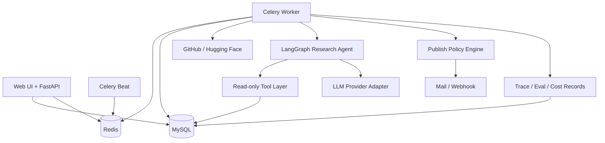

# 架构设计文档：企业开源技术情报 Agent 与自动周报平台

> 项目事实基线由 `REQUIREMENTS.md`、`INTERFACES.md` 和本文档共同构成。  
> 任何影响需求、架构、接口、数据模型、依赖或目录结构的代码变更，都必须同步更新对应文档。  
> 最后更新：2026-10-12 ｜ 文档版本：v0.8.3

## 1. 概述与目标

- **项目定位**：使用专用研究 Agent 自动完成开源项目趋势研究、证据补齐、报告验证和周报生成。
- **核心问题**：研发战略和架构团队每周需要人工搜索、筛选、阅读、比较并整理开源项目，重复且耗时。
- **目标用户**：研发战略、架构、技术管理和产品研究岗位；个人版本由管理员兼任分析师。
- **价值指标**：降低单份周报人工耗时；提高引用覆盖率、事实一致性和来源可追溯性；控制单报告 Token 成本；减少异常对发布流程的阻塞。
- **质量属性优先级**：正确性 > 可维护性 > 数据安全 > 成本可观测性 > 性能 > 扩展性。

### 1.1 范围

**In scope**

- GitHub 和 Hugging Face 公开数据采集。
- 每日指标快照、候选筛选、时间窗口聚合。
- 单个专用研究 Agent 的计划、工具调用、证据验证和报告写作。
- 风险分级发布策略：`AUTO`、`AUTO_WITH_DELAY`、`MANUAL`。
- MySQL 多表模型、Redis/Celery 异步任务、FastAPI 接口和轻量管理界面。
- 基础 RBAC、报告可见范围、审计日志、Prompt Injection 防护和 Token 预算。
- Baseline 与 Agent 的离线评测、版本回归、Bad Case 反馈。

**Out of scope（首期）**

- 企业 SSO、多租户、复杂 ABAC、完整 DLP、HA 集群和 Kubernetes。
- 微调模型、Multi-Agent 自主协作和无限自主循环。
- 任意网页抓取、任意 URL 下载、Shell 工具和数据库写工具。
- 面向外部客户发布报告；首期仅面向内部受控读者。

## 2. 约束与关键假设

- **技术约束**：个人项目，短期可上手；优先使用成熟开源组件，不引入需要专用基础设施的依赖。
- **部署假设**：单企业、单租户、Docker Compose 起步；生产可部署在受控 Linux 主机。
- **模型假设**：支持企业认可的 OpenAI-compatible API；需要时可切换本地模型，代码不绑定厂商。
- **数据假设**：采集数据来自公开来源；生成周报可能属于企业内部资料，不能默认发送给未批准的 SaaS。
- **审核假设**：常规低风险周报允许无人工阻塞发布；异常、敏感和配置变更场景必须人工审核。
- **规模假设**：每日候选 100-500 个仓库，每周深度分析 10-30 个仓库，单实例足够。
- **仓库最终路径**：`D:\job-workspace\project_sources\open-source-intelligence-agent`。所有代码、文档、迁移、配置和测试的最终版本必须在该目录中维护；其他目录只可作为临时副本。
- **项目文档基线**：[REQUIREMENTS.md](REQUIREMENTS.md) 定义需求与验收；[INTERFACES.md](INTERFACES.md) 定义外部 API、Agent Tool 和跨模块对象；本文档定义系统结构与实施顺序。
- **开工学习清单**：[docs/technology-learning-checklist.md](docs/technology-learning-checklist.md) 和 [docs/readiness-and-startup-roadmap.md](docs/readiness-and-startup-roadmap.md)。
- **调研说明**：当前环境未执行联网技术调研。选型吸收 LangGraph、Langfuse/LangSmith、RAGAS 类工具的设计模式，但数据结构与发布策略按本项目重新设计；实施前需校验依赖版本与许可证。

## 3. 架构选型

### 3.1 候选方案

| 维度 | 方案 A：模块化单体 + Worker（推荐） | 方案 B：微服务 | 方案 C：Serverless 工作流 |
|---|---|---|---|
| 架构风格 | 单体代码库，API、Worker、Beat 分进程 | API、采集、Agent、报告独立服务 | 云函数、托管队列和托管数据库 |
| 优点 | 边界清晰、部署简单、调试容易、适合个人开发 | 独立扩缩容，团队边界清楚 | 运维少，按量计费 |
| 缺点 | 单库和单仓库需要自律维护模块边界 | 分布式事务、调试和部署复杂度高 | 厂商锁定、本地模型和敏感数据控制较弱 |
| 与项目匹配度 | 高 | 低至中，当前规模不成立 | 低，数据保护与模型兼容受限 |

### 3.2 决策

采用 **方案 A：模块化单体 + 独立 Worker 进程**。同一代码仓库遵守明确模块边界，部署时运行 `api`、`worker`、`beat` 三个应用进程，并使用 MySQL 与 Redis。未来确有独立扩容需求时，再按模块拆分服务并新增 ADR。

## 4. 系统上下文与容器视图

### 4.1 系统上下文

```mermaid
flowchart LR
    Admin[管理员/分析师] --> System[开源技术情报 Agent 平台]
    Reader[内部读者] --> System
    GitHub[GitHub API] --> System
    HF[Hugging Face API] --> System
    Model[批准的大模型服务] <--> System
    Mail[邮件/飞书 Webhook] <-- System
```

### 4.2 容器视图



## 5. 技术栈

| 层 | 选型 | 版本基线 | 理由 |
|---|---|---|---|
| 语言 | Python | 3.11+ | 与 AI/Agent 生态、数据处理和现有技能一致 |
| Web API | FastAPI + Pydantic | FastAPI 0.11x, Pydantic 2.x | 类型契约清晰，适合内部 API 和 Agent 工具边界 |
| ORM/迁移 | SQLAlchemy + Alembic | 2.x / 1.x | 支持显式模型、事务和可回滚迁移 |
| 数据库 | MySQL | 8.0+ | 自然满足多表快照、聚合、唯一约束和面试要求 |
| 缓存/队列 | Redis | 7.x | 缓存外部 API 结果并承载 Celery 队列 |
| 异步任务 | Celery + Celery Beat | 5.x | 长耗时研究任务可重试、隔离并独立监控 |
| Agent 编排 | LangGraph | `>=1.0,<2`（已验证 1.2.14） | 显式状态图，便于限制循环和记录轨迹 |
| 模型适配 | OpenAI-compatible Provider Adapter + 确定性离线桩 | 不绑定供应商 | 支持批准 API、本地模型切换，并支持无网络端到端验证 |
| 管理界面 | Jinja2 + HTMX | 当前稳定版 | 首期避免复杂前端，能完成审核和配置流程 |
| 部署 | Docker Compose | Compose v2 | 一键启动 MySQL、Redis、API、Worker、Beat |
| 评测 | pytest + 自建 Runner + LLM-as-a-judge | 按需 | 支持离线评测、版本回归和消融实验 |
| 监控 | 结构化日志 + MySQL 指标表 + 简单看板 | 首期轻量 | 先证明监控意识，不引入完整可观测平台 |

## 6. 模块与目录结构

```text
open-source-intelligence-agent/
├── ARCHITECTURE.md              # 架构唯一真理源
├── README.md                    # 文档入口
├── docs/                        # PRD、API、数据、安全、评测、ADR
├── src/open_source_intelligence/
│   ├── api/                     # FastAPI 路由、依赖注入、认证
│   ├── web/                     # Jinja2/HTMX 管理界面
│   ├── collectors/              # GitHub/Hugging Face 数据源适配器
│   ├── pipeline/                # 清洗、快照、候选筛选和质量校验
│   ├── agent/                   # LangGraph、Tools、Prompts、Guardrails
│   ├── reports/                 # 模板、版本、审核和发布策略
│   ├── evaluation/              # 数据集、Scorer、回归和成本统计
│   ├── security/                # RBAC、ACL、脱敏和审计
│   ├── persistence/             # SQLAlchemy 模型、Repository、迁移
│   ├── workers/                 # Celery Tasks 和调度定义
│   └── core/                    # 配置、日志、异常和共享类型
├── prompts/                     # 版本化 Prompt 和评分 Rubric
├── alembic.ini                  # Alembic CLI 配置
├── migrations/                  # 数据库迁移环境和版本脚本
├── tests/                       # 单元、集成、端到端、安全与评测测试
├── infra/                       # Compose、环境模板和部署配置
└── scripts/                     # 初始化、回填和运维脚本
```

模块依赖方向为 `api/web -> application services -> agent/pipeline/reports -> persistence/core`。Agent 只能通过显式 Tool Layer 访问数据库，不允许直接构造 SQL，也不允许调用 Shell。

## 7. 核心数据模型摘要

详细字段见 [docs/data-model.md](docs/data-model.md)。

| 实体 | 关键职责 |
|---|---|
| `users`, `roles`, `user_roles` | 身份和角色 |
| `data_sources`, `topics` | 采集源与监控主题配置 |
| `repositories`, `repo_snapshots` | 仓库主数据和每日时间序列 |
| `pipeline_runs` | 采集、筛选、报告任务的运行记录 |
| `agent_configs`, `agent_runs`, `agent_steps`, `tool_calls` | Agent 版本、状态、轨迹和工具调用 |
| `reports`, `report_sources`, `report_reviews` | 报告、证据引用、审核和版本 |
| `eval_datasets`, `eval_cases`, `eval_runs`, `eval_results` | 评测集、执行和指标 |
| `feedback` | 人工反馈和 Bad Case |
| `audit_logs` | 权限、配置、审核、发布和导出审计 |

### 7.1 运行时不变量

| # | 不变量 | 作用域 | 维护方 | 校验方式 |
|---|---|---|---|---|
| INV-1 | 同一仓库同一自然日最多只有一条快照 | `repo_snapshots` | Collector | 唯一约束 `(repository_id, snapshot_date)` |
| INV-2 | 所有采集更新必须幂等，可重复执行而不产生重复仓库或快照 | Pipeline | Collector | 唯一约束 + Upsert 集成测试 |
| INV-3 | 每个 Agent 步骤和工具调用必须关联唯一 `agent_run_id` | Agent Runtime | Agent Recorder | 外键和运行轨迹完整性测试 |
| INV-4 | Agent 单次运行不得超过模型调用、工具调用、循环和 Token 预算 | Agent Runtime | Graph Guard | 运行前预算校验和停止条件 |
| INV-5 | 报告发布前必须得到通过或经过审批的 `publish_decision` | Publishing | Policy Engine | 发布服务前置断言 |
| INV-6 | `MANUAL` 决策的报告在审核通过前不得推送 | Publishing | Publishing Service | 状态机与集成测试 |
| INV-7 | 任何报告读取、下载、审核和推送都必须经过 ACL 检查 | Security | Authorization Service | API 授权测试和审计测试 |
| INV-8 | 日志、Trace 和 Prompt 中不得写入数据库密码、API Key 和未批准的敏感字段 | Observability | Redaction Filter | 单元测试和敏感字段扫描 |
| INV-9 | 外部 README/网页文本始终标记为不可信输入，不能改变工具权限 | Agent Runtime | Prompt Guard | Prompt Injection 评测 |
| INV-10 | 报告中的关键数字必须能追溯到 `report_sources` | Verification | Verifier | 引用覆盖和指标一致性测试 |

## 8. Agent 运行时设计

### 8.1 设计原则

Agent 不是抓取器和数据库的替代品。确定性工作由 Python、SQL 和规则完成；Agent 只处理需要研究判断、工具选择和证据综合的部分。首期采用单个专用研究 Agent，不采用 Multi-Agent，避免重复老项目并降低状态治理成本。

```text
Research -> Tool Call -> Observe -> Verify -> Write
                    ^                  |
                    +---- evidence gap -+
```

### 8.2 状态对象

```text
AgentState {
  run_id: integer
  topic_id: integer
  window_start: datetime
  window_end: datetime
  candidate_repo_ids: list[integer]
  prompt_version: string
  max_loops: integer
  max_model_calls: integer
  max_tool_calls: integer
  research_plan: list<ResearchTask>            # 累积
  evidence: list<EvidenceRef>                  # 累积
  draft_sections: list<SectionRef>             # 累积，T10 在此之上合成完整报告
  messages: list<ChatMessage>                  # 累积，模型可见的对话轨迹
  last_observations: list<ToolObservation>     # 本轮工具结果，供 observe 节点消费
  pending_tool_calls: list<ModelToolCall>      # 本轮模型给出的工具调用
  verification: VerificationResult | null
  loop_count: integer
  tool_call_count: integer
  model_call_count: integer
  estimated_cost: decimal
  status: pending | running | needs_review | completed | failed
  error_code: string | null
  error_message: string | null
  incomplete: boolean
}
```

T8 的 `agent/state.py` 按本节实现该状态：标量字段由节点覆盖，列表字段通过 `Annotated[list[X], operator.add]` 累积，节点只返回自己的增量。

```text
ResearchTask        { task_index: integer, intent: profile | metrics | prior_reports | content, repo_id: integer | null }
ToolObservation     { tool_name, repo_id, ok, result_count, truncated, error_code, payload }
EvidenceRef         { tool_name, repo_id, ok, result_count, truncated, error_code, summary }
VerificationResult  { sufficient: boolean, reason: string, covered_repo_ids: list<integer>,
                      missing_repo_ids: list<integer>, content_repo_ids: list<integer>,
                      has_prior_baseline: boolean }
```

`ResearchTask.intent` 是枚举而非自由文本：`plan` 节点只能把意图映射到白名单工具，模型无法通过任务描述引入新工具。`EvidenceRef` 记录的是**工具观测**（哪个工具、是否成功、返回几条、是否截断）；面向读者的可追溯事实引用是 `save_report_section` 使用的 `CitationRef`，字段见 [docs/agent-tool-contract.md](docs/agent-tool-contract.md)。

### 8.3 Tool Layer

| 工具 | 输入 | 输出 | 权限 |
|---|---|---|---|
| `query_repo_metrics` | `repo_id`, `start`, `end`, `granularity="day"` | `ToolResult[list[MetricPoint]]` | 只读 |
| `get_repository_profile` | `repo_id` | `ToolResult[RepositoryProfile]` | 只读 |
| `get_repository_content` | `repo_id`, `content_type="readme"`, `max_chars`(500-12000，默认 6000), `query_hint` | `ToolResult[ContentSnippet]`，`untrusted` 恒为 `true` | 只读、截断、不可信标记 |
| `search_prior_reports` | `topic_id`, `repo_id`, `before`, `limit` | `ToolResult[list[ReportSummary]]` | 只读、ACL 检查 |
| `save_report_section` | `section_key`, `content_markdown`, `citations`, `content_digest` | `ToolResult[SectionRef]` | 仅写当前运行草稿 |

工具契约必须使用 Pydantic Schema。模型无权创建新工具、修改工具白名单、执行 Shell 或直接写 MySQL。发布动作由 Policy Engine 和 Publishing Service 完成，不属于 Agent Tool。

工具的输入输出、错误码、权限和测试映射详见 [docs/agent-tool-contract.md](docs/agent-tool-contract.md)。该文档是工具设计与人类可读契约，Pydantic 模型是运行时契约。

### 8.4 模型路由与 Token 控制

- 规则和 SQL 完成候选筛选，候选阶段不调用大模型。
- 廉价模型用于相关性分类、证据抽取和结构化字段补全。
- 主模型用于研究计划、复杂对比和最终报告综合。
- 历史仓库画像和报告摘要缓存复用；README 只保留与任务相关的片段。
- 默认限制：单次运行最多 4 个研究循环、6 次模型调用、10 次工具调用，具体值进入 `agent_configs`。
- 预算达到 80% 时降级；达到 100% 时停止新增模型调用，生成带未完成说明的草稿或进入人工审核。

**实现状态**：T8 已实现「100% 硬停止 → 写出草稿 → 终态 `needs_review`」，三档预算落到 `agent_configs` 的 `max_loops` / `max_model_calls` / `max_tool_calls`。T9 已补齐 `max_tokens`、Prompt/Completion Token 计数和 80% 降级：达到 80% 后停止新增研究规划调用，保留撰写预算；达到 100% 后不再发起新的模型调用。**尚未实现**：廉价模型分流与画像/摘要缓存复用 —— 当前单次运行只使用一个 `AGENT_MODEL`。

### 8.5 发布策略

| 决策 | 条件 | 默认行为 |
|---|---|---|
| `AUTO` | 低敏感级别、内部可见、评测通过、无工具异常、非首次配置 | 直接进入发布任务 |
| `AUTO_WITH_DELAY` | 常规内部周报 | 延迟窗口内允许撤回或修改，窗口结束后发布 |
| `MANUAL` | 敏感报告、外部推送、低置信度、新模型/Prompt、关键验证失败 | 必须人工审核 |

“低风险常规周报不需要人工审核”是本项目的效率原则。人工审核用于异常处理、风险门禁和 Bad Case 积累，不作为所有报告的默认阻塞步骤。

## 9. 数据与工程流程

```text
Celery Beat
  -> collect_sources
  -> normalize_and_upsert
  -> create_daily_snapshots
  -> rank_candidates
  -> run_research_agent
  -> verify_report
  -> evaluate_publish_policy
  -> publish_or_request_review
  -> collect_metrics
```

关键工程约束：

- 外部 API 使用认证、并发限制、分页、超时、指数退避和可重试错误分类。
- 所有写入采用事务和唯一约束；重复执行不能产生重复数据。
- 采集失败记录到 `pipeline_runs`，不因单个仓库失败中断整批任务。
- 报告发布采用状态机：`draft -> pending_review -> approved -> scheduled -> published -> failed`。
- Redis 故障时，API 仍可读取已入库报告；只影响新任务入队，不影响历史数据读取。
- 首期每日和每周任务频率可配置，时区统一保存 UTC，展示时转换为 `Asia/Shanghai`。

### 9.1 T5 确定性数据 Pipeline

T5 已实现以下内部能力：

- `create_daily_snapshots(session, snapshot_date)` 按 `(repository_id, snapshot_date)` 幂等创建或更新每日快照；首日增量为 `NULL`，后续增量相对最近历史快照计算。
- `get_snapshot_series(...)` 按日期返回单仓库时间序列。
- `rank_topic_candidates(session, topic, as_of_date)` 基于语言、关键词、最低 Star 和时间窗口筛选候选；候选阶段不调用大模型。
- 候选分数为 `max(0, star_growth + 2 * fork_growth + latest_stars / 1000)`，负增长不能突破 `score >= 0` 数据库约束。
- 每个主题重新排序时替换原有 `topic_repositories`，避免旧候选残留；`max_candidates` 之外的候选保留分数和排名，但 `selected_for_agent=false`。
- `python -m open_source_intelligence.pipeline.cli --action snapshot|rank|all --date YYYY-MM-DD` 提供可重复执行的运维入口。

### 9.2 T6 Celery 调度与 PipelineRun

T6 已实现以下能力：

- 每日确定性 Pipeline 固定为 `collect -> snapshot -> rank`，由 `run_daily_pipeline()` 编排，每个阶段各写一条 `pipeline_runs` 记录。
- `pipeline_runs.run_type` 增加 `rank`；`collect`、`snapshot`、`rank` 允许 `topic_id IS NULL`（全局运行），`agent` 和 `publish` 仍必须绑定主题，由数据库 CHECK 约束保证。
- 每次尝试写独立运行行，`attempt = 已重试次数 + 1`，因此重试轨迹（attempt 1 失败、attempt 2 成功）完整可查，不用覆盖历史行。
- 失败语义：全部供应商失败抛 `PipelineStageError`（`COLLECTOR_FAILED`）并停止批次；部分供应商失败记为 `partial` 后继续；快照失败抛 `SNAPSHOT_FAILED`；单个主题排序失败只记 `RANK_FAILED`，不影响其他主题。
- 运行记录在 `queued -> running -> 终态` 的每次转换立即提交，进程崩溃不会丢失失败证据；`error_message` 写入前脱敏并截断。
- Beat 在 `PIPELINE_SCHEDULE_ENABLED` 为真时，按 `APP_TIMEZONE` 每天 `PIPELINE_SCHEDULE_HOUR:PIPELINE_SCHEDULE_MINUTE`（默认 02:00）调度 `run_daily_pipeline` 任务。
- Celery 任务按 `PIPELINE_TASK_MAX_RETRIES` 重试，退避为 `PIPELINE_RETRY_BACKOFF_SECONDS * 2^已重试次数`；参数非法不重试。
- 状态查询：`python -m open_source_intelligence.pipeline.cli --action runs` 支持按 `run_type`、`status`、`topic_id` 和 `run_id` 查询；`list_pipeline_runs()` 是后续 API 的读取入口。

### 9.3 T7 Tool Layer 与数据契约

T7 已实现以下能力：

- `agent/tools/contracts.py` 用 Pydantic 严格模型固定工具契约（`extra="forbid"`、`strict=True`），字段名、边界和错误码与 `docs/agent-tool-contract.md` 逐字一致；`ToolResult<T>` 是唯一返回信封，`ToolMeta` 携带 `latency_ms`、`truncated` 和 `result_count`。
- `agent/tools/registry.py` 的 `ToolRegistry.invoke()` 按固定顺序执行「白名单 → 运行策略 → 预算 → Schema 校验 → handler → 只读写保护 → `tool_calls` 记录」，任何分支都留下可审计的调用记录。
- 授权通过运行时注入的 `ToolContext` 完成，`agent_run_id`、`topic_id`、`authorized_topic_ids`、`allowed_tools` 和工具预算都不接受模型参数伪造；仓库类工具要求仓库属于授权主题。
- `get_repository_content` 读取缓存的 README，清除 script/style 与控制字符后按 `max_chars`（500-12000，默认 6000）截断，并始终返回 `untrusted=true`；工具不访问任意 URL。
- `search_prior_reports` 只返回授权主题下已发布的报告摘要，无权限主题返回 `TOOL_ACCESS_DENIED`，不泄露摘要、计数或存在性。
- `save_report_section` 以 `(report_draft_id, section_key, content_digest)` 幂等保存：同摘要重复保存返回原有版本，内容变化则版本递增，每个 `agent_run` 只对应一个草稿。
- 支撑工具的数据契约新增 9 张表：`agent_configs`、`agent_runs`、`agent_steps`、`tool_calls`、`reports`、`report_sources`、`report_drafts`、`report_sections`、`repository_contents`（README 内容缓存，data-model 之外新增）。
- `repository_contents` 与 `report_drafts`/`report_sections` 是 T7 为落地契约而新增的表：前者承载「缓存命中直接返回」的 README，后者承载契约中的 `report_draft_id` 与章节版本；`report_versions`、`report_reviews` 留待 T10/T11。
- 发布动作仍不属于 Agent Tool，由 Policy Engine 与 Publishing Service 在 T11 实现。

### 9.4 T8 LangGraph Research Agent

T8 已实现以下能力：

- `agent/graph.py` 用 LangGraph `StateGraph` 搭出有界五节点图 `plan -> tool -> observe -> verify -> write`；`verify` 通过条件边回到 `plan`，形成「证据缺口 → 继续研究」的显式回边。`GRAPH_NODES` 固定节点顺序供测试断言。
- `plan` 是研究阶段唯一调用模型的位置，它把 `ModelTurn.tool_calls` 交给 `tool` 节点；`tool` 节点逐个 `ToolRegistry.invoke()`，因此模型的每次工具调用都经过 T7 的白名单、ACL、预算与 Schema 校验，并被记入 `tool_calls`。
- 三档预算 `max_loops` / `max_model_calls` / `max_tool_calls` 全部来自 `agent_configs`；任一耗尽立即停止研究并写出当前草稿，终态为 `needs_review`，不会无限循环。
- 章节写入使用独立预算（次数由模板固定为 6），不与研究阶段的工具预算竞争，因此「研究得深」不会挤掉「写得完」。
- `verify` 节点要求四类证据齐备才算充足：每个候选仓库的画像与指标、主题级历史报告基线、至少一个候选仓库的 README 内容；不满足时把缺口写进 `VerificationResult` 并回边补研究。
- `agent/prompts.py` 从 `prompts/` 加载版本化 Prompt；`AGENT_PROMPTS_DIR` 可覆盖，`resolve_prompts_dir()` 同时覆盖仓库检出与容器 `/app` 两种布局。
- 模型接入是可插拔 Adapter：`ModelClient` Protocol 只有 `provider` / `model` / `complete()`；`OfflineModelClient` 是确定性离线桩（默认），`OpenAICompatibleClient` 通过同一接口调用 OpenAI-compatible `/chat/completions`；`build_model_client(settings)` 按 `AGENT_PROVIDER` 选择。默认离线桩让端到端验证无需网络与 API Key，且相同输入产出字节一致，可作 T14 的评测 baseline。
- 受限网络下的取舍：`AGENT_PROVIDER=openai_compatible` 时 `AGENT_API_BASE` 必须是 `https://` 且必须提供 `AGENT_API_KEY`，否则配置校验直接失败；离线桩不需要任何凭证。
- `run_research_agent()` 负责取主题、解析研究窗口、加载候选仓库、取或建 `agent_configs`、把工具策略收敛为白名单子集、建 `pipeline_runs(run_type=agent)` 与 `agent_runs`，并在结束时把计数与终态同时写回 `agent_runs` 与 `pipeline_runs`。
- `StepRecorder` 按 `step_index` 递增写 `agent_steps`（`plan`/`tool`/`observe`/`verify`/`write` 五类），只保存脱敏摘要与 SHA-256 摘要值，不落模型输出或 README 原文。
- 终态语义：`AGENT_NO_CANDIDATES`、`AGENT_BUDGET_EXCEEDED`、`AGENT_EVIDENCE_INCOMPLETE`、`AGENT_WRITE_FAILED` 判为 `needs_review`（结果需人工复核，不是异常）；`AGENT_MODEL_UNAVAILABLE`、`AGENT_DRAFT_INVALID` 判为 `failed`。
- Write 边界：按 T8 交付范围，Agent 只通过 `save_report_section` 生成 6 个草稿章节并留下 `citations`；完整报告合成、引用有效性校验与发布决策属于 T10/T11。
- 工具参数校验增加 JSON 回落通道：模型参数天然是 JSON 形状（时间是 ISO 字符串），注册表先按 T7 的严格 Python 路径 `model_validate`，失败后回落到 `model_validate_json`；两条路径都保持 `extra="forbid"` 并拒绝错误类型，T7 语义不变。
- `workers.tasks.run_research_agent` 已登记但**不进入 beat 调度**：Agent 消耗真实的模型预算，自动编排要等报告与发布阶段就绪后再开。任务只在 `AGENT_MODEL_UNAVAILABLE` 且未达重试上限时重试；`needs_review` 作为结果直接返回，不当成错误重试。

### 9.5 T5–T8 复查修复

对 T5–T8 代码做了一次对照契约的复查，修复四处真实缺陷。每处都先写出会在修复前失败的回归测试，再改实现。

| # | 缺陷 | 影响 | 修复 |
|---|---|---|---|
| 1 | 只读工具写保护只报警不回滚 | 保护触发后 `_record()` 的 `commit()` 会把处理器暂存的写入一起提交，「只读工具从不写入」事实上不成立 | `ToolRegistry._failure(discard_writes=True)` 在记录失败调用前先 `session.rollback()`；同时覆盖「暂存写入后抛异常」的路径 |
| 2 | 撰写阶段的 Prompt 从未生效 | `prompts/draft_v1.md` 与 `PromptStage="draft"` 已定义却无人调用，`write` 节点沿用 `plan` 的系统 Prompt，真实供应商拿不到章节键、引用格式与 JSON 结构要求 | `GraphDependencies.draft_prompt` 承载 `load_prompt("draft", ...)`，`_write_node` 用 `_draft_messages()` 把系统消息替换为草稿 Prompt，保留 user 上下文与工具轨迹 |
| 3 | 章节写入失败被判为成功 | `_write_node` 只改 `status` 而不设错误码，`_terminal_status` 又只看错误码与证据，于是「6 节只写成功 3 节」被报成 `completed` | `_write_node` 在 `failures > 0` 时写 `AGENT_WRITE_FAILED`；`_terminal_status` 收紧为「无错误码 **且** 证据充足」才是 `completed` |
| 4 | 图内逃逸异常让运行卡在 `running` | 节点抛出的未分类异常（供应商适配器缺陷、记录步骤时的数据库抖动）会穿透 `graph.invoke`，`agent_runs` / `pipeline_runs` 永久停在 `running`，运维无法区分存活与僵死 | `run_research_agent` 捕获后经 `_record_crashed_run()` 写下 `AGENT_INTERNAL_ERROR` 终态再原样抛出；恢复写入自身失败时回滚，不掩盖原始异常 |

新增错误码 `AGENT_INTERNAL_ERROR`（见 `agent/errors.py`），终态映射与 `INTERFACES.md` §8 一致。`REVIEW_REQUIRED_CODES` 保持不变，因此它判为 `failed`。

端到端复跑时还暴露了两处**验证脚本自身**的缺陷。它们不影响产品代码，但会让门禁在本机静默失败或误报，因此一并修复：

| # | 缺陷 | 影响 | 修复 |
|---|---|---|---|
| 5 | 验证脚本把「真实抓取 GitHub」当前置条件 | `verify_t5.ps1` / `verify_t6.ps1` 在正文冒烟之前先跑一次真实采集；主机无 GitHub 出口（`api.github.com` 连接被拒）时整条验证直接失败。而 `t6_mysql_smoke.py` 早已内置 `--collector offline`，该离线能力因这层前置而永远走不到 | 两个脚本新增**默认关闭**的 `-Offline` 开关：离线模式下改用仍可达的数据源播种，必要时复用 T4 已入库数据，并把 `--collector offline` / 可达 provider 传给下游冒烟与 Celery 检查；不带开关时行为与原先逐字一致，联网主机上的门禁强度不变 |
| 6 | `verify_t6.ps1` 的运行查询断言依赖返回行序 | 它按 `runs` 查询结果的**出现顺序**拼 `attempt` 并期望 `"1,2"`，而 `list_pipeline_runs` 的契约是 `ORDER BY id DESC`（最新在前），所以同一天的重试必然返回 `2,1`，断言恒假 | 断言前对 `attempt` 排序。要求不变（同一天必须同时存在 attempt 1 与 2），只是不再依赖行序 |

修复后 T5 与 T6 的离线端到端验证均通过：T5 复用 22 个已入库仓库完成快照幂等、窗口增量与排序断言；T6 完成真实 Celery 成功调度、独立 worker 的两次失败重试（attempt 轨迹 `1,2`）、Beat 准点派发与 CLI 运行查询。

### 9.6 T9 Prompt Guard 与运行预算

T9 已实现以下能力：

- `agent/guards.py` 在不可信内容进入模型对话前扫描指令式文本；命中行替换为 `[BLOCKED_UNTRUSTED_INSTRUCTION]`，剩余内容包裹在 `<untrusted_content>` 中。
- Prompt Guard 只作用于 `untrusted=true` 的内容载荷，不修改指标、画像或历史报告等结构化数据；越权工具仍由 T7 白名单、ACL 和 Schema 在运行时拒绝。
- 命中风险时状态记录 `guard_triggered=true`，`verification.security_risk=true`，跳过后续研究回边，终态写 `AGENT_PROMPT_INJECTION` 并进入人工复核。
- `agent_configs.max_tokens` 配置单次运行 Token 上限；`agent_runs.prompt_tokens` 与 `completion_tokens` 记录每个运行实际观测到的用量。
- 达到 80% 时 `budget_degraded=true`，不再调用模型继续研究，但允许用剩余预算完成草稿；达到 100% 时在任何新模型调用前停止并标记 `AGENT_BUDGET_EXCEEDED`。
- `AGENT_MAX_TOKENS` 默认 12000，随 `AGENT_MAX_LOOPS`、`AGENT_MAX_MODEL_CALLS` 和 `AGENT_MAX_TOOL_CALLS` 一起进入 Agent 配置与环境模板。

## 10. 关键接口摘要

完整契约见 [docs/api-contract.md](docs/api-contract.md)。

| 接口组 | 代表接口 | 说明 |
|---|---|---|
| 认证 | `POST /api/v1/auth/login`, `GET /api/v1/auth/me` | 登录和当前用户 |
| 数据源 | `/api/v1/sources` | 采集源配置 |
| 主题 | `/api/v1/topics` | 监控主题与筛选条件 |
| 仓库 | `/api/v1/repositories`, `/api/v1/repositories/{id}/snapshots` | 仓库和趋势查询 |
| Agent | `/api/v1/agent/runs`, `/api/v1/agent/runs/{id}` | 触发与查看研究轨迹 |
| 报告 | `/api/v1/reports`, `/api/v1/reports/{id}/review`, `/publish` | 查询、审核和发布 |
| 评测 | `/api/v1/evaluations`, `/api/v1/evaluations/{id}/run` | 数据集、执行和指标 |
| 审计 | `/api/v1/audit-logs` | 只读审计查询，限管理员 |

API 使用 JSON，错误返回 RFC 7807 Problem Details。列表接口统一支持 `page`、`page_size`，并限制最大 `page_size`。所有写操作需要 CSRF 防护或 Bearer 认证，所有报告读取执行 ACL。

## 11. 安全与隐私架构

- 外部采集内容是不可信输入，必须隔离、截断并标记来源。
- 首期角色为 `ADMIN`、`EDITOR`、`VIEWER`；报告可见范围为 `PRIVATE`、`TEAM`、`INTERNAL`。
- 机密报告默认禁止发送给未经批准的外部模型；Provider Adapter 必须读取模型数据策略。
- 模型请求前执行基础敏感信息识别，数据库连接串、API Key、Cookie 和内部密码不得进入 Prompt 或日志。
- 关键操作写入不可由普通管理员修改的审计日志。
- 报告导出和下载需记录事件；首期不实现完整水印和端到端 DLP。
- 详细威胁与控制见 [docs/security-and-privacy.md](docs/security-and-privacy.md)。

## 12. 评测与可观测性

必须评测三件事：

1. Agent 是否比单 Prompt Baseline 提升报告质量。
2. 报告事实和引用是否可追溯，关键数字是否与数据库一致。
3. 每次运行的 Token、成本、延迟、工具成功率和人工干预率是否可接受。

初始验收目标：

| 指标 | 初始目标 |
|---|---|
| 关键数字准确率 | >= 95% |
| 引用覆盖率 | >= 95% |
| 事实一致性 | >= 90% |
| 任务完成率 | >= 90% |
| Prompt Injection 阻断率 | >= 95% |
| Agent 相对 Baseline 的引用覆盖率提升 | >= 10 个百分点 |
| 常规报告人工阻塞率 | 接近 0，异常报告除外 |

详细协议见 [docs/evaluation.md](docs/evaluation.md)。

## 13. 架构决策记录

- [ADR-001](docs/adr/ADR-001-single-specialized-agent.md)：采用单个专用研究 Agent，不采用 Multi-Agent。
- [ADR-002](docs/adr/ADR-002-deterministic-pipeline.md)：确定采集与指标计算，Agent 只负责研究闭环。
- [ADR-003](docs/adr/ADR-003-risk-based-publishing.md)：常规低风险报告自动发布，异常报告人工审核。
- [ADR-004](docs/adr/ADR-004-modular-monolith.md)：模块化单体代码库，API、Worker、Beat 分进程部署。
- [ADR-005](docs/adr/ADR-005-lightweight-enterprise-controls.md)：实现轻量 RBAC、ACL、审计和模型数据策略，不追求完整企业治理。

## 14. 实施计划

> 状态：[ ] 未开始  [~] 进行中  [x] 已完成

- [x] T1 项目脚手架与配置 — 依赖：无 — 验证：测试、Compose、API、Worker、Beat 端到端验证通过
- [x] T1.1 项目元数据与包骨架 — 验证：`pyproject.toml` 可解析，可编辑安装和导入成功
- [x] T1.2 核心配置与日志 — 依赖 T1.1 — 验证：保留配置校验与脱敏测试，真实输出 JSON 日志
- [x] T1.3 FastAPI 空应用与健康检查 — 依赖 T1.2 — 验证：真实 Uvicorn 启动后 `/health` 和 `/docs` 返回 200
- [x] T1.4 Worker 与 Beat 空服务 — 依赖 T1.2 — 验证：Worker 消费健康任务，Beat 每 60 秒成功调度 Redis 任务
- [x] T1.5 Docker Compose 与环境模板 — 依赖 T1.3/T1.4 — 验证：五服务健康启动，API、Worker、Beat 容器化闭环通过
- [x] T1.6 T1 测试与冒烟收口 — 依赖 T1.3-T1.5 — 验证：14 项测试、Ruff、Compose、API、Worker 和 Beat 通过
- [x] T2 数据库模型与迁移 — 依赖：T1 — 验证：10 张核心表、升级/回滚、schema drift 检查通过
- [x] T2.1 SQLAlchemy 基础层与水合类型 — 验证：UTC 类型、命名约定和 Session 工厂通过测试
- [x] T2.2 十个核心 ORM 模型 — 验证：身份、来源、主题、仓库、快照、Pipeline 和审计模型通过约束测试
- [x] T2.3 Alembic 迁移环境 — 验证：`upgrade head`、`downgrade base`、再次升级和 `alembic check` 通过
- [x] T3 认证、RBAC 与审计骨架 — 依赖：T2 — 验证：Argon2、JWT、三角色权限、401/403 和审计事件通过
- [x] T4 GitHub/Hugging Face Collector — 依赖：T2 — 验证：真实双源采集、重试、幂等入库和采集审计通过
- [x] T5 每日快照与候选排序 — 依赖：T4 — 验证：重复运行不重复，按时间窗口可查出趋势
- [x] T6 Celery 调度与 PipelineRun — 依赖：T3/T5 — 验证：定时任务可执行、失败可重试、状态可查询
- [x] T7 Tool Layer 与数据契约 — 依赖：T2/T5 — 验证：工具 Schema、ACL、截断和只读限制测试通过
- [x] T8 LangGraph Research Agent — 依赖：T7 — 验证：完成一条 Research→Tool→Observe→Verify→Write 轨迹，17 步、13 次工具调用、6 个草稿章节，两条降级路径均干净收敛
- [x] T9 Prompt Guard 与运行预算 — 依赖：T8 — 验证：循环、工具、Token 超限时安全停止
- [ ] T10 报告生成与引用 — 依赖：T8 — 验证：关键数字可追溯，引用链接有效
- [ ] T11 Verifier 与发布策略 — 依赖：T10 — 验证：`AUTO`、`AUTO_WITH_DELAY`、`MANUAL` 状态机测试通过
- [ ] T12 报告 API 与管理界面 — 依赖：T3/T11 — 验证：可查看、编辑、审核、发布和回退报告
- [ ] T13 邮件/Webhook 推送 — 依赖：T11/T12 — 验证：仅已批准报告可推送，失败可重试
- [ ] T14 评测数据集与 Runner — 依赖：T8/T10 — 验证：Baseline、Agent、消融版本可输出统一报告
- [ ] T15 监控指标与看板 — 依赖：T6/T10/T14 — 验证：任务、Token、延迟、失败率和评测结果可见
- [ ] T16 数据回填与端到端演示 — 依赖：T4/T5/T14 — 验证：完成一次历史回填和完整周报生成
- [ ] T17 安全测试与故障演练 — 依赖：T3/T9/T13 — 验证：越权、Prompt Injection、API 失败和重复任务均被正确处理
- [ ] T18 文档同步与发布检查 — 依赖：T1-T17 — 验证：架构、API、数据模型和评测文档与代码一致

任务顺序以数据模型和权限为地基，先跑通纵向切片，再扩展评测和界面。每个任务完成后必须真实运行核心路径，不能以单元测试替代冒烟验证。

## 15. 变更日志

| 日期 | 变更摘要 | 影响章节 | 关联任务/ADR | 验证方式 |
|---|---|---|---|---|
| 2026-09-24 | 初始架构建立，完成需求、选型、文档和任务拆解 | 全部 | ADR-001~005 | 文档审查，待用户确认 |
| 2026-09-24 | 新增 Agent 工具接口契约及文档索引 | 8.3、文档索引 | T7 | 链接与 JSON 示例校验 |
| 2026-10-08 | 明确 D 盘目录为项目唯一最终版路径 | 2、文档路径约定 | - | 目标目录存在性确认 |
| 2026-10-08 | 补齐根需求、接口文档与开工学习路线 | 文档基线、2、15 | S0-S3 门控 | 文档链接与验收检查 |
| 2026-10-09 | 完成 T1.1 项目元数据与包骨架 | 5、14 | T1.1 | `pyproject.toml` 解析、可编辑安装、源码与环境导入均成功 |
| 2026-10-09 | 完成 T1.2 配置校验与结构化日志 | 4、5、14 | T1.2 | 7 项测试、Ruff、compileall 和 JSON 日志冒烟验证通过 |
| 2026-10-09 | 完成 T1.3 FastAPI 应用工厂与健康检查 | 7、10、14 | T1.3 | 9 项测试、Ruff、Uvicorn 启动、`/health` 与 `/docs` 返回 200 |
| 2026-10-09 | 安装并验证 Docker Desktop WSL 2 与国内镜像 | 4、部署约束 | 环境准备 | `hello-world` 拉取运行成功，Engine 内核为 WSL 2，Compose v5.5.1 可用 |
| 2026-10-09 | 完成 T1.4 Celery Worker 与 Beat 空服务 | 5、9、14 | T1.4 | 11 项测试、Ruff、临时 Redis 容器、Worker 消费和 Beat 周期调度均通过 |
| 2026-10-09 | 完成 T1.5 Docker Compose 与环境模板 | 4、5、14 | T1.5 | 五服务构建启动、API 200、Worker 消费、Beat 容器周期调度通过 |
| 2026-10-09 | 增加浏览器根路径预览重定向 | 7、10、14 | T1.3 修复 | 根路径 307 到 `/docs`，`/docs` 返回 200，相关测试通过 |
| 2026-10-09 | 完成 T1.6 测试与冒烟收口 | 9、10、14 | T1.6 | 统一脚本通过 14 项测试、Ruff、Compose、API 健康、Worker 消费和 Beat 运行 |
| 2026-10-09 | 修复 T1 审查 P1 与验证脚本误报风险 | 4、5、9、14 | T1 复审 | mypy 0 错误、15 项测试、三服务 JSON 日志、URL/JSON 脱敏、强制重建和同任务 ID 生命周期通过 |
| 2026-10-09 | 完成 T2 SQLAlchemy 核心模型与 Alembic 迁移 | 5、6、14 | T2 | 19 项测试、10 张业务表、MySQL 升级/回滚、二次升级和 `alembic check` 通过 |
| 2026-10-09 | 修复 T2 审查问题并强化数据库验证 | 5、6、9、14 | T2 复审 | 22 项测试、时间默认值、CHECK 约束、自包含迁移和 MySQL CRUD 冒烟通过 |
| 2026-10-09 | 完成 T3 认证、RBAC 与审计骨架 | 5、7、8、14 | T3 | 29 项测试、真实登录、当前用户、401 拒绝和 auth.* 审计持久化通过 |
| 2026-10-09 | 完成 T4 GitHub/Hugging Face Collector | 4、5、9、14 | T4 | 36 项测试、真实双源采集、重复采集幂等、来源和成功审计验证通过 |
| 2026-10-09 | 修复 T3/T4 审查问题 | 2、4、5、9、14 | T3/T4 复审 | 40 项测试、认证时序均一化、生产密钥保护、API 异常统一、并发 Upsert 和唯一数据源通过验证 |
| 2026-10-12 | 完成 T5 每日快照、候选排序与 CLI | 9、14 | T5 | 44 项测试、Ruff、mypy、真实 4 仓库 MySQL 冒烟、重复快照和排序幂等、窗口增量与负分保护通过 |
| 2026-10-12 | `pipeline_runs` 支持全局运行并新增 `rank` 类型 | 7、9.2、14 | T6 | 迁移 `9c1f7b2d4e83`；`alembic upgrade head`、`alembic check` 通过；主题范围 CHECK 约束在 MySQL 上生效 |
| 2026-10-12 | 完成 T6 Celery 调度、每日 Pipeline 编排与运行状态查询 | 9.2、10、14 | T6 | 62 项测试、Ruff、mypy；MySQL 冒烟验证幂等、attempt 轨迹、错误脱敏和约束；真实 Celery 重试记录两次尝试；Beat 定时触发与 CLI 状态查询通过 |
| 2026-10-12 | 新增 Agent 运行、工具调用、报告与 README 内容缓存共 9 张表 | 6、7、9.3、14 | T7 | 迁移 `b3f6a1c2d4e7`；`upgrade head`、`downgrade -1`、再次升级和 `alembic check` 通过；元数据共 19 张表 |
| 2026-10-12 | 完成 T7 工具层、数据契约与五个白名单工具 | 8.3、9.3、10、14 | T7 | 109 项测试（Agent 46 项）、Ruff、mypy 57 文件 0 错误；真实 MySQL 冒烟执行 5 个工具并记录 8 条 tool_calls，ACL 拒绝、截断、不可信标记、草稿幂等与只读限制全部通过 |
| 2026-10-12 | 对齐 §8.2 状态对象与 §8.3 工具签名到已实现契约（`ResearchTask.intent` 枚举、`EvidenceRef` 的观测语义、五个工具的输入字段与返回信封） | 8.2、8.3 | T7/T8 文档校正 | 与 `agent/state.py`、`agent/tools/contracts.py` 逐字段比对 |
| 2026-10-12 | 完成 T8 LangGraph Research Agent：有界五节点图与条件回边、三档预算硬停止、可插拔模型 Adapter（默认确定性离线桩）、运行时编排与记录、运行历史 CLI、Celery 任务（不入 beat 调度） | 5、8.2、8.3、9.4、10、14 | T8 | 171 项测试、Ruff、mypy 74 文件 0 错误；真实 MySQL 冒烟 17 步 / 13 次工具调用 / 6 个草稿章节 / 2 个候选仓库，步类型齐全、只读工具零写入；无候选（`needs_review`）与模型不可用（`failed`）两条降级路径通过；新增依赖 `langgraph>=1.0,<2` 与 13 个 `AGENT_*` 配置项，无数据库迁移 |
| 2026-10-12 | T5–T8 复查修复四处缺陷：只读写保护改为回滚、撰写阶段启用 `draft` Prompt、章节写入失败计入 `AGENT_WRITE_FAILED`、逃逸异常收口为 `AGENT_INTERNAL_ERROR` | 9.3、9.4、9.5、15 | T5–T8 复查 | 新增 5 项回归测试（先证明修复前失败）；176 项测试、Ruff check+format、mypy 74 文件 0 错误；真实 MySQL 冒烟复跑通过 |
| 2026-10-12 | 修复两处验证脚本缺陷：`verify_t5.ps1` / `verify_t6.ps1` 新增默认关闭的 `-Offline` 开关；`verify_t6.ps1` 的运行查询断言改为按 attempt 排序 | 9.5、15 | T5–T8 复查 | T5 离线端到端通过（repositories=22, candidates=22）；T6 离线端到端通过（run_rows=6, attempts=1,3, retry_attempts=1,2）；不带 `-Offline` 的默认行为与原先一致 |
| 2026-10-12 | 完成 T9 Prompt Guard、80%/100% Token 预算与 Token 计数持久化 | 8.4、9.6、14 | T9 | 184 项测试、Ruff、mypy；迁移 `c4a9e2f1d6b8` 升级和 drift 检查通过；MySQL 冒烟验证正常 Token 持久化、80% 降级撰写、100% 硬停止和注入风险复核均通过 |
| 2026-10-12 | 修复 T6 迁移回滚的 MySQL 外键顺序，并让 T2 验证脚本按 ORM 元数据动态计算表数量 | 9.2、14、15 | T2/T6 回归 | `verify_t2.ps1` 完成升级、回滚 base、再次升级；19 张 ORM 表加 `alembic_version` 共 20 张，临时库已清理 |
