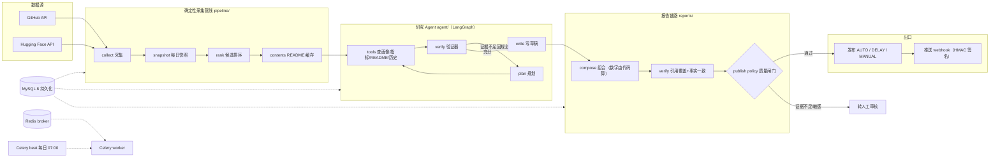

# Open-Source Intelligence Agent

> 项目状态：T1-T32 已完成（实施任务清单见 `ARCHITECTURE.md` §14）

**自动采集开源项目动态 → 专用研究 Agent 分析、验证 → 生成带可追溯证据的周报 → 风险闸门决定自动发布或人工审核。**

一个把「每周人工搜 GitHub、看 README、比数据、写周报」自动化成一个**有证据锚点、有预算闸门、有质量门禁**的工程化 Agent 系统。


---

## 它解决什么问题

研发战略和架构团队每周要回答「最近开源圈有什么值得跟进的动向」。手工做这件事意味着：搜仓库、翻 README、抄 stars 数、算环比、判断真假、写成周报——重复、耗时，而且**数字容易抄错、结论没有出处**。

这个项目把这条链路自动化，并解决了三个「直接调 LLM 写周报」做不到的痛点：

| 痛点         | 直接调 LLM 的问题                         | 本项目的解法                                      |
| ---------- | ----------------------------------- | ------------------------------------------- |
| **数字不可信**  | 模型会编造/算错数字（实测一次把 84,713 算成 "64.8%"） | 净增、百分比全部由代码对快照首末差计算，模型只写判断、不写数字             |
| **结论无出处**  | 报告说「涨了」但没有任何可核对的证据                  | 每个含数字的章节都带引用锚点，能定位到 `repo_snapshots` 的具体快照行 |
| **垃圾直接发布** | 没有质量门禁，幻觉内容一路发出去                    | 验证器 + 发布策略闸门：证据不足转人工审核，只有「通过」才自动发布          |

## 核心亮点

1. **证据锚点可复现**——报告里每个数字都能点开核对，追溯到真实的采集快照（见 [真实报告样例](#真实运行证据)）。
2. **真实模型计费与预算闸**——每次模型调用累计 token/cost，超预算即停，成本可查、可控。
3. **数字由系统算，防模型编造**——`reports/composition.py` 对快照做首末差，派生数字不交给模型。
4. **五容器编排**——api / worker / beat / mysql / redis，一条 `docker compose up` 起全套。
5. **5 变体消融评测**——用真实模型证明每个组件（验证器、工具、历史）的必要性与增益。

## 产品演示

67 秒录屏走一遍真实界面（不是拼图）：总览 → 一键触发采集／研究 → 采集与运行的三层台账 → 报告详情（正文、版本历史、审核记录、推送记录、研究轨迹）→ 推送记录 → 评测 → 运维看板。

<video src="docs/assets/demo.mp4" poster="docs/assets/home.png" controls width="100%"></video>

**[▶ 打开演示视频](docs/assets/demo.mp4)**（MP4 · 1080p · 4.7 MB）

> GitHub 的 README 不会内联播放仓库内的 mp4：点上面的链接下载后观看，或在本地 IDE／Typora 里预览时直接播。录屏里所有数字、投递记录、评测结果都来自本机真实运行，不是演示数据。

## 系统架构



完整分层架构图见 [docs/architecture-diagram.md](docs/architecture-diagram.md)，图中每个组件都能在 `src/open_source_intelligence/` 找到对应模块。

## 技术栈

| 层        | 技术                                                       |
| -------- | -------------------------------------------------------- |
| API / 界面 | FastAPI + Jinja2 + HTMX（分组侧栏管理界面）                        |
| 异步任务     | Celery + Celery Beat（每日定时 + 研究任务隔离重试）                    |
| Agent 编排 | LangGraph（显式状态图，限制循环、记录轨迹）                               |
| 模型适配     | OpenAI-compatible Provider Adapter（真实模型 / 离线确定性桩，不绑定供应商） |
| 存储       | MySQL 8（多表快照、唯一约束、运行时不变量）+ Redis（broker）                 |
| 检索       | TF-IDF 词法 RAG（零依赖、确定性、可复现）                               |
| 部署       | Docker Compose（五服务一键起）                                   |
| 评测       | pytest + 自建 Runner（消融实验 + 版本回归）                          |

## 快速开始

```bash
# 1. 准备环境（改掉占位口令与 SECRET_KEY）
cp .env.example .env

# 2. 起五服务栈
docker compose --env-file .env -f infra/docker-compose.yml up -d --build

# 3. 建表
docker compose --env-file .env -f infra/docker-compose.yml exec -T api alembic upgrade head

# 4. 种子数据 + 端到端演示（产出真实 published 报告）
docker compose --env-file .env -f infra/docker-compose.yml exec -T api python /app/scripts/seed_demo.py
docker compose --env-file .env -f infra/docker-compose.yml exec -T api python /app/scripts/init_demo.py

# 5. 打开首屏
# http://127.0.0.1:8000/ui/login  （admin / dev-admin-password-change-me）
```

> 详细启动、建号、采集/研究/评测触发、排查见 [docs/operations.md](docs/operations.md)。

## 真实运行证据

以下数据全部来自**真实模型 + 真实采集快照**，不是演示桩。

### 真实报告样例（数字可复现）

一份由系统生成的周报样例，[docs/samples/weekly-report-sample.md](docs/samples/weekly-report-sample.md)：

| 仓库                           | 净增 stars（10-22 → 10-26） |
| ---------------------------- | ----------------------: |
| morluto/rea                  |                 +29,855 |
| DietrichGebert/ponytail      |                  +4,764 |
| Graphify-Labs/graphify       |                  +3,948 |
| affaan-m/ECC                 |                  +3,489 |
| TauricResearch/TradingAgents |                  +2,805 |

每个净增都是「窗口末快照 stars − 首快照 stars」，可直接核对。

### 真实投递

发布后按白名单投递到真实收件箱：`PUSH_DELIVERY=live` + SMTP（587 + STARTTLS）+ HMAC 签名（Webhook 通道）。每次投递落一行 `report_pushes`，成功记 `smtp:<host>:<port>` / `http:200`，失败记 `failed` + `error_code`（传输失败不抛异常，而是一行可重试的记录）。同一报告同一版本同一目标只发一次，重复请求即重试。

### 5 变体消融评测（真实模型 `deepseek-chat`）

对同一数据集跑 5 个变体，量化每个组件的增益（完整报告见 [docs/ablation-report-c1.md](docs/ablation-report-c1.md)）：

| 变体                 |      引用覆盖率 |      事实一致性 |  Token | 成本(USD) | 工具调用 |
| ------------------ | ---------: | ---------: | -----: | ------: | ---: |
| baseline（单提示）      |     0.6667 |     0.0000 | 11,256 |  0.0025 |    0 |
| **agent_full（完整）** | **1.0000** | **1.0000** | 47,651 |  0.0083 |   48 |
| no_verifier（去验证器）  |     1.0000 |     1.0000 | 27,896 |  0.0050 |   33 |
| no_tools（去工具）      |     0.9444 |     1.0000 | 15,488 |  0.0030 |   18 |
| no_history（去历史）    |     1.0000 |     1.0000 | 46,147 |  0.0081 |   48 |

**关键结论**：完整 Agent 相对单提示 baseline，事实一致性 **0 → 1.0**（从「无法证明任何事实」到「3/3 全部可核对」）。`no_tools` 是唯一触发回归的变体（引用覆盖率跌破 0.95 门禁）。

## 项目结构

```text
src/open_source_intelligence/
├── api/            # FastAPI 路由、依赖注入、认证
├── web/            # Jinja2/HTMX 管理界面（首页 + 七个功能页）
├── collectors/     # GitHub / Hugging Face 数据源适配器
├── pipeline/       # 采集、快照、候选筛选、README 预热（四阶段确定性管线）
├── agent/          # LangGraph、工具、Prompt、守卫、验证器、计费
├── reports/        # 组合、验证、版本、审核、发布策略、分享
├── evaluation/     # 数据集、评分器、消融对比、成本统计
├── security/       # RBAC、ACL、脱敏、审计、Prompt Injection 防护
├── persistence/    # SQLAlchemy 模型、Repository、迁移
├── workers/        # Celery 任务与调度定义
└── core/           # 配置、日志、异常、共享类型
```

## 文档索引

| 文档                                                                           | 用途                       |
| ---------------------------------------------------------------------------- | ------------------------ |
| [docs/architecture-diagram.md](docs/architecture-diagram.md)                 | 系统架构图（Mermaid，逐组件对应代码模块） |
| [docs/samples/weekly-report-sample.md](docs/samples/weekly-report-sample.md) | 真实报告样例（数字可复现）            |
| [docs/ablation-report-c1.md](docs/ablation-report-c1.md)                     | 消融评测报告：5 变体对比与量化结论       |
| [docs/operations.md](docs/operations.md)                                     | 运维手册：启动、建号、触发、排查         |
| [docs/requirements.md](docs/requirements.md)                                 | 详细产品需求、角色与功能验收           |
| [docs/api-contract.md](docs/api-contract.md)                                 | REST API、请求响应对象与错误约定     |
| [docs/agent-tool-contract.md](docs/agent-tool-contract.md)                   | Agent 内部工具、权限与错误码契约      |
| [docs/data-model.md](docs/data-model.md)                                     | MySQL 表结构、关系与运行时不变量      |
| [docs/security-and-privacy.md](docs/security-and-privacy.md)                 | 权限、数据保护、模型调用与审计边界        |
| [docs/evaluation.md](docs/evaluation.md)                                     | Agent、报告质量与成本评测方案        |
| [docs/observability.md](docs/observability.md)                               | 监控指标口径、窗口语义与看板           |
| [docs/backfill.md](docs/backfill.md)                                         | 历史回填：分页、限流、断点续传与并发守卫     |
| [docs/development-process.md](docs/development-process.md)                   | 企业流程的个人精简执行版本            |
| [ARCHITECTURE.md](ARCHITECTURE.md)                                           | 架构唯一真理源（设计理由、决策与实施清单）    |
| [REQUIREMENTS.md](REQUIREMENTS.md) / [INTERFACES.md](INTERFACES.md)          | 需求与接口基线                  |

## License

[MIT](LICENSE)
