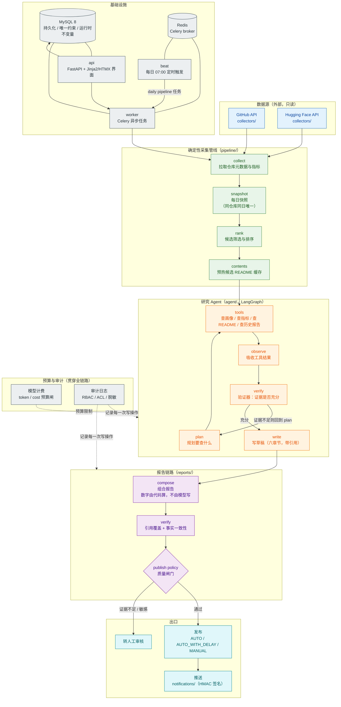

# 系统架构图
> 层级：详细规格（展开基线）｜职责：逐组件对应代码模块的架构图｜冲突时以三份根文档为准

> 一张图看完整条流水线：数据源 → 采集 → 快照 → 排名 → 研究 Agent → 报告组合 → 质量闸门 → 发布/推送。
> 旁路标注 MySQL、Redis、Celery worker/beat 与模型计费。
> 图中的每个组件都能在 `src/open_source_intelligence/` 里找到对应模块。

## 关键工程环节（不只是「大模型」）

| 环节 | 模块 | 一句话 |
|---|---|---|
| 计费 | `agent/` 预算闸 | 每次模型调用累计 token/cost，超 `AGENT_MAX_COST`/`AGENT_MAX_TOKENS` 即停 |
| 验证 | `agent/graph.py` 验证器 | 证据不充分就回到规划、拒绝写草稿，而不是带着猜测往下走 |
| 数字可信 | `reports/composition.py` | 净增/百分比由代码对快照首末差计算，模型只写判断、不写数字 |
| 闸门 | `reports/` 发布策略 | `AUTO_WITH_DELAY`/`MANUAL` 决定「直接发布」还是「转人工」 |
| 幂等 | `pipeline/` | 同仓库同日唯一快照、采集可重复执行、重复任务无副作用 |
| 注入防护 | `agent/` 守卫 | 命中即停、转人工，注入文本不达模型 |
