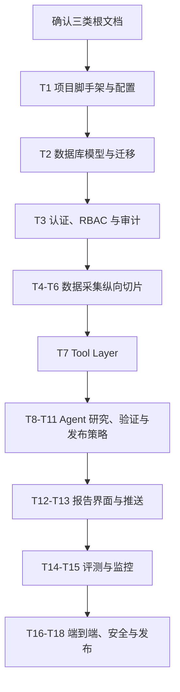

# 项目准备度与正式开工路线图

> 目的：判断当前是否具备进入 S4 实施的条件，并给出从第一个模块开始的直观流程。  
> 最后更新：2026-10-12

## 1. 当前准备度

| 检查项 | 状态 | 说明 |
|---|---|---|
| 项目目标 | 完整 | 专用研究 Agent 提升周报效率 |
| 需求文档 | 已补齐 | 根目录 `REQUIREMENTS.md` + 详细 PRD |
| 接口文档 | 已补齐 | 根目录 `INTERFACES.md` + API/Tool 契约 |
| 架构文档 | 已具备 | 根目录 `ARCHITECTURE.md` |
| ADR | 已具备 | 5 条关键决策 |
| 数据模型 | 已具备 | 表、唯一约束、状态机和运行时不变量 |
| 安全与隐私 | 已具备 | RBAC、ACL、审计、模型策略和轻量边界 |
| 评测方案 | 已具备 | Baseline、Agent、消融和质量指标 |
| 开发流程 | 已具备 | 企业阶段门控的个人精简版本 |
| 技术学习清单 | 已补齐 | 按 T1-T18 映射学习项 |
| 代码与脚手架 | 已完成 | T1.1-T1.6 全部完成，T1 统一验证脚本通过 |
| 数据库模型与迁移 | 已完成 | 10 张核心表、Alembic 升级/回滚和 drift 检查通过 |
| 认证与审计 | 已完成 | Argon2、JWT、RBAC、401/403 和审计事件运行验证通过 |
| 外部数据采集 | 已完成 | GitHub/HF 真实采集、重试、幂等入库和采集审计通过 |
| 快照与候选排序 | 已完成 | 每日快照、窗口增量、规则筛选、候选排序和重复执行幂等通过 |
| Celery 调度与运行记录 | 已完成 | 每日 Pipeline 定时触发、失败重试轨迹、运行状态查询和 CHECK 约束通过 |
| 工具层与数据契约 | 已完成 | 5 个白名单工具契约、ACL、截断、只读限制、草稿幂等和 9 张新表通过真实 MySQL 冒烟 |
| 本地运行环境 | 可用 | Python 3.12.7、Docker Desktop 4.94.0、Compose v5.5.1 和 WSL 2 已验证 |

结论：**T1-T7 均已完成，数据库、认证、真实数据采集、每日快照、规则候选排序、Celery 定时调度、Pipeline 运行记录和受限工具层已落地，可以进入 T8 LangGraph Research Agent。**

## 2. 开工前最终确认

用户确认以下内容后进入 S4：

1. `REQUIREMENTS.md` 的范围、验收和人工审核策略。
2. `INTERFACES.md` 的 API、Tool 和字段契约。
3. `ARCHITECTURE.md` 的技术选型和 T1-T18 顺序。
4. 首期模型供应商和 GitHub Token 的获取方式。
5. 首期推送渠道暂定为邮件或 Webhook，具体实现放到 T13。

## 3. 正式开工总流程



推荐从 **T1 项目脚手架与配置** 开始，不能直接先写 Agent。Agent 依赖数据库、Tool 契约、采集数据和运行追踪；先做 Agent 会形成无法验证的孤立 demo。

## 4. 分阶段开工计划

### 阶段 A：工程地基

任务：T1-T3。

产物：

- 可安装的 Python 包和统一配置。
- Docker Compose：API、Worker、Beat、MySQL、Redis。
- 数据库迁移和基础 Repository。
- 登录、角色、报告 ACL 和审计骨架。

验证：

- 空应用启动并返回 `/health`。
- 迁移可升级和回滚。
- ADMIN、EDITOR、VIEWER 权限差异测试通过。

### 阶段 B：数据纵向切片

任务：T4-T6。

产物：

- GitHub/Hugging Face Collector。
- 清洗、去重、幂等 Upsert 和每日快照。
- 候选排序和趋势查询。
- Celery 定时任务、重试和 PipelineRun。

验证：

- 同一批数据执行两次，不产生重复。
- 能从数据库计算 7 日 star/fork 增量。
- 失败任务有状态、错误码和重试记录。

### 阶段 C：Agent 纵向切片

任务：T7-T11。

产物：

- 5 个白名单 Tool 和 Pydantic 契约。
- LangGraph Research、Tool、Verify、Write 状态图。
- Prompt Guard、循环/工具/Token 预算。
- 结构化报告、引用和发布策略。

验证：

- 完成一条真实研究轨迹。
- 错误数字或无效引用能够被 Verifier 拦截。
- 正常报告进入自动延迟发布，异常报告进入人工审核。

### 阶段 D：产品闭环

任务：T12-T13。

产物：

- 报告查看、编辑、审核、发布和回退界面。
- 邮件/Webhook 推送和发送幂等。

验证：

- 用户能在界面上完成审核。
- 同一报告不会重复推送。

### 阶段 E：质量与交付

任务：T14-T18。

产物：

- Baseline、Agent、消融评测。
- 任务、Token、延迟、失败率和人工干预看板。
- 数据回填、端到端演示、安全测试和发布检查。

验证：

- 端到端生成一份周报。
- Prompt Injection、越权、重复任务和 API 失败测试通过。
- 文档、迁移、配置和代码状态一致。

## 5. T1 首个模块具体流程

T1 的目标不是“把功能写完”，而是建立一个能持续小步开发的工程底座。

### T1 输入

- Python 3.11+。
- Docker 与 Docker Compose。
- 确认后的根目录三类文档。
- `.env.example` 所需变量清单。

### T1 产物

```text
pyproject.toml
src/open_source_intelligence/
  api/
  core/
  persistence/
  workers/
tests/
infra/
  docker-compose.yml
  .env.example
```

首批文件必须保持最小，不提前实现采集、Agent、报告业务。

### T1 验证

1. Python 包可以安装。
2. API 启动后 `/health` 返回 200。
3. Worker 能启动并连接到 Redis。
4. Beat 能启动并注册一个空任务或健康任务。
5. MySQL 和 Redis 健康检查通过。
6. 配置缺失时启动失败并给出明确错误。
7. 日志不输出真实凭证。
8. 测试命令和 lint 命令可执行。

T1 完成后暂停，向用户展示实际启动结果，再进入 T2。

## 6. 单个模块开发循环

以后每个任务都按同一节奏执行：

```text
声明任务编号和架构组件
  -> 检查依赖文档
  -> 只实现当前任务
  -> 写单元和集成测试
  -> 启动并操作核心路径
  -> 执行 9 项自检
  -> 回写需求/接口/架构和 Changelog
  -> 汇报验证结果并等待确认
```

禁止的行为：

- 未确认需求就开始写业务代码。
- 一次跨多个任务大规模生成代码。
- 只报告“单测通过”而没有启动验证。
- 修改接口、表或配置却不回写文档。
- 为了简历关键词引入 Redis、LangGraph 或 Docker 之外的虚假依赖。

## 7. 最终开工判定

| 条件 | 当前状态 | 下一步 |
|---|---|---|
| 三类根文档齐全 | 已完成 | 用户确认内容 |
| 任务拆解明确 | 已完成 | 从 T1 开始 |
| 学习路径明确 | 已完成 | 按 T1 前置项准备 |
| 运行环境可用 | 已完成 | Docker Linux Engine 运行于 WSL 2，国内镜像已验证 |
| 外部凭证可用 | GitHub/HF 已验证，模型 Key 待准备 | T8 前准备模型 Key |
| 业务代码 | T1-T7 已完成 | 下一步进入 T8 LangGraph Research Agent |

当前 T7 已完成，5 个白名单工具的 Pydantic 契约、注册表（白名单 / ACL / 预算 / 只读强制）、内容清理与截断、草稿幂等保存以及支撑它们的 9 张表都已落地并在真实 MySQL 上验证。下一步进入 T8，用 LangGraph 把 Research → Tool → Verify → Write 串成一条可追踪、受预算约束的轨迹。
